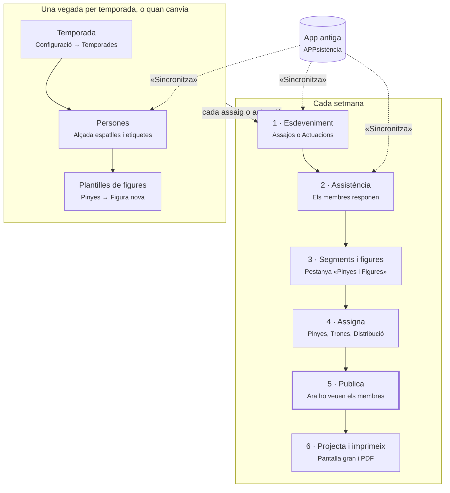

# Demo del Dashboard — Guió del presentador

Tots els equips (pinyes, troncs i xicalla) assistixen junts a la sessió i es veuen tots els apartats.
L'ordre va de més a menys comú: primer el que fa servir tothom, després el que és responsabilitat de
l'equip de pinyes i, finalment, el que és responsabilitat de l'equip de troncs i xicalla. Cada tècnic
ha d'eixir sabent fer les seues tasques setmanals sense ajuda i entenent què fan els altres equips.

La demo s'explica **per tasques** («Com pose la gent a la pinya de dijous?»), no per pantalles.

---

## Objectiu i format

- **Format:** videotrucada d'1 h 30 min, gravada. La gravació, amb marques de temps per bloc, fa de
  vídeo de referència.
- **Públic:** tots els equips alhora. Ningú no ix abans: el bloc d'un equip també interessa a l'altre,
  perquè treballen sobre els mateixos segments i les mateixes persones.
- **Rols:** un presentador que comparteix el Dashboard de **preproducció**; un ajudant que llig el xat,
  apunta dubtes i els guarda per al torn de preguntes.
- **Pantalla:** zoom del navegador al 125 %, una sola pestanya, notificacions silenciades. Les tecles
  s'expliquen en veu alta (no es veuen en la gravació).
- **Recurs final:** dues guies ràpides, [[GUIA_PINYES]] i [[GUIA_TRONCS_XICALLA]], més l'enllaç a pre
  per a practicar. Cada guia porta la part comuna sencera.

## Agenda

| Min | Bloc | Contingut |
|---|---|---|
| 0–10 | Mapa general | Flux de la setmana, qui fa què, glossari, què veu el membre al mòbil |
| 10–35 | **Comú a tothom** | D'on venen les dades (l'app antiga), preparar un assaig, publicar, imprimir, projectar |
| 35–58 | **Responsabilitats de Pinyes** | Omplir la pinya, conflictes, distribució, nodes extra, plantilles |
| 58–80 | **Responsabilitats de Troncs i Xicalla** | Alçades, mode de figura, troncs per pisos, estructura del tronc, xicalla |
| 80–90 | Tancament | Dubtes, guies, exercici per a casa |

## Preparació prèvia

L'esdeveniment de demo ha de tindre **data futura**: dos dies després de la data, els segments queden
bloquejats («Assignacions bloquejades») i no s'hi pot assignar.

### Dades a preproducció

- [ ] Crear l'**Assaig DEMO** (data futura) amb respostes d'assistència variades: Ve, No ve, Pendent.
- [ ] Segment 1: una pinya **mig assignada** (per a ensenyar a omplir-la i el salt al node buit següent).
- [ ] Segment 2: una figura amb un **conflicte provocat** (la mateixa persona en dos llocs del segment).
- [ ] Segment 3: un tronc amb **avisos d'alçada rojos** (diferència de pis de 10 cm o més) i una
  persona sense alçada («?? cm»).
- [ ] Deixar els tres segments **sense publicar**: publicar-ne un es fa en directe.
- [ ] Tindre una actuació futura creada (perquè aparega la marca 🎭 al panell de persones).
- [ ] Un esdeveniment anterior amb pinya i tronc assignats (per a ensenyar «Importa pinya» i
  «Importa tronc»).
- [ ] Un mòbil amb la PWA i un compte MEMBRE assignat al segment 1 (per a ensenyar el marcador de la
  pròpia posició).
- [ ] Comprovar que pre es pot sincronitzar amb l'app antiga, o tindre preparada una captura de la
  pantalla «Sincronització global» si no es pot fer en directe.

### Comptes i convocatòria

- [ ] Un compte TECHNICAL a pre per a cada tècnic. Comprovar que tots poden iniciar sessió abans del dia.
- [ ] Enviar l'enllaç de la videotrucada i l'enllaç a pre.

### Decisions que cal portar preses

- [ ] **Qui sincronitza** les dades de l'app antiga i quan (per exemple, la persona que prepara
  l'assaig, el mateix dia al matí).
- [ ] **Qui publica** els segments i quan (per exemple, el dia abans de l'assaig).
- [ ] **On es canvia l'alçada** d'una persona: mentre l'app antiga siga vigent, s'ha de canviar allà
  (vegeu el bloc comú).

### Formulari previ (3 dies abans)

Tres preguntes curtes; les respostes decideixen on posar més temps i quins trucs s'ensenyen.

1. Quines tasques feu amb el Dashboard cada setmana?
2. Què no enteneu o vos costa més del Dashboard?
3. Què feu encara «a mà» fora del Dashboard (paper, WhatsApp, full de càlcul)?

### Assaig de la demo

- [ ] Fer la demo sencera amb un tècnic de confiança 2 o 3 dies abans, cronometrada. Si passa de
  90 min, retallar l'editor de plantilles (passa a la guia).

## Flux setmanal, qui fa què i glossari

Les fletxes discontínues són la **sincronització**: mentre l'app antiga continue vigent, les persones,
els esdeveniments i l'assistència entren al Dashboard des d'allà. La part de dalt es fa una vegada per
temporada. Cada assaig o actuació repetix els passos 1 a 6, i només el pas 5 fa que els membres vegen
on els toca.

### Qui fa què

| Tasca | Tothom | Pinyes | Troncs i Xicalla |
|---|:---:|:---:|:---:|
| Sincronitzar amb l'app antiga | ● | | |
| Esdeveniment, notes, assistència, passar llista | ● | | |
| Segments i figures de l'esdeveniment | ● | | |
| Conflictes, publicar, imprimir, projectar | ● | | |
| Omplir la pinya, «Importa pinya» | | ● | |
| Distribució al camp, cordons, nodes extra | | ● | |
| Plantilles: pestanyes Pinya i Rengles, composicions | | ● | |
| Alçades de les persones | | | ● |
| Mode de figura (Completa / Peu / Remat / Neta) | | | ● |
| Omplir el tronc per pisos, «Importa tronc», avisos d'alçada | | | ● |
| Plantilles: pestanya Tronc i «Estructura del tronc» | | | ● |
| Xicalla: «Menor de 16», adult responsable, delegacions | | | ● |

Mostrar esta taula a l'inici i tornar-hi abans de cada bloc de perfil («ara parlem d'esta columna»).

### Glossari

| Concepte | Què vol dir | Exemple |
|---|---|---|
| App antiga | APPsistència, on encara es gestionen persones, esdeveniments i respostes. El Dashboard en copia les dades | «Sincronitza tot» porta les últimes respostes |
| Plantilla | El disseny reutilitzable d'una figura (Pinyes → Figures) | Una figura que la colla fa servir tota la temporada |
| Figura de l'esdeveniment | Còpia de la plantilla dins d'un segment. Amb la primera persona assignada es congela: si després es canvia la plantilla, esta còpia no canvia | Si dimarts s'afig un lloc a la plantilla, la pinya de dijous ja començada no el té. Cal «Nodes extra» o «Reinicialitza» (que buida les assignacions) |
| Segment | Un bloc de temps de l'assaig o de l'actuació, amb una o més figures | «Primera ronda: dues figures alhora» |
| Publicar | Fer visible un segment als membres a l'app | Fins que no es publica, ningú no veu on li toca |
| Conflicte | La mateixa persona col·locada en dos llocs del mateix segment. No es prohibix, s'avisa | Una persona al tronc d'una figura i a la pinya d'una altra |
| Bloqueig | Dos dies després de l'esdeveniment, segments i assignacions queden de només lectura | L'historial queda tal com es va fer |

## 0–10 min · Mapa general

L'objectiu d'este bloc és que tothom tinga el mapa al cap abans de vore cap botó.

1. **Benvinguda (1 min).** Dir que la sessió es grava, que les guies arriben després i que els dubtes
   van al xat. Explicar l'ordre: primer el comú, després pinyes, després troncs i xicalla.
2. **Esquema del flux (2 min).** Mostrar l'esquema de dalt. Cada bloc posterior comença assenyalant
   «ara som ací».
3. **Qui fa què (2 min).** La taula de responsabilitats. Remarcar que tots els equips treballen sobre
   els mateixos segments: el que fa un equip ho veu l'altre.
4. **Glossari (2 min).** Els conceptes, amb exemples de colla. Insistir en *plantilla vs figura de
   l'esdeveniment*: és l'origen de la majoria de confusions.
5. **Què veu el membre (3 min).** Compartir el mòbil amb la PWA:
    - el botó «Vaig / No vaig» d'un assaig;
    - la llista de segments publicats de l'esdeveniment, amb el resum de la pròpia posició;
    - la projecció d'un segment amb la pròpia posició marcada.

   Missatge clau: **el que no es publica, el membre no ho veu**. Les notes de l'esdeveniment i el
   PDF no arriben mai als membres.

## 10–35 min · Comú a tothom

### 10–16 min · D'on venen les dades: l'app antiga

Missatge en una frase: **«Mentre la colla continue fent servir l'app antiga, el Dashboard en fa una
còpia. La còpia només va en un sentit i només quan algú prem Sincronitza.»**

Explicar-ho amb una imatge de colla: l'app antiga és el *cens oficial*; el Dashboard és la *llibreta
de la tècnica*, on s'apunten coses que l'app antiga no té (etiquetes, figures, assignacions). Cada
vegada que es sincronitza, la llibreta copia el cens de nou, però el que només és a la llibreta no es
toca.

| On es clica | Què fa |
|---|---|
| Inici → «Sincronització de dades antigues» → «Sincronitza tot» | Ho porta tot: persones, assajos, actuacions i assistència |
| Persones → «Sincronitza» | Només les persones |
| Assajos o Actuacions → «Sincronitza» | Només els esdeveniments i les seues respostes |

Què es trepitja i què no:

| Ve de l'app antiga (es torna a copiar cada vegada) | És només del Dashboard (no es toca mai) |
|---|---|
| Persones: nom, cognoms, telèfon, data de naixement, **alçada espatlles**, lesions, acollida, camisa | Etiquetes, «Menor de 16» i «Observacions tècniques» (només es copien la primera vegada que entra la persona) |
| Esdeveniments: títol, data, hora, lloc i informació | «Compta per a estadístiques», notes, segments, figures i assignacions |
| Assistència: les respostes Vinc / No vinc / Potser | «Ha arribat» marcat amb «Confirmació» o «Passa llista», i les notes d'assistència ja escrites |

Quatre regles per a recordar:

1. **Primer persones, després esdeveniments.** Si no, hi ha respostes que no troben la persona.
   «Sincronitza tot» ja ho fa en este ordre.
2. **El que ve de l'app antiga es canvia a l'app antiga.** Si canvieu l'alçada al Dashboard, la
   pròxima sincronització la torna a deixar com estava. (Important per a l'equip de troncs.)
3. **Sincronitzeu abans de preparar l'assaig**, per a tindre les respostes al dia.
4. **En assajos, el «Potser» de l'app antiga compta com a «Ve».** L'app antiga no té cap altra
   resposta afirmativa per als assajos.

A més: si una persona desapareix de l'app antiga, queda inactiva al Dashboard. Quan l'app antiga es
retire, esta pantalla desapareixerà i tot es farà des del Dashboard.

### 16–35 min · Preparar un assaig

Fil conductor: «prepararem l'assaig de dijous de principi a fi». Tot es fa sobre l'Assaig DEMO.

| Min | Tasca («Com faig…?») | On i què es clica | Què cal remarcar |
|---|---|---|---|
| 16–18 | Trobar l'assaig | Menú Assajos → filtre «Quan: Propers» → obrir l'Assaig DEMO | Assajos i Actuacions són la mateixa pantalla amb filtres diferents |
| 18–20 | Deixar notes per a la tècnica | Pestanya «Resum» → «Notes» | Les notes són internes: no les veu cap membre. El resum d'assistència separa Adults i Xicalla |
| 20–24 | Saber qui ve | Pestanya «Assistència» | Els estats canvien segons el moment: abans (Ve / No ve / Pendent), el dia (Ha arribat / No ha arribat / No vindrà) i després (Va vindre / No presentat / Sense resposta) |
| 24–26 | Passar llista el dia de l'assaig | Botó «Confirmació» (quiosc amb teclat gran) o «Passa llista» des del mòbil | Només en assajos. «Ha arribat» no es perd mai en sincronitzar. En actuacions, els «Ve» passen sols a «Ha arribat» |
| 26–30 | Organitzar l'assaig en segments | Pestanya «Pinyes i Figures» → «Segment nou» → «Figura» (triar figures o una composició) | Arrossegar per a reordenar segments i figures. Llevar una figura amb assignacions avisa que es perdran |
| 30–31 | Que els membres ho vegen | Interruptor «Publicat / No publicat» (global i per segment) | Els segments naixen sense publicar. Publicar-ne un en directe i mostrar-ho al mòbil |
| 31–33 | Imprimir o projectar | «Imprimeix» (PDF amb notes, segments i troncs per pisos) · «Projecta» al segment | En la projecció: F pantalla completa, ← → canvia de segment, Esc ix |
| 33–35 | Vore la participació i els conflictes | Pestanya «Participació» · indicador «N conflictes» al segment | Filtres «Només troncs / Només pinyes» i «Només xicalla». Un conflicte és cosa de tots dos equips: qui el veu l'avisa |

Tancar el bloc dient que «Assigna», dins de cada segment, és la porta als blocs de cada equip.

## 35–58 min · Responsabilitats de Pinyes

Obrir el bloc amb la columna «Pinyes» de la taula de responsabilitats. Fil conductor: «omplirem la
pinya del segment 1 i resoldrem el conflicte del segment 2». S'entra per «Assigna» al segment 1.

| Min | Tasca («Com faig…?») | On i què es clica | Què cal remarcar |
|---|---|---|---|
| 35–37 | Orientar-se en l'espai d'assignació | Pestanyes Pinyes · Troncs · Distribució · Nodes extra · Previsualitza; ◀ ▶ per a canviar de segment | «Ajuda» obri l'ajuda de la pantalla |
| 37–42 | Posar gent a la pinya | Clic al node i clic a la persona (en qualsevol ordre) | Si el node ja és ocupat, les dues persones s'intercanvien. El cursor salta al node buit següent. Tab = node següent |
| 42–44 | Corregir | Supr = «Desassigna» · Ctrl+Z desfà · arrossegar entre nodes | Es pot desfer tot; no fa por provar |
| 44–47 | Trobar la persona adequada | Panell de persones: cerca, «Filtra per etiqueta», grups Ve / Ha arribat, «A la pinya», «Al tronc», «Altres» | Qui té l'etiqueta del lloc ix primer. 🎭 = ve a la pròxima actuació. «Refrescar llista» porta l'assistència al dia. «Al tronc» = ja les ha col·locades l'equip de troncs |
| 47–49 | No partir de zero | «Importa pinya» | Copia les assignacions d'un esdeveniment anterior; salta els nodes ja ocupats |
| 49–52 | Resoldre un conflicte | Segment 2 → panell de conflictes: «Veure on està assignada», «Treure aquesta assignació» | Quan s'assigna algú que ja és col·locat: «Persona ja assignada» amb «Veure col·locació», «Moure ací» o «Assignar igualment» |
| 52–54 | Ajustar la figura al camp | Pestanya «Distribució»: cordons, «Cordons oberts», «Optimitza distribució» | La distribució és la que ix a la projecció |
| 54–55 | Afegir un lloc que la figura no té | Pestanya «Nodes extra»: Pinya, «Comodí», Decoratiu, Direcció | Només afecta este esdeveniment; la plantilla no canvia. Vora discontínua |
| 55–58 | Dissenyar una figura nova (breu) | Pinyes → «Figura nova»: pestanyes Pinya i Rengles | Només en ordinador. Es desa sola. L'avís «Ordre incorrecte» vol dir que les bases no van en sentit antihorari des de dalt a l'esquerra. La pestanya Tronc és de l'equip de troncs |

Si no hi ha temps, l'editor de plantilles es deixa per a la guia. «Reinicialitza» només es menciona:
buida la figura i la torna a la plantilla original.

## 58–80 min · Responsabilitats de Troncs i Xicalla

Obrir el bloc amb la columna «Troncs i Xicalla» de la taula de responsabilitats. Fil conductor:
«muntarem el tronc del segment 3 i en corregirem les alçades». S'entra per «Assigna» al segment 3 →
pestanya Troncs.

| Min | Tasca («Com faig…?») | On i què es clica | Què cal remarcar |
|---|---|---|---|
| 58–60 | Tindre les alçades | Fitxa de la persona → «Alçada espatlles» (cm) | Sense alçada no hi ha avisos: ix «?? cm». **L'alçada ve de l'app antiga**: s'ha de canviar allà, o la pròxima sincronització la desfà |
| 60–62 | Triar com es fa la figura | Pinyes i Figures → mode Troncs → Completa / Peu / Remat / Neta | Canviar el mode pot desassignar gent; demana confirmació |
| 62–66 | Posar gent al tronc | Pestanya Troncs: graella per pisos, clic al lloc i clic a la persona, arrossegar | En seleccionar un lloc de tronc, el filtre Xicalla s'activa sol |
| 66–68 | Triar per alçada | Panell de persones: «Alçada relativa (ex: +5, -10)», ordenació Max / Min | L'alçada relativa es compara amb la de referència de la colla |
| 68–72 | Llegir els avisos d'alçada | Columna per pis: «Diferència del pis» · insígnia «Suports desnivellats» | Groc a partir de 5 cm, roig a partir de 10 cm. Passar el ratolí per damunt d'una persona mostra qui la sosté i l'alçada acumulada |
| 72–73 | No partir de zero | «Importa tronc» | Igual que en pinyes: salta els llocs ja ocupats |
| 73–75 | Evitar el conflicte més greu | Missatge en roig «Una d'estes col·locacions és al tronc» | Una persona en dos troncs del mateix segment és el conflicte més greu; si l'altre lloc és a la pinya, cal parlar-ho amb l'equip de pinyes |
| 75–78 | Definir qui va damunt de qui | Pinyes → editar figura → pestanya Tronc → «Estructura del tronc» | Arrossegar des de baix d'una persona fins a les de sota; clic a la línia per a esborrar-la. Sense estructura, no hi ha càlcul d'alçades |
| 78–80 | Xicalla | Fitxa → «Menor de 16», adult responsable i delegacions | «Menor de 16» marca l'edat i activa els filtres de xicalla; és del Dashboard i la sincronització no el toca. No és el mateix que l'etiqueta Xicalla, que només classifica |

## 80–90 min · Tancament i exercici per a casa

1. **Dubtes del xat (5 min).** L'ajudant llig els dubtes agrupats. El que no es resol ara va a una
   llista per a la guia.
2. **Què s'emporten (2 min).** Les dues guies ràpides, l'enllaç a pre i la gravació amb marques de temps.
3. **Exercici per a casa (3 min).** A pre, abans del pròxim assaig real. Pre és una còpia: es pot
   trencar tot.

### Exercici · tothom

- [ ] Fer «Sincronitza tot» i comprovar que l'assistència de l'Assaig DEMO s'ha actualitzat.
- [ ] Obrir l'Assaig DEMO i escriure una nota a «Resum».
- [ ] Crear un segment nou amb una figura i publicar-lo.

### Exercici · equip de pinyes

- [ ] Omplir la pinya amb «Importa pinya» i corregir-ne tres llocs a mà.
- [ ] Resoldre el conflicte del segment 2.
- [ ] Ajustar els cordons a «Distribució» i obrir «Projecta».

### Exercici · equip de troncs i xicalla

- [ ] Canviar el mode d'una figura a Peu i tornar a Completa.
- [ ] Muntar un tronc i deixar-lo sense avisos rojos.
- [ ] Fer servir el filtre d'alçada relativa per a trobar una persona.
- [ ] Imprimir el PDF i comprovar que el tronc hi ix per pisos.

---

*Veïns: [[GUIA_PINYES]] · [[GUIA_TRONCS_XICALLA]] · [[SYNC_ARCHITECTURE]] · [[PINYES_MODULE]]*
