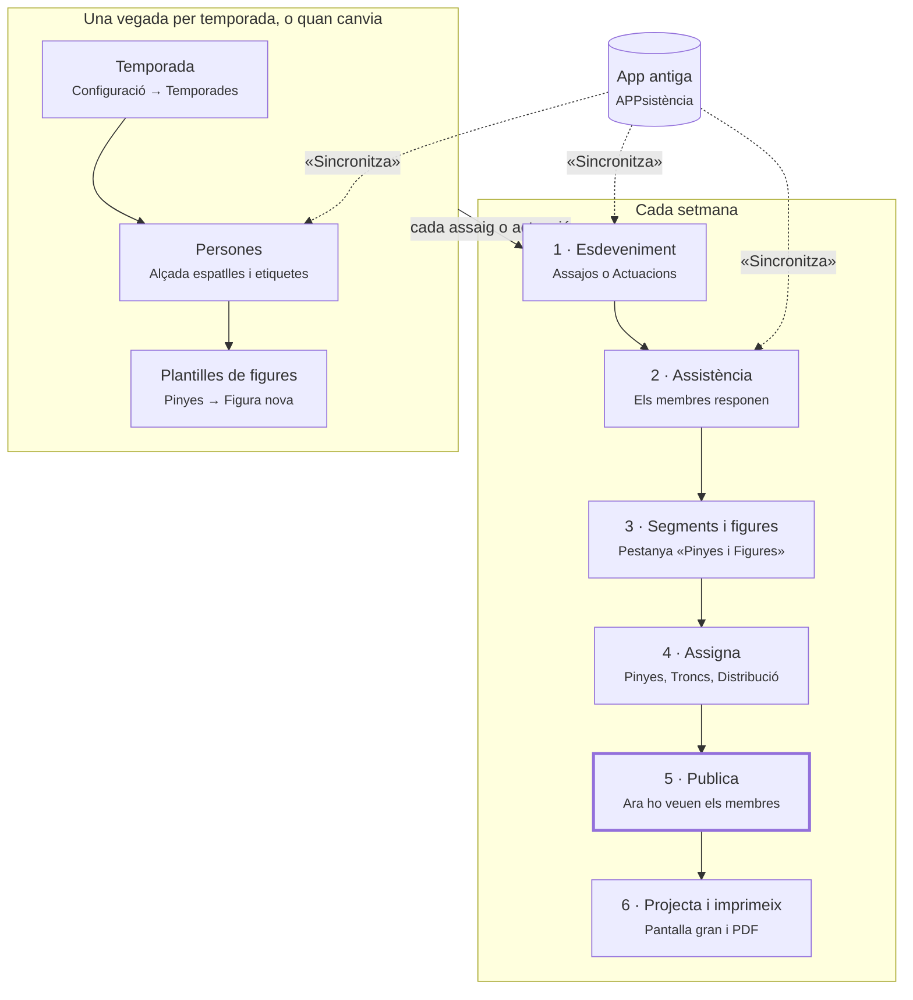

# Guia ràpida del Dashboard · Pinyes

Esta guia explica, tasca per tasca, com preparar la pinya d'un assaig o d'una actuació amb el
Dashboard. Per a practicar sense por, feu servir l'entorn de proves (preproducció): és una còpia i no
afecta les dades reals.

---

## El flux de cada setmana

Les fletxes discontínues són la sincronització amb l'app antiga (vegeu més avall). La part de dalt es prepara una vegada per temporada. Cada assaig o actuació repetix els passos 1 a 6,
i només el pas 5 fa que els membres vegen on els toca.

## Cinc conceptes per a no perdre's

| Concepte | Què vol dir |
|---|---|
| **Plantilla** | El disseny reutilitzable d'una figura. Es crea a Pinyes → Figures. |
| **Figura de l'esdeveniment** | Una còpia de la plantilla dins d'un segment. En assignar-hi la primera persona, la còpia es congela: si després modifiqueu la plantilla, esta figura no canvia. Per a afegir-hi un lloc, feu servir «Nodes extra». |
| **Segment** | Un bloc de temps de l'assaig o de l'actuació, amb una o més figures. |
| **Publicar** | Fer visible un segment als membres a l'app. Fins que no el publiqueu, ningú no veu on li toca. |
| **Conflicte** | La mateixa persona col·locada en dos llocs del mateix segment. El Dashboard ho permet, però ho avisa. |

A més, dos dies després de l'esdeveniment, els segments i les assignacions queden **bloquejats**
(només lectura).

## D'on venen les dades: l'app antiga

Mentre la colla continue fent servir l'app antiga (APPsistència), el Dashboard en fa una còpia. La
còpia només va en un sentit, de l'app antiga al Dashboard, i només es fa quan algú prem
**Sincronitza**. Penseu en l'app antiga com el *cens oficial* i en el Dashboard com la *llibreta de
la tècnica*: cada sincronització torna a copiar el cens, però el que només és a la llibreta no es toca.

| On es clica | Què fa |
|---|---|
| Inici → «Sincronització de dades antigues» → «Sincronitza tot» | Ho porta tot: persones, assajos, actuacions i assistència |
| Persones → «Sincronitza» | Només les persones |
| Assajos o Actuacions → «Sincronitza» | Només els esdeveniments i les seues respostes |

| Ve de l'app antiga (es torna a copiar cada vegada) | És només del Dashboard (no es toca mai) |
|---|---|
| Persones: nom, cognoms, telèfon, data de naixement, **alçada espatlles**, lesions, acollida, camisa | Etiquetes, «Menor de 16» i «Observacions tècniques» (només es copien la primera vegada que entra la persona) |
| Esdeveniments: títol, data, hora, lloc i informació | «Compta per a estadístiques», notes, segments, figures i assignacions |
| Assistència: les respostes Vinc / No vinc / Potser | «Ha arribat» marcat amb «Confirmació» o «Passa llista», i les notes d'assistència ja escrites |

Quatre regles:

1. **Primer persones, després esdeveniments.** «Sincronitza tot» ja ho fa en este ordre.
2. **El que ve de l'app antiga es canvia a l'app antiga.** Si ho canvieu al Dashboard, la pròxima
   sincronització ho torna a deixar com estava.
3. **Sincronitzeu abans de preparar l'assaig**, per a tindre les respostes al dia.
4. **En assajos, el «Potser» de l'app antiga compta com a «Ve».**

Si una persona desapareix de l'app antiga, queda inactiva al Dashboard. Quan l'app antiga es retire,
tot es farà des del Dashboard i este apartat deixarà de valdre.

## Tasques comunes

| Vull… | Feu… |
|---|---|
| Portar les últimes dades de l'app antiga | Inici → «Sincronitza tot». Feu-ho abans de preparar l'assaig. |
| Trobar un assaig o una actuació | Menú **Assajos** o **Actuacions** → filtre «Quan: Propers» → cliqueu l'esdeveniment. |
| Deixar notes per a la tècnica | Pestanya **Resum** → «Notes». Les notes són internes: cap membre no les veu. |
| Saber qui ve | Pestanya **Assistència**. Abans de l'esdeveniment hi veureu Ve / No ve / Pendent; el mateix dia, Ha arribat / No ha arribat / No vindrà. |
| Passar llista el dia de l'assaig | Botó **Confirmació** (pantalla amb teclat gran) o **Passa llista** des de l'app del mòbil. Escriviu el nom i toqueu la persona. |
| Organitzar l'esdeveniment en blocs | Pestanya **Pinyes i Figures** → «Segment nou» → «Figura». Podeu triar diverses figures o una composició. Arrossegueu per a canviar l'ordre. |
| Que els membres vegen on els toca | Interruptor **Publicat** del segment (o el general de l'esdeveniment). Els segments nous naixen sense publicar. |
| Imprimir el resum | Botó **Imprimeix**. Obri un PDF amb les notes, els segments i els troncs per pisos. |
| Ensenyar la figura en pantalla gran | Botó **Projecta** del segment. F: pantalla completa · ← →: segment anterior o següent · Esc: eixir. |
| Vore qui ha participat on | Pestanya **Participació**: una taula de persones per segments, amb filtres de pinya, tronc i xicalla. |

## Tasques de pinyes

Tot comença amb el botó **Assigna** d'un segment (pestanya Pinyes i Figures). S'obri l'espai
d'assignació, amb les pestanyes Pinyes, Troncs, Distribució, Nodes extra i Previsualitza. Amb ◀ ▶
passeu d'un segment a l'altre sense eixir.

| Vull… | Feu… |
|---|---|
| Posar una persona en un lloc | Cliqueu el lloc i després la persona del panell (o al revés). El cursor salta sol al lloc buit següent. |
| Canviar dues persones de lloc | Assigneu una persona a un lloc ja ocupat: les dues s'intercanvien. També podeu arrossegar d'un lloc a l'altre. |
| Llevar una persona | Seleccioneu el lloc i premeu Supr («Desassigna»). |
| Desfer un error | Ctrl+Z. Ctrl+Maj+Z ho torna a fer. |
| Trobar la persona adequada | Al panell de persones: cerca, «Filtra per etiqueta» i grups (Ve / Ha arribat, «A la pinya», «Al tronc», «Altres»). Qui té l'etiqueta del lloc apareix primer. |
| Tindre l'assistència al dia | «Refrescar llista» al panell de persones. |
| Aprofitar la pinya de l'últim assaig | «Importa pinya» i trieu l'esdeveniment. Els llocs ja ocupats no es toquen. |
| Resoldre un conflicte | Obriu el panell de conflictes i aneu d'un a l'altre amb ◀ ▶: «Veure on està assignada» o «Treure aquesta assignació». |
| Col·locar les figures al camp | Pestanya **Distribució**: cordons, «Cordons oberts», posició i angle. «Optimitza distribució» les reorganitza soles. |
| Afegir un lloc que la figura no té | Pestanya **Nodes extra**: Pinya, «Comodí» (nom lliure), Decoratiu o Direcció. Només afecta este esdeveniment. |
| Tornar a començar una figura | «Reinicialitza». Buida totes les assignacions i torna a la plantilla original. |
| Dissenyar una figura nova | Menú **Pinyes** → «Figura nova» (només en ordinador). Pestanya Pinya per als llocs i les bases; pestanya Rengles per a les rengles, clicant del centre cap a fora. Es desa sola. |
| Agrupar diverses figures | Menú **Pinyes** → «Composició nova» i arrossegueu-hi les figures. Després es pot afegir sencera a un segment. |

## Dreceres i trucs amagats

**A l'espai d'assignació**

| Tecla o gest | Què fa |
|---|---|
| Tab | Va al lloc següent |
| Supr o Retrocés | Lleva la persona del lloc |
| Ctrl+Z · Ctrl+Maj+Z | Desfà · refà |
| Ctrl+ + · Ctrl+ − | Apropa · allunya |
| Esc | Cancel·la la selecció |
| Arrossegar entre llocs | Mou o intercanvia persones |

**A l'editor de figures**

| Tecla o gest | Què fa |
|---|---|
| P | Previsualitza la figura |
| Cmd+D (Ctrl+D) | Duplica el lloc seleccionat |
| Fletxes · Maj+fletxes | Mou el lloc 1 píxel · 10 píxels |
| Roda del ratolí · botó del mig | Zoom · desplaçar el llenç |

**Altres trucs**

- 🎭 al costat d'un nom vol dir que la persona ve a la pròxima actuació: útil per a provar-la a l'assaig.
- A **Nodes extra**, Cmd+1…8 crea un lloc de pinya i Cmd+9 un lloc amb nom lliure.
- A **Participació**, l'interruptor «Mostra només les persones assignades a dos llocs del mateix
  segment» troba tots els conflictes de l'esdeveniment.
- La fitxa de cada persona té un **Historial de pinyes** amb tots els llocs on ha estat.

## Si veieu este avís…

| Avís | Què passa | Què podeu fer |
|---|---|---|
| «Persona ja assignada» | La persona ja té un lloc en este segment. | «Veure col·locació» per a mirar-ho, «Moure ací» per a canviar-la de lloc o «Assignar igualment» si ha d'estar en els dos llocs. |
| «N conflictes — Resoleu-los des de l'assignació» | Hi ha persones en dos llocs del mateix segment. | Entreu per «Assigna» i obriu el panell de conflictes. |
| «Assignacions bloquejades» o «Bloquejat» | Han passat dos dies des de l'esdeveniment. | Res: queda com a historial. |
| «Ordre incorrecte» (editor de figures) | Les bases no van en sentit antihorari des de dalt a l'esquerra. | Cliqueu l'avís per a vore l'ajuda i reordeneu les bases. |
| «…assignacions es perdran» | Esteu llevant una figura que ja té gent. | Confirmeu només si ho voleu perdre. |
| «Encara no optimitzat per a mòbil» | Esta pantalla només funciona bé en ordinador. | Obriu-la des d'un ordinador. |

---

*Veïns: [[DEMO_GUIO]] · [[GUIA_TRONCS_XICALLA]] · [[ad-hoc-nodes-user-guide]] · [[SYNC_ARCHITECTURE]]*
