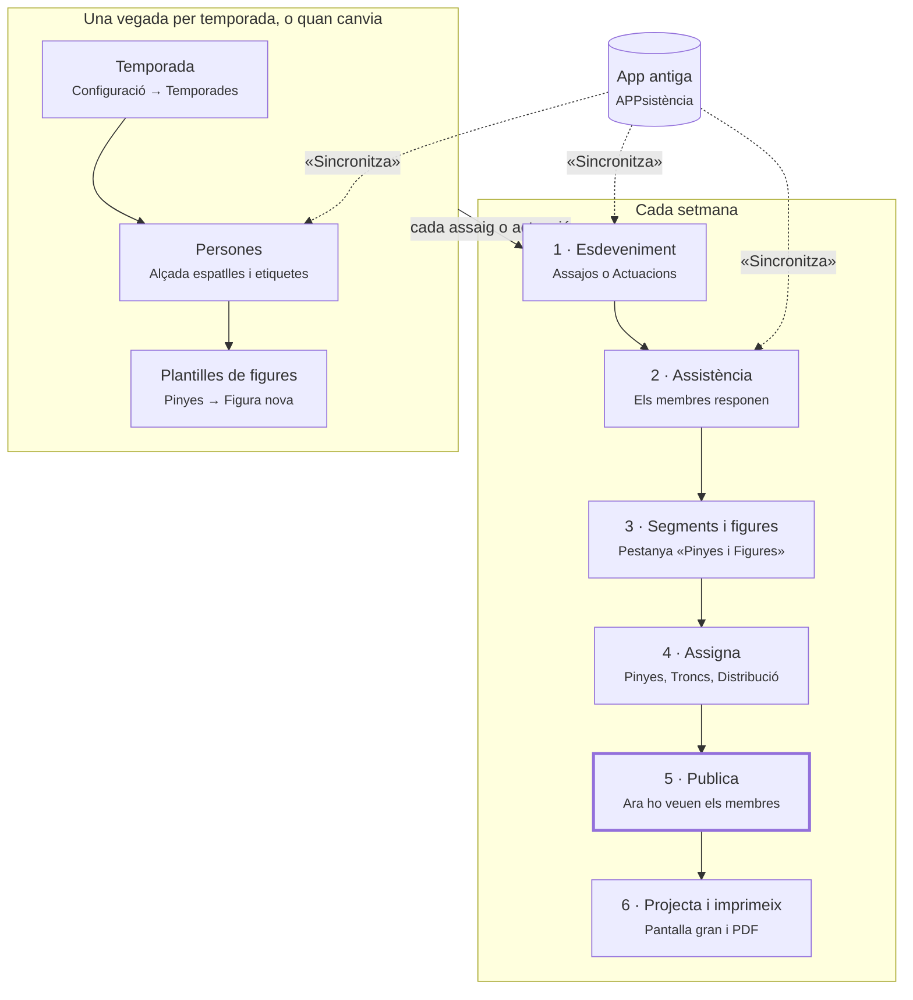

# Guia ràpida del Dashboard · Troncs i Xicalla

Esta guia explica, tasca per tasca, com muntar els troncs d'un assaig o d'una actuació amb el
Dashboard. La xicalla fa servir les mateixes pantalles que els troncs. Per a practicar sense por, feu
servir l'entorn de proves (preproducció): és una còpia i no afecta les dades reals.

---

## El flux de cada setmana

Les fletxes discontínues són la sincronització amb l'app antiga (vegeu més avall). La part de dalt es prepara una vegada per temporada. Per als troncs, el pas clau és tindre l'alçada
de cada persona. Cada assaig o actuació repetix els passos 1 a 6, i només el pas 5 fa que els membres
vegen on els toca.

## Cinc conceptes per a no perdre's

| Concepte | Què vol dir |
|---|---|
| **Plantilla** | El disseny reutilitzable d'una figura, amb el tronc per pisos. Es crea a Pinyes → Figures. |
| **Figura de l'esdeveniment** | Una còpia de la plantilla dins d'un segment. En assignar-hi la primera persona, la còpia es congela: si després modifiqueu la plantilla, esta figura no canvia. |
| **Segment** | Un bloc de temps de l'assaig o de l'actuació, amb una o més figures. |
| **Publicar** | Fer visible un segment als membres a l'app. Fins que no el publiqueu, ningú no veu on li toca. |
| **Conflicte** | La mateixa persona col·locada en dos llocs del mateix segment. El Dashboard ho permet, però ho avisa. Si els dos llocs són de tronc, és el conflicte més greu. |

A més, dos dies després de l'esdeveniment, els segments i les assignacions queden **bloquejats**
(només lectura).

## D'on venen les dades: l'app antiga

Mentre la colla continue fent servir l'app antiga (APPsistència), el Dashboard en fa una còpia. La
còpia només va en un sentit, de l'app antiga al Dashboard, i només es fa quan algú prem
**Sincronitza**. Penseu en l'app antiga com el *cens oficial* i en el Dashboard com la *llibreta de
la tècnica*: cada sincronització torna a copiar el cens, però el que només és a la llibreta no es toca.

| On es clica | Què fa |
|---|---|
| Inici → «Sincronització de dades antigues» → «Sincronitza tot» | Ho porta tot: persones, assajos, actuacions i assistència |
| Persones → «Sincronitza» | Només les persones |
| Assajos o Actuacions → «Sincronitza» | Només els esdeveniments i les seues respostes |

| Ve de l'app antiga (es torna a copiar cada vegada) | És només del Dashboard (no es toca mai) |
|---|---|
| Persones: nom, cognoms, telèfon, data de naixement, **alçada espatlles**, lesions, acollida, camisa | Etiquetes, «Menor de 16» i «Observacions tècniques» (només es copien la primera vegada que entra la persona) |
| Esdeveniments: títol, data, hora, lloc i informació | «Compta per a estadístiques», notes, segments, figures i assignacions |
| Assistència: les respostes Vinc / No vinc / Potser | «Ha arribat» marcat amb «Confirmació» o «Passa llista», i les notes d'assistència ja escrites |

Quatre regles:

1. **Primer persones, després esdeveniments.** «Sincronitza tot» ja ho fa en este ordre.
2. **El que ve de l'app antiga es canvia a l'app antiga.** Si ho canvieu al Dashboard, la pròxima
   sincronització ho torna a deixar com estava.
3. **Sincronitzeu abans de preparar l'assaig**, per a tindre les respostes al dia.
4. **En assajos, el «Potser» de l'app antiga compta com a «Ve».**

Si una persona desapareix de l'app antiga, queda inactiva al Dashboard. Quan l'app antiga es retire,
tot es farà des del Dashboard i este apartat deixarà de valdre.

## Tasques comunes

| Vull… | Feu… |
|---|---|
| Portar les últimes dades de l'app antiga | Inici → «Sincronitza tot». Feu-ho abans de preparar l'assaig. |
| Trobar un assaig o una actuació | Menú **Assajos** o **Actuacions** → filtre «Quan: Propers» → cliqueu l'esdeveniment. |
| Deixar notes per a la tècnica | Pestanya **Resum** → «Notes». Les notes són internes: cap membre no les veu. |
| Saber qui ve | Pestanya **Assistència**. Abans de l'esdeveniment hi veureu Ve / No ve / Pendent; el mateix dia, Ha arribat / No ha arribat / No vindrà. |
| Passar llista el dia de l'assaig | Botó **Confirmació** (pantalla amb teclat gran) o **Passa llista** des de l'app del mòbil. Escriviu el nom i toqueu la persona. |
| Organitzar l'esdeveniment en blocs | Pestanya **Pinyes i Figures** → «Segment nou» → «Figura». Arrossegueu per a canviar l'ordre. |
| Que els membres vegen on els toca | Interruptor **Publicat** del segment (o el general de l'esdeveniment). Els segments nous naixen sense publicar. |
| Imprimir el resum | Botó **Imprimeix**. Obri un PDF amb les notes, els segments i cada tronc pis per pis. |
| Ensenyar la figura en pantalla gran | Botó **Projecta** del segment. F: pantalla completa · ← →: segment anterior o següent · Esc: eixir. |
| Vore qui ha participat on | Pestanya **Participació**: una taula de persones per segments. Filtres «Només troncs» i «Només xicalla», amb la columna d'alçada. |

## Tasques de troncs

Abans de res, cal que cada persona tinga l'**Alçada espatlles** a la fitxa. Sense esta dada, el
Dashboard no pot calcular les alçades del tronc i mostra «?? cm». Mentre l'app antiga siga vigent, **l'alçada es canvia a l'app antiga** i després se sincronitza: si la canvieu al Dashboard, la pròxima sincronització la desfà.

La feina es fa amb el botó **Assigna** d'un segment → pestanya **Troncs**. Hi ha una graella per pisos
per cada figura del segment.

| Vull… | Feu… |
|---|---|
| Posar l'alçada d'una persona | Canvieu-la a l'app antiga i feu «Sincronitza» a **Persones**. Per a consultar-la: menú **Persones** → cliqueu la persona → «Alçada espatlles». |
| Triar com es fa la figura | Pestanya Pinyes i Figures → «Mode de visualització: Troncs» → Completa / Peu / Remat / Neta. Canviar el mode pot desassignar gent: demana confirmació. |
| Posar una persona al tronc | Cliqueu el lloc i després la persona (o al revés), o arrossegueu-la. En triar un lloc de tronc, el filtre **Xicalla** s'activa sol. |
| Triar per alçada | Al panell de persones, escriviu una alçada relativa («ex: +5, -10») o ordeneu per Max / Min. |
| Saber si el tronc quadra | Mireu la columna de cada pis: «Diferència del pis» en groc a partir de 5 cm i en roig a partir de 10 cm. «Suports desnivellats» avisa quan algú trepitja persones d'alçades diferents. |
| Vore qui sosté a qui | Passeu el ratolí per damunt d'una persona: es marquen les persones de sota i l'alçada acumulada fins a ella. |
| Aprofitar el tronc de l'últim assaig | «Importa tronc» i trieu l'esdeveniment. Els llocs ja ocupats no es toquen. |
| Desfer un error | Botons de desfer i refer de la graella, o Ctrl+Z. |
| Definir qui va damunt de qui | Menú **Pinyes** → editeu la figura → pestanya **Tronc**. A la dreta, «Estructura del tronc»: arrossegueu des de la part de baix d'una persona fins a les persones que la sostenen. Cliqueu una línia per a esborrar-la. Sense esta estructura no hi ha càlcul d'alçades. |
| Afegir pisos o llocs al tronc | Mateixa pestanya **Tronc**, panell esquerre: botons + per a pisos, llocs i bases. |

## Tasques de xicalla

La marca que compta és **«Menor de 16»** a la fitxa de la persona. No és el mateix que l'etiqueta
«Xicalla»: l'etiqueta només classifica, mentre que «Menor de 16» activa tots els filtres de xicalla.

| Vull… | Feu… |
|---|---|
| Marcar una persona com a xicalla | Menú **Persones** → fitxa → «Edita» → «Menor de 16». Esta marca és del Dashboard: la sincronització no la toca. |
| Saber quanta xicalla ve | Pestanya **Resum** de l'esdeveniment → «Resum assistència», amb l'interruptor Adults / Xicalla. |
| Vore només xicalla quan assigne | Al panell de persones, interruptor **Xicalla**. S'activa sol en triar un lloc de tronc. |
| Revisar on ha anat la xicalla | Pestanya **Participació** → «Només xicalla». |
| Saber qui en respon | Fitxa de la persona → «Defineix adult responsable» i «Delegacions». L'adult responsable pot confirmar l'assistència des de l'app en nom del xiquet o la xiqueta. |

## Dreceres i trucs amagats

| Tecla o gest | Què fa |
|---|---|
| Supr o Retrocés | Lleva la persona del lloc |
| Ctrl+Z · Ctrl+Maj+Z | Desfà · refà |
| Arrossegar entre llocs | Mou o intercanvia persones |
| Passar el ratolí per damunt d'una persona | Mostra qui la sosté i l'alçada acumulada |
| Esc | Cancel·la la selecció |

- 🎭 al costat d'un nom vol dir que la persona ve a la pròxima actuació: útil per a provar-la a l'assaig.
- Al llistat de **Persones** podeu mostrar la columna «Assistències (temp. actual)» per a vore qui ve més.
- La fitxa de cada persona mostra l'alçada comparada amb la de referència de la colla i un
  **Historial de pinyes** amb tots els llocs on ha estat.
- A **Participació**, la columna d'alçada (± cm) ajuda a repartir els pisos entre assajos.

## Si veieu este avís…

| Avís | Què passa | Què podeu fer |
|---|---|---|
| «?? cm» | Falta l'alçada d'alguna persona d'eixe pis. | Ompliu-ne l'alçada a l'app antiga i sincronitzeu les persones. |
| «Diferència del pis» en groc o roig | Les persones d'un mateix pis queden a alçades diferents: groc a partir de 5 cm, roig a partir de 10 cm. | Canvieu alguna persona de lloc o busqueu-ne una altra amb el filtre d'alçada. |
| «Suports desnivellats» | Una persona trepitja dues persones d'alçades massa diferents. | Igualeu les alçades de les persones de sota. |
| «Una d'estes col·locacions és al tronc» (en roig) | La persona ja és en un altre tronc o pinya del mateix segment. | «Veure col·locació», «Moure ací» o, només si cal de veres, «Assignar igualment». |
| Avís en canviar el mode (Completa / Peu / Remat / Neta) | El mode nou té menys llocs i algunes persones quedaran sense lloc. | Confirmeu només si ho voleu. |
| «Assignacions bloquejades» o «Bloquejat» | Han passat dos dies des de l'esdeveniment. | Res: queda com a historial. |

---

*Veïns: [[DEMO_GUIO]] · [[GUIA_PINYES]] · [[PINYES_MODULE]] · [[SYNC_ARCHITECTURE]]*
