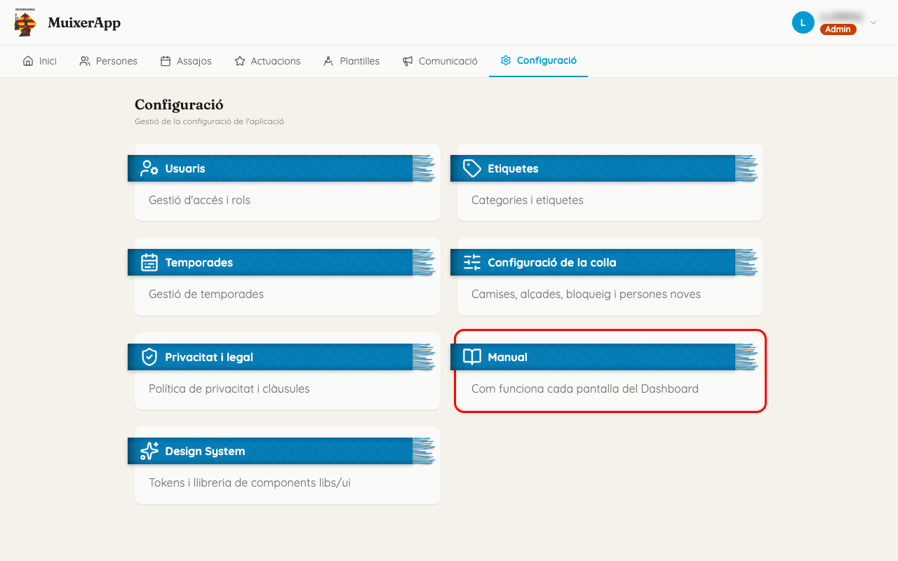
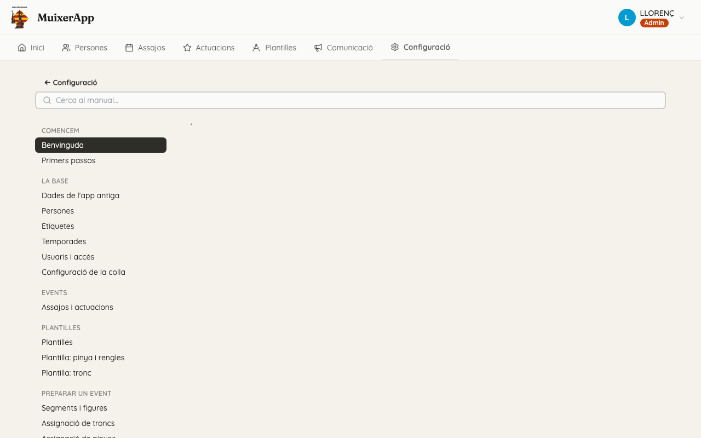

<!-- rutes: /config/manual /config/manual/:slug -->

# Benvinguda

## Per a què serveix

Este manual explica el Dashboard pantalla per pantalla. L'han escrit per als tècnics de pinyes, de troncs i de xicalla. Es manté al dia: cada vegada que canvia alguna cosa de l'app, també es corregeix la pàgina que la descriu.

## On és

Al Dashboard, obriu «Configuració» i feu clic a la targeta «Manual».

## Com fer-lo servir

Hi ha dues maneres de llegir-lo:

- **Consulta ràpida.** Si esteu encallats en una pantalla, escriviu una paraula al camp «Cerca al manual», a dalt de tot: la cerca ignora els accents i les majúscules, i mostra les pàgines on apareix. També podeu buscar la pantalla pel nom al menú de l'esquerra. En un mòbil, el menú és un desplegable a dalt. Els títols del menú són els noms de les pestanyes i dels botons del Dashboard. Cada pàgina té un «Pas a pas» amb les tasques habituals i un apartat «Compte amb» amb els errors més freqüents.
- **Lectura ordenada.** Si és la primera vegada, llegiu-lo en l'ordre del menú. És el mateix ordre en què es prepara un assaig o una actuació.

Dues coses que trobareu a totes les pàgines:

- Els blocs **«Si sou de pinyes»** i **«Si sou de troncs o xicalla»** només apareixen quan la feina de cada perfil és diferent. Si una pàgina no en té, és igual per a tothom.
- Els noms entre cometes, com ara «Persona nova», són exactament els textos que veureu a la pantalla.

## Recorregut recomanat per perfil

Esta taula segueix l'ordre de feina d'un event. La columna «Tothom» és la base comuna. Les altres dues afigen les pàgines pròpies de cada perfil.

| Pas | Tothom | Pinyes | Troncs i xicalla |
|---|---|---|---|
| 1. Base comuna | [Primers passos](01-primers-passos.md), [Dades de l'app antiga](02-dades-app-antiga.md), [Persones](03-persones.md), [Etiquetes](04-etiquetes.md), [Temporades](05-temporades.md), [Assajos i actuacions](07-assajos-i-actuacions.md) | | |
| 2. Plantilles | [Plantilles](08-plantilles.md) | [Plantilla: pinya i rengles](09-plantilles-pinya.md) | [Plantilla: tronc](10-plantilles-tronc.md) |
| 3. Esquelet de l'event | [Segments i figures](11-segments-i-figures.md) | | |
| 4. Assignació | [Conflictes](14-conflictes.md) | [Assignació de pinyes](13-assignacio-pinyes.md) | [Assignació de troncs](12-assignacio-troncs.md) |
| 5. Distribució | [Previsualitza i projecció](16-previsualitza-i-projeccio.md) | [Distribució i nodes extra](15-distribucio-i-nodes-extra.md) | |
| 6. Revisió | [Participació](17-participacio.md), [L'app dels membres (PWA)](19-pwa.md) | | |

L'assignació es fa en dos torns. Primer assignen els tècnics de troncs i de xicalla, perquè trien persones abans. Després, els de pinyes omplin la pinya amb la gent que queda.

Si també administreu usuaris o envieu avisos a la colla, llegiu [Usuaris i accés](06-usuaris-i-acces.md) i [Comunicació](18-comunicacio.md).

## Glossari

Quan la pantalla fa servir una paraula diferent de la que diem a la plaça, s'indiquen totes dues.

- **Actuació / Assaig**: els dos tipus d'event. Cadascun té la seua pestanya: «Actuacions» i «Assajos».
- **App antiga**: l'aplicació d'assistència que fèiem servir abans. Les persones, els assajos i les actuacions encara es copien des d'allà. Vegeu [Dades de l'app antiga](02-dades-app-antiga.md).
- **App dels membres (PWA)**: l'app del mòbil on els membres diuen si vénen («Vaig» / «No vaig») i veuen on estan col·locats. Vegeu [L'app dels membres](19-pwa.md).
- **Assignar**: posar una persona en un lloc d'una figura dins d'un segment.
- **Base**: les persones del tronc que van a terra, al pis 1. La resta del tronc puja damunt d'elles.
- **Composició**: un grup de figures col·locades juntes i guardades amb un nom, per a afegir-les d'una vegada a un segment. Es troben a «Plantilles», pestanya «Composicions».
- **Conflicte**: una persona que està en dos llocs alhora dins del mateix segment. L'app ho permet, però ho avisa. Vegeu [Conflictes](14-conflictes.md).
- **Cordó**: cada anell de la pinya, comptat des del centre cap enfora (1r, 2n, 3r…). En un segment es pot reduir el nombre de cordons d'una figura o deixar-los oberts («Cordons oberts»).
- **Distribució**: on es col·loca cada figura del segment, a la pantalla i a la plaça. És la pestanya «Distribució».
- **Etiqueta**: una marca que es posa a una persona, per exemple una posició que sap fer. Les etiquetes decideixen qui es proposa per a cada lloc. Cada etiqueta té una categoria: Pinya, Tronc, Xicalla o Altres. Vegeu [Etiquetes](04-etiquetes.md).
- **Figura**: la construcció que es fa a la plaça. Al Dashboard, la figura es dibuixa una vegada com a plantilla. Quan s'afig a un segment, se'n fa una còpia només per a eixe segment.
- **Lloc (node)**: cada posició d'una figura on va una persona. La pantalla de vegades en diu «node», per exemple a «Propietats del node» o a «Nodes extra». En este manual en diem lloc.
- **Mode de la figura**: indica quina part de la figura es fa en un segment: «Completa», «Peu», «Remat» o «Neta». Vegeu [Segments i figures](11-segments-i-figures.md).
- **Nodes extra**: llocs afegits a mà en un segment, fora de la plantilla. Per exemple, una persona de reforç o una decoració. Vegeu [Distribució i nodes extra](15-distribucio-i-nodes-extra.md).
- **Persona provisional**: una persona creada al Dashboard només amb l'àlies, per a algú que encara no és a l'app antiga. El seu àlies comença per «~». Vegeu [Persones](03-persones.md).
- **Pinya**: les persones que envolten i sostenen el tronc. És la feina dels tècnics de pinyes.
- **Pis**: cada altura del tronc. El pis 1 és la base.
- **Plantilla**: el model d'una figura, amb els llocs de pinya, les rengles i el tronc. Es fa servir en molts events. És la pestanya «Plantilles». Si canvieu una plantilla, les figures que ja tenen gent assignada en un segment no canvien. Vegeu [Plantilles](08-plantilles.md).
- **Previsualitza / Projecció**: com es veurà el segment a la pantalla gran i a l'app dels membres. Vegeu [Previsualitza i projecció](16-previsualitza-i-projeccio.md).
- **Publicar**: fer que un segment es veja a l'app dels membres. Es fa amb la icona de l'ull del segment; l'estat es veu com a «Publicat» o «No publicat».
- **Rengla**: la fila de llocs de la pinya que va del centre cap enfora. Té un lloc per cordó.
- **Segment (prova)**: cada bloc d'un assaig o d'una actuació. A la plaça en diem prova; la pantalla en diu segment, per exemple al botó «Segment nou».
- **Temporada**: un període de dates que agrupa els events per a les estadístiques. Vegeu [Temporades](05-temporades.md).
- **Tronc**: la part de la figura que puja per damunt de la pinya, per pisos. És la feina dels tècnics de troncs i de xicalla.
- **Xicalla**: els xiquets i xiquetes de la colla. A la fitxa de la persona apareix com a «Xicalla»: es calcula a partir de la data de naixement.

## Relacionat

- [Primers passos](01-primers-passos.md)
- [Preguntes freqüents](20-preguntes-frequents.md)
