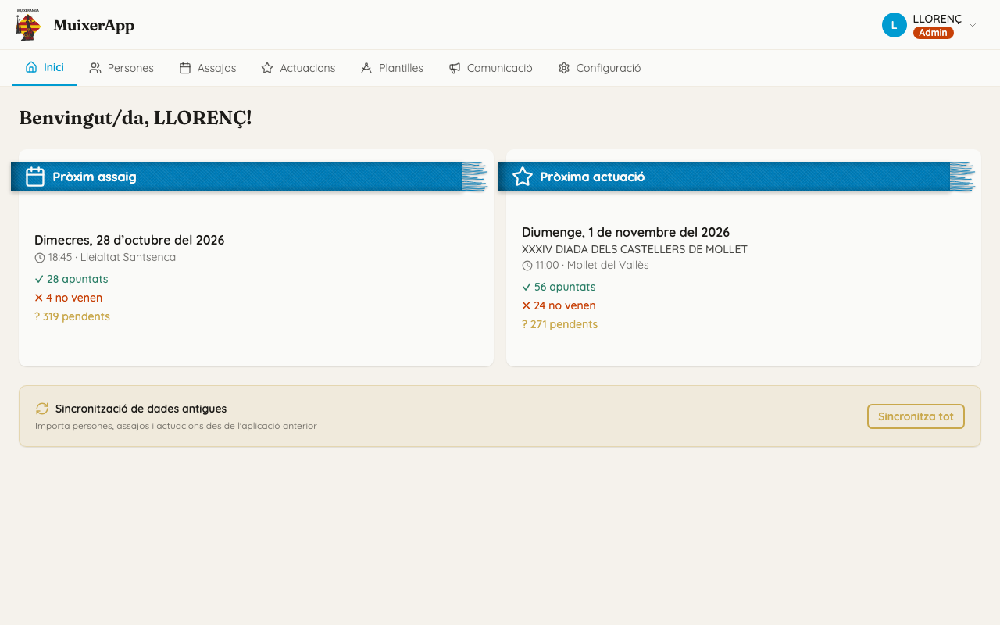
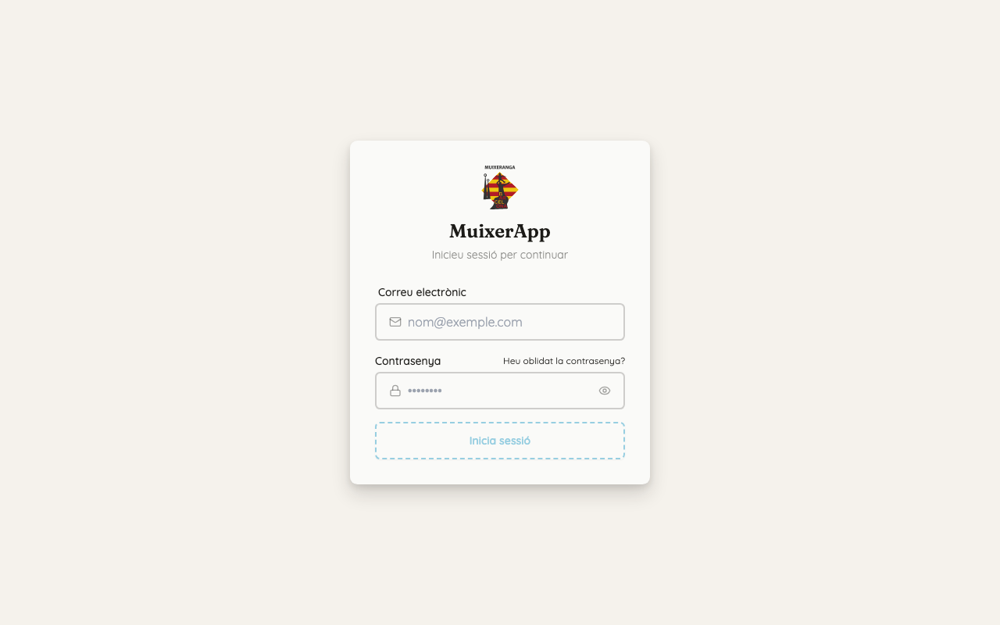
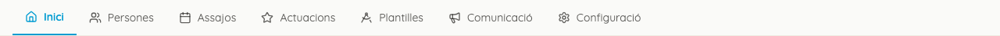
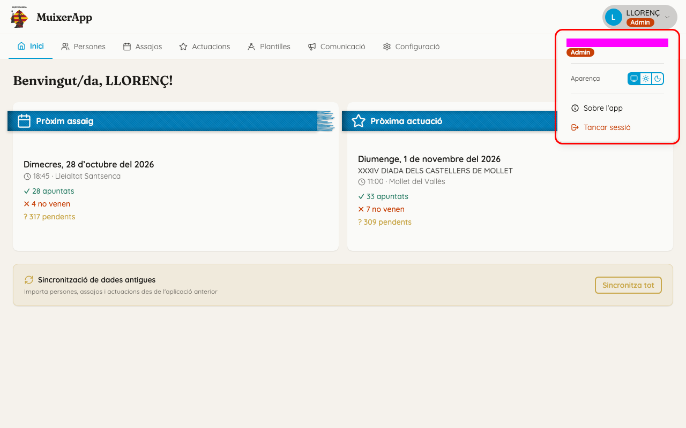
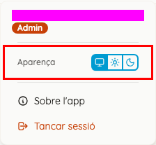
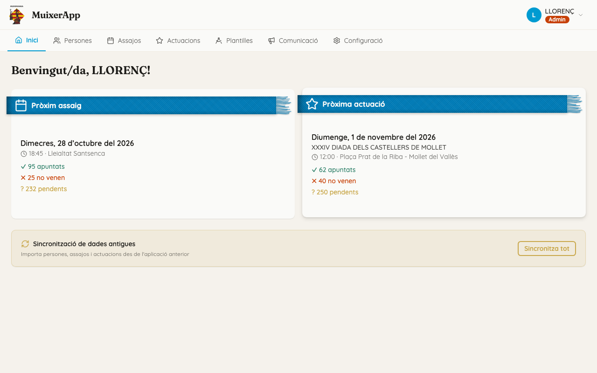

<!-- rutes: /login /forgot-password /reset-password /home -->

# Primers passos

## Per a què serveix

Esta pàgina explica com entrar al Dashboard, què hi ha a cada pestanya de dalt i què ensenya la pantalla «Inici». Al Dashboard només hi poden entrar els comptes de tècnica i d'administració. Els membres fan servir l'app del mòbil ([L'app dels membres](19-pwa.md)).

## On és

Obriu l'adreça del Dashboard al navegador. És recomanable fer-lo servir des d'un ordinador o una tauleta: algunes pantalles no s'obrin en un mòbil (vegeu «Compte amb»).

## Pas a pas

### Entrar

1. Escriviu el «Correu electrònic» i la «Contrasenya».
2. Feu clic a «Inicia sessió».

El botó no s'activa fins que el correu té forma de correu i la contrasenya té almenys 6 caràcters.

### Si no recordeu la contrasenya

1. A la pantalla d'entrada, feu clic a «Heu oblidat la contrasenya?».
2. Escriviu el correu i feu clic a «Envia l'enllaç de recuperació». Sempre apareix el mateix missatge, tant si el correu existeix com si no: «Si l'adreça existeix, rebreu un correu amb instruccions per a recuperar la contrasenya.»
3. Obriu l'enllaç del correu. Escriviu la «Contrasenya nova» (almenys 8 caràcters), repetiu-la a «Confirmeu la contrasenya» i feu clic a «Estableix la contrasenya».

Si l'enllaç ja no serveix, apareix «L'enllaç de recuperació no és vàlid o ha caducat.». Feu clic a «Torna a sol·licitar la recuperació» per a demanar-ne un altre.

### Acceptar la política de privacitat

La primera vegada que entreu, i cada vegada que la colla canvia la política de privacitat, apareix una finestra «Política de Privacitat» (o «La Política de Privacitat s'ha actualitzat»). Llegiu-la i feu clic a «Accepte». No es pot tancar d'una altra manera.

### Moure's per l'app

Les pestanyes de dalt porten a cada part del Dashboard:

| Pestanya | Què hi ha | Pàgina del manual |
|---|---|---|
| «Inici» | Un resum dels pròxims events | esta mateixa |
| «Persones» | Les persones de la colla | [Persones](03-persones.md) |
| «Assajos» i «Actuacions» | Els events | [Assajos i actuacions](07-assajos-i-actuacions.md) |
| «Plantilles» | Les figures i les composicions | [Plantilles](08-plantilles.md) |
| «Comunicació» | Notícies i notificacions | [Comunicació](18-comunicacio.md) |
| «Configuració» | Usuaris, etiquetes, temporades i este manual | [Etiquetes](04-etiquetes.md), [Temporades](05-temporades.md), [Usuaris i accés](06-usuaris-i-acces.md) |

En una pantalla estreta, les pestanyes només mostren la icona. En un mòbil, es pleguen dins del botó «Navegar».

La pestanya «Plantilles» és on es dibuixen les figures. Les figures de cada event, en canvi, es preparen des de l'event mateix, a la pestanya «Pinyes i Figures». Vegeu [Segments i figures](11-segments-i-figures.md).

### Llegir «Inici»

- Dalt hi ha la salutació «Benvingut/da, …!».
- Les targetes «Pròxim assaig» i «Pròxima actuació» mostren la data, l'hora i el lloc de l'event, i tres comptadors:
  - «✓ N apuntats»: persones que han dit que hi van;
  - «✗ N no venen»: persones que han dit que no hi van;
  - «? N pendents»: persones que encara no han respost.
- Feu clic en una targeta per a obrir l'event.
- Si no hi ha cap event programat, la targeta diu «Cap assaig programat properament» (o «Cap actuació programada properament»). El botó «Veure assajos» (o «Veure actuacions») obri la llista.
- La targeta «Sincronització de dades antigues» porta, amb el botó «Sincronitza tot», a la pantalla d'importació des de l'app antiga. Vegeu [Dades de l'app antiga](02-dades-app-antiga.md).

### El menú d'usuari

Dalt a la dreta hi ha un cercle amb la vostra inicial, el vostre àlies i el rol. Feu-hi clic per a obrir el menú.

- Dalt del menú hi ha el correu del compte i el rol: «Tècnica» o «Admin».
- **«Aparença»** té tres botons amb icona: «Sistema» (segueix el tema de l'ordinador o del mòbil), «Clar» i «Fosc». Passeu el ratolí per damunt d'un botó per a veure'n el nom. L'elecció es guarda només en eixe navegador. Les figures i la projecció sempre es veuen en clar, perquè es llegisquen bé.

  

- **«Sobre l'app»** obri una finestra amb el contacte, la política de privacitat i l'enllaç al codi de l'app a «GitHub».

  

- **«Tancar sessió»** tanca la sessió en eixe navegador i torna a la pantalla d'entrada.

### On és este manual

Obriu «Configuració» i feu clic a «Manual». Vegeu [Benvinguda](00-benvinguda.md).

## Compte amb

- **Comptes de membre.** Si entreu amb un compte de membre, el Dashboard diu «Correu electrònic o contrasenya incorrectes.», encara que la contrasenya siga bona. El missatge enganya: el compte no té permís de tècnica. Parleu amb qui administra els usuaris ([Usuaris i accés](06-usuaris-i-acces.md)).
- **La sessió queda oberta.** El navegador recorda la sessió uns dies. Si passeu una setmana sense entrar-hi, vos tornarà a demanar la contrasenya. En un ordinador compartit, feu «Tancar sessió» en acabar.
- **Plantilles en un mòbil.** L'editor de plantilles i el de composicions no s'obrin en un mòbil. Apareix l'avís «Aquesta funcionalitat només està disponible en dispositius d'escriptori o tauleta.» i torneu a «Plantilles». En una tauleta sí que funcionen.
- **Tutorial de Plantilles.** La primera vegada que obriu «Plantilles» apareix el tutorial «Com funciona el mòdul de Pinyes». Si marqueu «No tornes a mostrar», ja no tornarà a eixir en eixe navegador.
- **El tema és de cada navegador.** Si canvieu d'ordinador, «Aparença» torna a «Sistema».
- **«Sincronitza tot» no importa res per si sol.** Només obri la pantalla «Sincronització global». A més, només un compte d'administració pot fer la importació. Vegeu [Dades de l'app antiga](02-dades-app-antiga.md).

## Relacionat

- [Benvinguda](00-benvinguda.md)
- [Dades de l'app antiga](02-dades-app-antiga.md)
- [Usuaris i accés](06-usuaris-i-acces.md)
- [L'app dels membres (PWA)](19-pwa.md)
