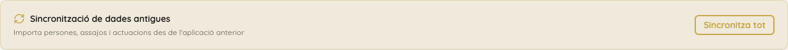
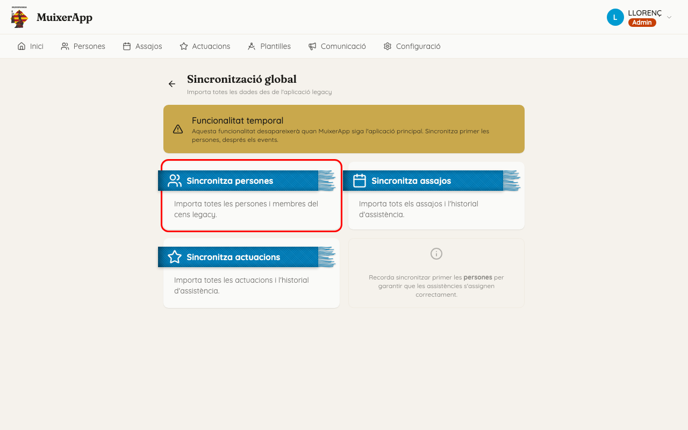
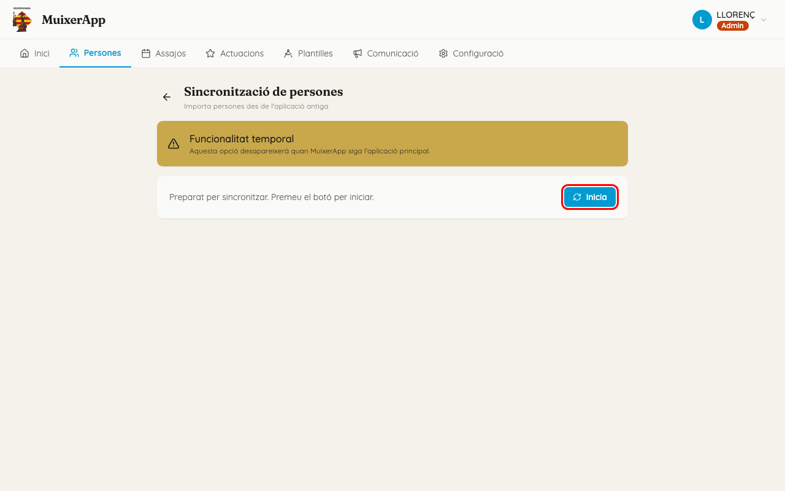
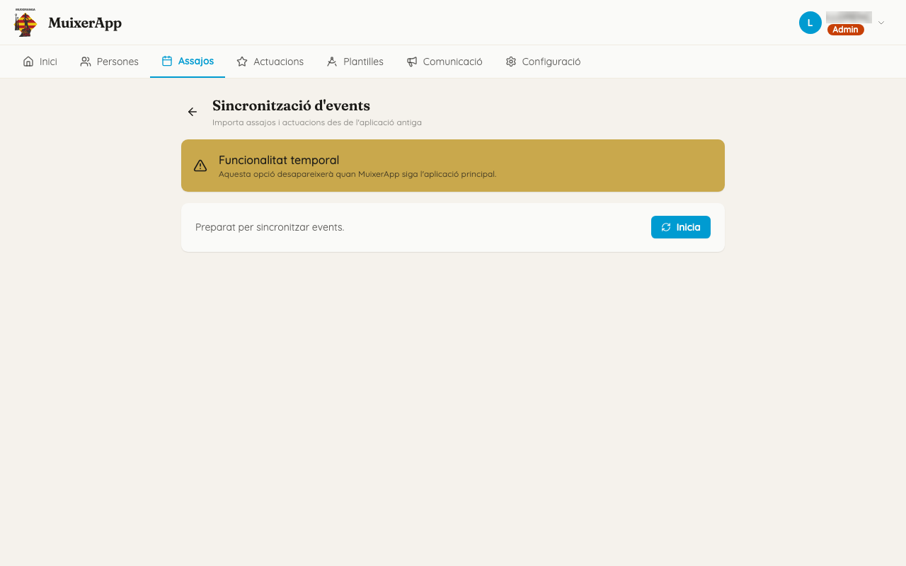

<!-- rutes: /sync /persons/sync-start /rehearsals/sync /performances/sync -->

# Dades de l'app antiga

## Per a què serveix

Durant una temporada, la colla fa servir dues apps alhora:

- l'**app antiga**, on la gent encara s'apunta als assajos i a les actuacions;
- **MuixerApp**, on es preparen les figures.

Les persones, els assajos, les actuacions i les respostes d'assistència es copien de l'app antiga a MuixerApp. A això en diem **importar** o **sincronitzar**. Quan tota la colla faça servir només MuixerApp, esta pantalla desapareixerà. Per això la pantalla diu «Funcionalitat temporal».

## Per què encara és així

La gent encara s'apunta a l'app antiga, i algunes dades encara només es mantenen allà. Mentre convisquen les dues apps, hi ha dades que **manen a l'app antiga** i dades que **manen a MuixerApp**. Saber quines són de cadascuna evita perdre feina. Ho explica l'apartat «Què canvia i què no en importar».

La pantalla de vegades diu «legacy»: és la paraula anglesa per a l'app antiga.

## On és

Hi ha tres camins, i tots porten a la mateixa importació:

- «Inici» → targeta «Sincronització de dades antigues» → «Sincronitza tot»;
- «Persones» → «Sincronitza»;
- «Assajos» o «Actuacions» → «Sincronitza».

## Pas a pas

Només un compte d'administració pot importar (vegeu «Compte amb»).

### 1. Importeu primer les persones

1. A «Sincronització global», feu clic a «Sincronitza persones».
2. Feu clic a «Inicia».
3. Mentre treballa, es veu «Sincronitzant... N%» i el «Registre» es va omplint.
4. En acabar, es veu «Sincronització completada ✓» i un resum amb «Nous», «Actualitzats» i «Errors».
5. Feu clic a «Finalitza». Tornareu a «Persones» amb la llista actualitzada.

### 2. Després, importeu els events

1. A «Sincronització global», feu clic a «Sincronitza assajos» o a «Sincronitza actuacions». **Les dues fan el mateix**: importen tots els assajos, totes les actuacions i les respostes d'assistència de tots.
2. Feu clic a «Inicia» i espereu a «Sincronització completada ✓».
3. Feu clic a «Finalitza».

Les persones van primer perquè, si no, les respostes de les persones noves no troben a qui pertanyen. Al «Registre» apareixen com a «sense match».

### 3. Llegiu el «Registre»

Mireu sobretot:

- les línies **grogues**, que són avisos. Per exemple:
  - «Alias "X" ja existeix…, assignat "Y"»: dues persones de l'app antiga volien el mateix àlies i una n'ha rebut un altre;
  - «N esdeveniments importats no són dins de cap temporada.»: cal crear o ampliar una temporada ([Temporades](05-temporades.md));
- les línies **roges**, que són errors.

### 4. Si alguna cosa falla

- Si apareix «Error durant la sincronització», feu clic a «Torna a sincronitzar».
- Si apareix «Ja hi ha una sincronització en curs», una altra importació encara treballa. Espereu uns minuts i torneu-ho a provar.

### 5. Un sol event

Per a importar només l'assistència d'un event, obriu l'event i feu clic al seu botó «Sincronitza». Vegeu [Assajos i actuacions](07-assajos-i-actuacions.md).

## Què canvia i què no en importar

**Ho porta l'app antiga.** Si ho canvieu al Dashboard, la importació següent ho desfà. Estes dades es canvien a l'app antiga:

- de les persones:
  - nom, cognoms, àlies, telèfon i data de naixement;
  - «Alçada espatlles», «Membre», «Acollida» i «Data camisa»;
- dels events: el títol, la data, l'hora d'inici, el lloc i les dades de l'actuació (hora final, «A casa», «Autocar», «Colles»);
- les respostes d'assistència («Ve», «No ve», «Pendent») dels events que vénen de l'app antiga.

**Ho porta MuixerApp.** La importació no ho toca mai:

- les etiquetes i el «Gènere»;
- els adults responsables i les delegacions que afegiu al Dashboard;
- les persones provisionals;
- els events creats al Dashboard (i cap event no s'esborra mai en importar);
- els segments, les figures i les assignacions;
- la «Descripció», l'«URL mapa» i les notes internes dels events;
- «Compta per a estadístiques»;
- qui ha arribat a un event (passada de llista o «Confirmació»).

**Ve de l'app antiga només la primera vegada.** Després es canvia al Dashboard:

- «Menor de 16»;
- «Observacions tècniques».

Un exemple: a l'app antiga, una persona té 140 cm d'alçada d'espatlles. Si la corregiu a 145 al Dashboard, després de la importació tornarà a dir 140. Corregiu-la a l'app antiga.

## Si sou de pinyes

Les etiquetes no es perden mai en importar. Les podeu treballar tranquil·lament al Dashboard. Vegeu [Etiquetes](04-etiquetes.md).

## Si sou de troncs o xicalla

- L'«Alçada espatlles» ve de l'app antiga. És la dada que fa servir el filtre d'alçada de l'assignació de troncs ([Assignació de troncs](12-assignacio-troncs.md)). Si una alçada és incorrecta, corregiu-la a l'app antiga.
- «Menor de 16» només es copia la primera vegada, a partir de la posició que la persona té a l'app antiga. Quan un xiquet o una xiqueta passa a adult, canvieu-ho al Dashboard.
- Si a l'app antiga una persona de la xicalla té el mateix correu que un adult, eixe adult queda com a responsable seu (relació «Pare/Mare»).

## Compte amb

- **Només administració.** Amb un compte de tècnica, les pantalles d'importació s'obrin igual, però en fer «Inicia» apareix «Error de connexió amb el servidor». No és cap avaria: el compte no té permís per a importar.
- **Desactivar algú que encara és a l'app antiga.** Si desactiveu al Dashboard una persona que encara és a l'app antiga, la importació següent la torna a crear com a persona nova i activa, amb un àlies diferent. Doneu-la de baixa primer a l'app antiga.
- **Persones provisionals duplicades.** Si una persona provisional del Dashboard després s'apunta a l'app antiga, acabarà duplicada: MuixerApp no les lliga soles. Aviseu qui administra l'app.
- **Respostes des del mòbil.** Per als events que vénen de l'app antiga, mana la resposta de l'app antiga. Una resposta donada a l'app del mòbil es pot perdre en la importació següent. Si a l'app antiga una resposta torna a estar en blanc, ací torna a «Pendent». Mentre hi haja importacions, la gent s'ha d'apuntar a l'app antiga.
- **«Potser vinc».** En un assaig que encara no s'ha fet, «Potser vinc» de l'app antiga compta com «Ve». És l'única resposta afirmativa que l'app antiga ofereix abans d'un assaig. En una actuació, «Potser» queda com a «Pendent».
- **Esperar.** La importació d'events pot tardar uns minuts. No tanqueu la pestanya mentre diu «Sincronitzant...».
- **«Cancel·la».** «Cancel·la» només deixa de mostrar el progrés. Pot ser que la importació continue igualment. Espereu uns minuts abans de llançar-la una altra vegada.
- **«Sincronitza tot».** El botó d'«Inici» només obri esta pantalla. No importa res per si sol.

## Relacionat

- [Persones](03-persones.md)
- [Temporades](05-temporades.md)
- [Usuaris i accés](06-usuaris-i-acces.md)
- [Assajos i actuacions](07-assajos-i-actuacions.md)
