<!-- rutes: /persons /persons/:id -->

# Persones

## Per a què serveix

«Persones» és la llista de tota la gent de la colla. Des d'ací podeu:

- buscar una persona;
- veure i corregir la seua fitxa: etiquetes, observacions i estat;
- donar-li accés a l'app del mòbil;
- lliurar la camisa a qui ja hi té dret.

Moltes dades personals vénen de l'app antiga. Vegeu [Dades de l'app antiga](02-dades-app-antiga.md).

## On és

Pestanya «Persones».

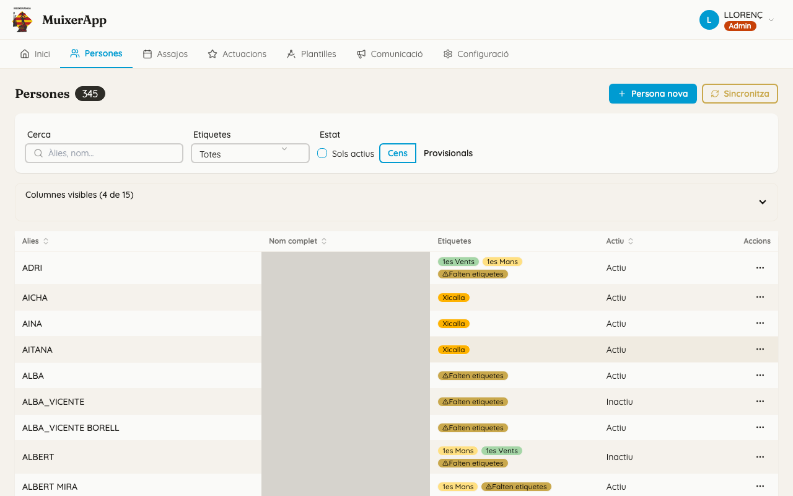

## Pas a pas

### Buscar algú

1. Escriviu a «Cerca» un àlies, un nom o un cognom. No cal posar els accents.
2. Feu clic a la fila per a obrir-ne la fitxa. També podeu fer servir l'acció «Veure detall».

Amb Ctrl+clic (Cmd+clic en un Mac), la fitxa s'obri en una pestanya nova i no perdeu els filtres de la llista.

### Filtrar la llista

- «Etiquetes» deixa triar una etiqueta o més, agrupades per categoria. Ixen les persones que en tenen **qualsevol** de les triades.
- «Sols actius» amaga les persones donades de baixa. Sense esta casella, la llista també mostra les inactives.
- «Cens» i «Provisionals» canvien entre la gent que ve de l'app antiga i les persones creades al Dashboard.

Els filtres actius apareixen com a etiquetes al costat de «Filtres actius:». Cadascun es lleva amb la seua creu, i tots alhora amb «Neteja filtres».

### Trobar qui no té les etiquetes que toquen

1. Obriu «Etiquetes» i trieu «Falten etiquetes».
2. La llista només mostra les persones a qui falta alguna etiqueta.

També podeu fer clic a la insígnia groga «Falten etiquetes» d'una fila: activa el mateix filtre.

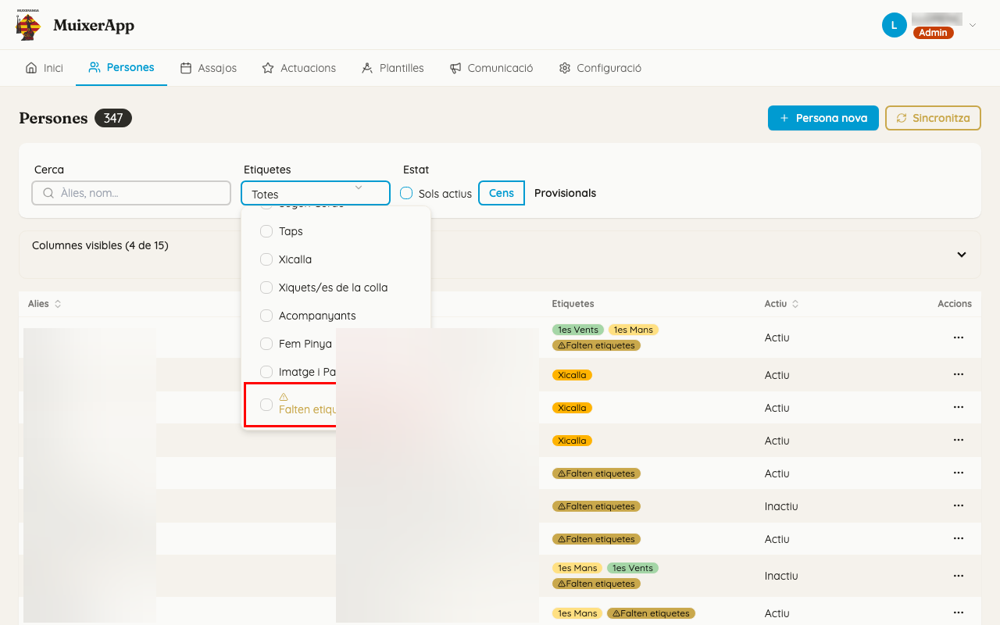

La regla és esta. Cada persona necessita alguna d'estes combinacions:

- una etiqueta de Xicalla;
- una etiqueta d'Altres;
- una etiqueta de Pinya **i** una de Tronc.

Passeu el ratolí per damunt de la insígnia per a veure què falta, per exemple «Falta etiqueta de Tronc». És només un avís: no impedeix res. Per a etiquetar molta gent de pressa, feu servir l'assistent «Etiqueta persones» ([Etiquetes](04-etiquetes.md)).

### Triar les columnes

- «Columnes visibles (N de M)» mostra o amaga columnes. Per defecte no es veuen «Telèfon», «Data naixement», «Alçada», «Assistències (temp. actual)», «Acollida», «Membre», «Xicalla», «Data camisa», «Notes», «Creat» ni «Actualitzat».
- L'elecció queda guardada en eixe navegador.
- Feu clic a la capçalera d'una columna per a ordenar la llista.

### Crear una persona nova

Feu-ho per a algú que encara no és a l'app antiga, per exemple el primer dia que ve.

1. Feu clic a «Persona nova».
2. Escriviu l'«Àlies» i feu clic a «Crea».
3. Apareix el tutorial «Doneu accés a la persona», amb tres passos: «Persona creada», «Genereu l'enllaç d'invitació» i «Per a la xicalla». Passeu-los amb «Següent».
4. En fer clic a «Entesos!», s'obri la fitxa de la persona nova.

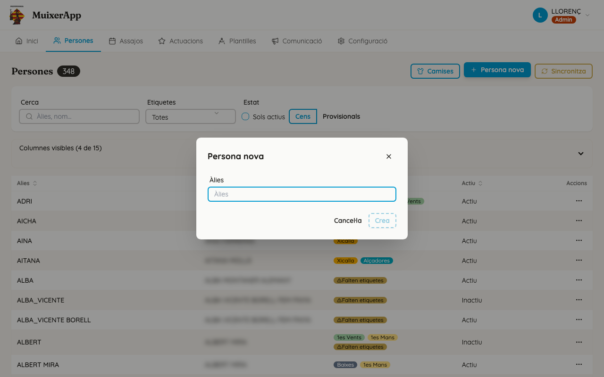

La persona queda com a **provisional**:

- el seu àlies comença per «~»;
- només apareix a «Provisionals», no a «Cens».

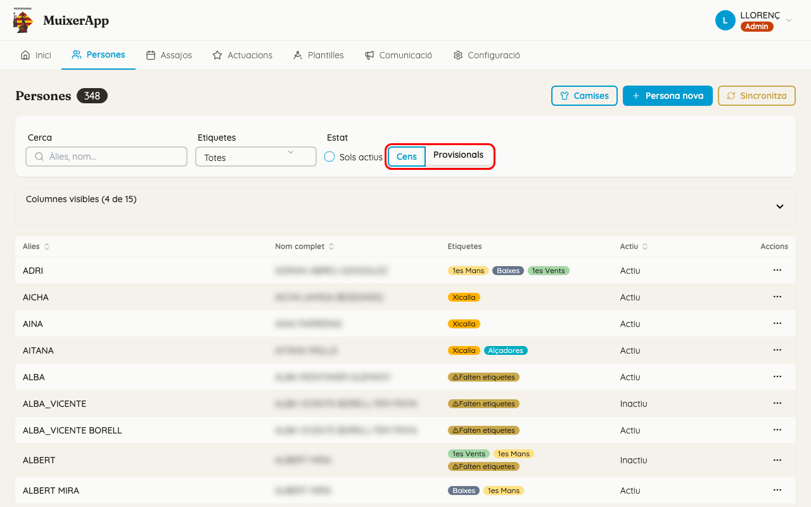

### Llegir la fitxa

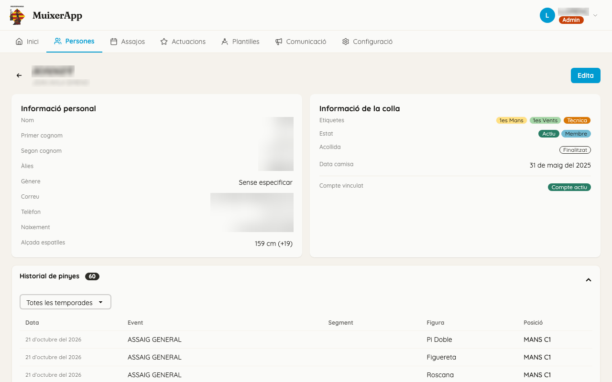

- Dalt hi ha l'àlies. Si cal, també hi ha les insígnies «Provisional» o «Inactiu».
- «Informació personal»: «Nom», «Primer cognom», «Segon cognom», «Àlies», «Gènere», «Correu», «Telèfon», «Naixement» i «Alçada espatlles». Al costat de l'alçada, entre parèntesis, hi ha la diferència respecte de l'alçada de referència de la colla (140 cm, si no s'ha canviat a [Configuració de la colla](21-configuracio-colla.md)).
- «Informació de la colla»:
  - «Etiquetes»;
  - «Estat»: «Actiu» o «Inactiu», i també «Membre» i «Xicalla» quan toca;
  - «Acollida»;
  - «Data camisa» (o «Camisa: No»);
  - «Observacions tècniques», si n'hi ha.
- «Historial de pinyes»: vegeu més avall.
- «Metadades» (plegat): «Creat» i «Actualitzat».

### Corregir la fitxa

1. Feu clic a «Edita».
2. Canvieu el que calga:
   - Les etiquetes es marquen i es desmarquen amb un clic. Estan agrupades per categoria.
   - «Xicalla» es calcula sola a partir de la «Data de naixement» i la majoria d'edat de la colla (16 anys, si no s'ha canviat). Amb data de naixement, la casella està desactivada i davall diu «Es calcula a partir de la data de naixement.». Sense data, la marqueu a mà.
   - A «Observacions tècniques», trieu una opció ràpida (🤕 Baixa llarga, 🍃 Sense càrrega, ⏰️ Restricció horària o 🐣 Cuida xicalla) o «Altre», per a escriure-hi una observació i triar-ne la icona.
3. Feu clic a «Alça». Apareix «Alçat correctament».

«Cancel·la» desfà els canvis. Dalt dels camps personals hi ha l'avís de confidencialitat de la colla.

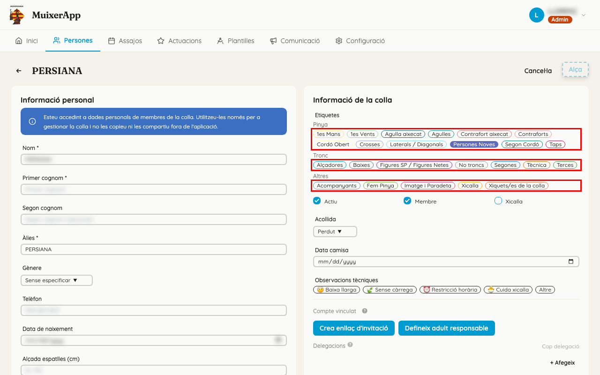

Recordeu que alguns camps els torna a escriure l'app antiga en cada importació (vegeu «Compte amb»).

### Lliurar camises

Per a rebre la camisa, cal haver anat a un nombre d'actuacions i d'assajos. Per defecte, 2 actuacions i 6 assajos, comptant totes les temporades. Els administradors ho canvien a [Configuració de la colla](21-configuracio-colla.md).

1. A «Persones», feu clic a «Camises».
2. La llista mostra les persones actives que encara no tenen camisa, en dos blocs:
   - «Poden rebre la camisa»: ja compleixen els requisits;
   - «En curs»: encara no, ordenades de les que estan més a prop a les que menys.
3. Cada fila té una marca per cada actuació (estrela) i cada assaig (calendari) que cal. La marca s'ompli en verd quan la persona ja hi ha anat. Al costat, «N/M» diu quantes en porta i quantes calen.
4. Feu clic a «Lliura la camisa». S'obri «Lliurament de la camisa».
5. Trieu la «Data de lliurament» (per defecte, hui) i feu clic a «Lliura». Apareix «S'ha lliurat la camisa a …» i la persona desapareix de la llista.

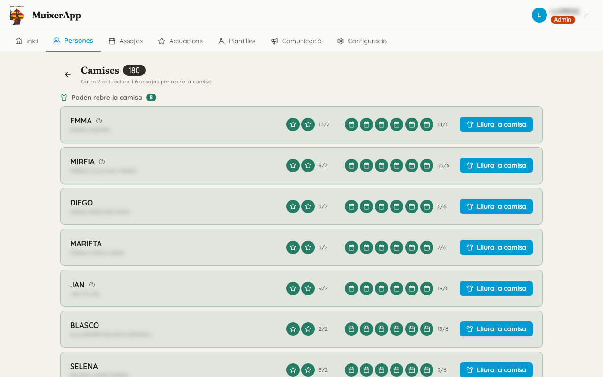

També podeu lliurar-la a qui encara no compleix els requisits. En eixe cas, el diàleg avisa del que li falta, per exemple «Encara no compleix els requisits: li falta 1 actuació.».

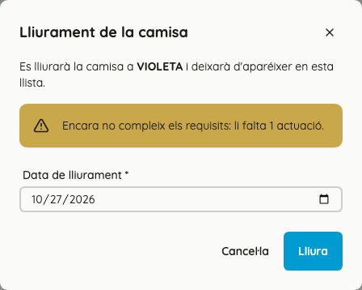

Només compten els events amb l'assistència marcada («Ha arribat») i que tenen «Compta per a estadístiques». La data de lliurament queda a «Data camisa» de la fitxa.

### Donar accés a l'app del mòbil

A «Informació de la colla», sota «Compte vinculat», es veu si la persona pot entrar a l'app del mòbil:

- «Compte actiu»: ja hi pot entrar. No cal fer res.
- «Pendent d'activar»: té un compte creat, però encara no hi ha entrat mai.
- Sense compte: encara no en té cap.

En els dos últims casos:

1. Feu clic a «Crea enllaç d'invitació». L'enllaç es copia sol i apareix «Enllaç d'invitació copiat al portapapers.».
2. Envieu-lo a la persona, per exemple per WhatsApp. L'app **no envia cap correu**.
3. La persona obri l'enllaç al mòbil i tria la seua contrasenya ([L'app dels membres](19-pwa.md)). Si era provisional, deixa de ser-ho.

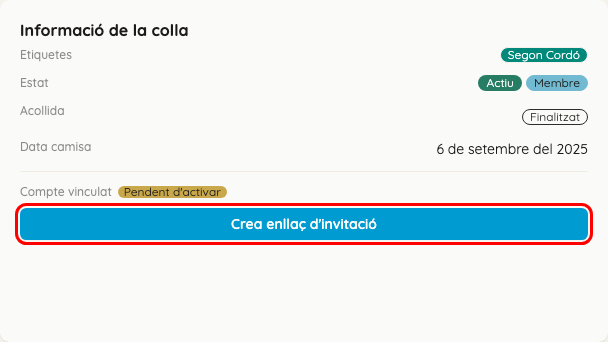

L'enllaç caduca als 3 dies. Si cal, torneu a fer clic a «Crea enllaç d'invitació»: se'n crea un de nou i l'anterior deixa de funcionar.

### Xicalla: l'adult responsable

Un xiquet o una xiqueta no té compte propi: el botó «Crea enllaç d'invitació» està desactivat. Passeu el ratolí per damunt per a veure'n el motiu. L'accés el té un adult responsable.

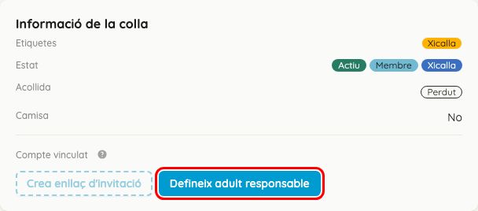

1. L'adult ha de tindre un compte. Si no en té, creeu-li'l abans: «Persona nova» i una invitació per a l'adult.
2. A la fitxa de la xicalla, feu clic a «Defineix adult responsable». S'obri la finestra «Vincula un delegat».
3. A «Relació», trieu «Pare/Mare» o «Tutor/a».
4. A «Cerca usuari», busqueu l'adult pel correu o pel nom i seleccioneu-lo.
5. Feu clic a «Afegeix».

Des d'eixe moment, la fitxa mostra «Responsable», amb l'àlies de l'adult i la relació. L'àlies enllaça a la fitxa de l'adult.

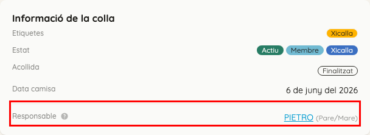

### Delegacions

Una delegació permet que una altra persona apunte esta persona des del seu compte.

1. Feu clic a «Edita».
2. A «Delegacions», feu clic a «+ Afegeix». S'obri la finestra «Afegeix un altre delegat».
3. Trieu la «Relació» i l'usuari, i feu clic a «Afegeix».
4. Feu clic a «Alça» per a eixir del mode d'edició.

Per a llevar una delegació, en mode «Edita» feu clic a la «✕» del costat i confirmeu amb «Elimina» a la finestra «Eliminar delegat».

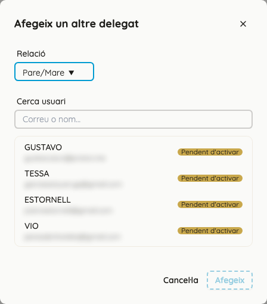

### Historial de pinyes

«Historial de pinyes» mostra tots els llocs on ha estat col·locada la persona, amb les columnes «Data», «Event», «Segment», «Figura» i «Posició».

- Trieu una temporada al desplegable «Totes les temporades» per a veure només eixa temporada.
- Feu clic a una fila per a obrir l'event.

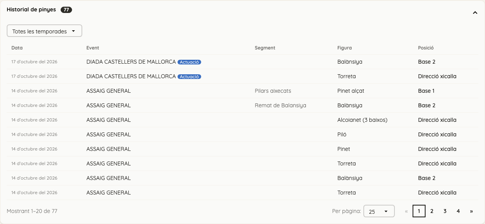

## Si sou de pinyes

- El vostre filtre és «Falten etiquetes». Si una persona només té etiqueta de Pinya, també hi ix: la regla demana Pinya **i** Tronc, si no és de Xicalla o d'Altres.
- Les etiquetes de pinya decideixen qui es proposa per a cada lloc. Vegeu [Etiquetes](04-etiquetes.md) i [Assignació de pinyes](13-assignacio-pinyes.md).

## Si sou de troncs o xicalla

- L'«Alçada espatlles» és la dada que fa servir el filtre d'alçada de l'assignació de troncs ([Assignació de troncs](12-assignacio-troncs.md)). Ve de l'app antiga: si és incorrecta, corregiu-la allà.
- La columna «Alçada» de la llista, amagada per defecte, permet ordenar la gent per alçada.
- «Xicalla» vol dir que la persona és menor d'edat. Si té data de naixement, es calcula sola; si no, es marca a mà.
- Per a donar accés a la família d'un xiquet o d'una xiqueta, seguiu els passos de «Xicalla: l'adult responsable».

## Compte amb

- **Camps que torna a escriure l'app antiga.** En cada importació, l'app antiga torna a escriure nom, cognoms, àlies, telèfon, naixement, «Alçada espatlles», «Membre», «Acollida» i «Data camisa». En canvi, les etiquetes, el «Gènere», «Xicalla», les «Observacions tècniques» i les delegacions es mantenen. Vegeu [Dades de l'app antiga](02-dades-app-antiga.md).
- **«Data camisa» i l'app antiga.** Si l'app antiga té una data de camisa, la importació la torna a escriure. Si no en té cap, la importació no esborra la que heu posat al Dashboard.
- **No hi ha botó per a esborrar persones.** Per a donar algú de baixa, feu clic a «Edita», desmarqueu «Actiu» i feu clic a «Alça». Si la persona encara és a l'app antiga, la importació següent la tornarà a crear ([Dades de l'app antiga](02-dades-app-antiga.md)).
- **Àlies repetits.** Dues persones no poden tindre el mateix àlies. Si ho proveu, apareix «Ja existeix una persona amb l'àlies…» (o «Ja existeix una persona provisional amb l'àlies…»). Recordeu que l'àlies d'una persona provisional comença per «~».
- **La invitació.** Envieu-la el mateix dia: caduca als 3 dies. Cada clic en crea una de nova i l'anterior deixa de funcionar. Si la persona ja té el compte actiu, apareix «Aquesta persona ja té un compte actiu».
- **L'adult responsable.** «Defineix adult responsable» només apareix si la persona no té compte ni responsable. L'adult ha de tindre compte, encara que estiga «Pendent d'activar». Per a la xicalla, la relació ha de ser «Pare/Mare» o «Tutor/a». Si no, apareix «El gestor principal d'un membre de la xicalla ha de ser pare/mare o tutor/a».
- **Persones provisionals duplicades.** Si una persona provisional després s'apunta a l'app antiga, quedarà duplicada ([Dades de l'app antiga](02-dades-app-antiga.md)).
- **Els filtres es perden en tornar.** Si torneu de la fitxa amb la fletxa «←», la llista apareix sense filtres. Per a conservar-los, obriu les fitxes en una pestanya nova.
- **Dades personals en pantalla.** La llista mostra «Nom complet» per defecte. Abans de compartir la pantalla, amagueu la columna des de «Columnes visibles».

## Relacionat

- [Dades de l'app antiga](02-dades-app-antiga.md)
- [Etiquetes](04-etiquetes.md)
- [Usuaris i accés](06-usuaris-i-acces.md)
- [Configuració de la colla](21-configuracio-colla.md)
- [Assignació de troncs](12-assignacio-troncs.md)
- [Participació](17-participacio.md)
- [L'app dels membres (PWA)](19-pwa.md)
