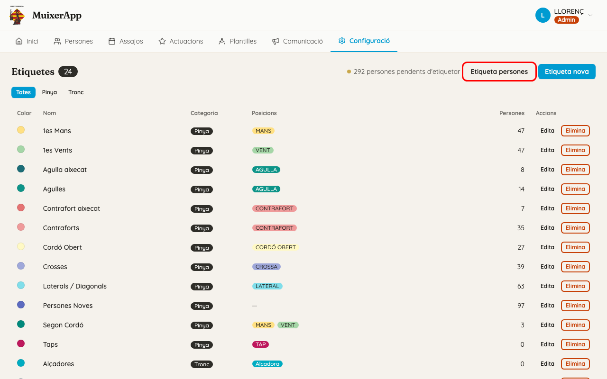
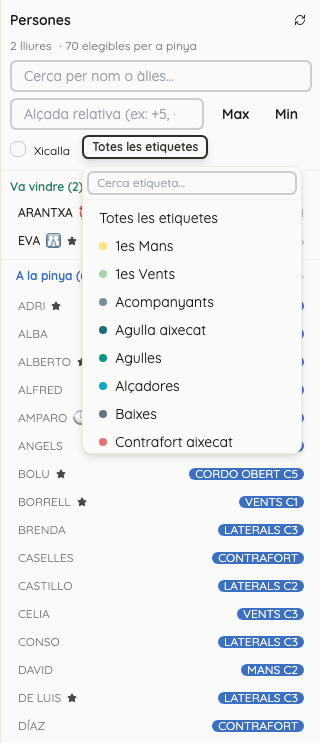
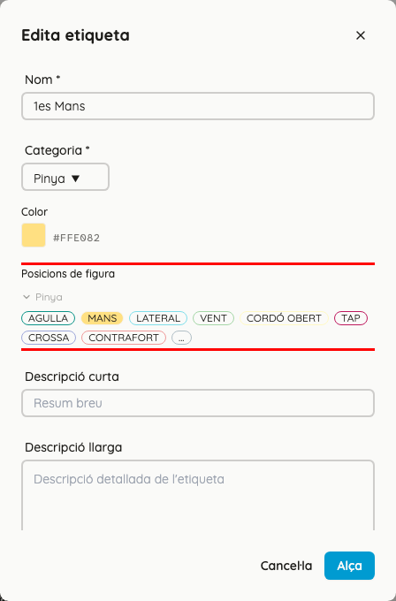
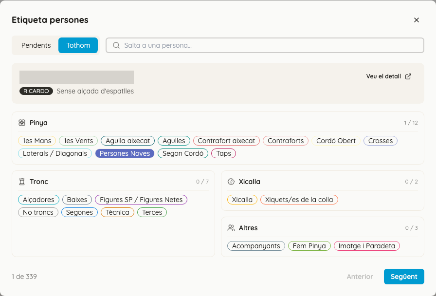
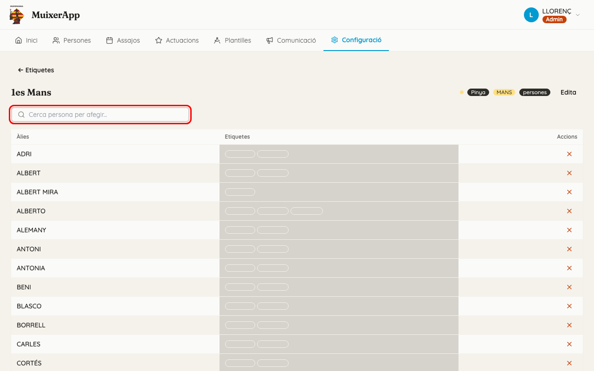

<!-- rutes: /config/tags /config/tags/:id -->

# Etiquetes

## Per a què serveix

Les etiquetes diuen què fa cada persona a la colla: pinya, tronc, xicalla o altres coses. Serveixen per a trobar ràpid la gent adequada quan col·loqueu persones en una figura i per a saber qui encara està per revisar.

## On és

«Configuració» → targeta «Etiquetes». Per a veure qui porta una etiqueta, feu clic a la seua fila.

## Grups d'etiquetes

Cada etiqueta té una «Categoria», que és el seu grup. Hi ha quatre grups fixos i no se'n poden crear més:

| Categoria | Per a què serveix | Exemples |
|---|---|---|
| Pinya | llocs de pinya | 1es Mans, 1es Vents, Segon Cordó, Laterals / Diagonals, Agulles, Contraforts, Crosses, Taps, Cordó Obert, Persones Noves |
| Tronc | pisos, base i direcció | Baixes, Segones, Terces, Alçadores, Figures SP / Figures Netes, No troncs, Tècnica |
| Xicalla | xicalla que participa a les figures | Xicalla, Xiquets/es de la colla |
| Altres | qui no fa ni pinya ni tronc | Acompanyants, Fem Pinya, Imatge i Paradeta |

Els exemples són les etiquetes amb què va començar l'app. Podeu crear-ne, canviar-ne i esborrar-ne.

Les etiquetes són només d'esta app. L'app antiga no en porta cap, i la sincronització no en crea ni n'esborra cap. Vegeu [Dades de l'app antiga](02-dades-app-antiga.md).

## Com fan servir les etiquetes l'assignació

Cada etiqueta pot apuntar a un o més tipus de lloc de les figures. Ho trieu al camp «Posicions de figura» del formulari de l'etiqueta. Per exemple, «1es Mans» apunta a MANS i «Segones» apunta a Segona.

Quan col·loqueu gent a l'espai de treball d'un segment (pestanyes Pinyes i Troncs), passa això:

- **Seleccioneu un lloc de la figura i la gent adequada puja.** El panell «Persones» posa primer qui porta una etiqueta que apunta a eixe tipus de lloc. Al costat del seu àlies hi ha un punt del color de l'etiqueta. Si hi passeu el ratolí per damunt, veureu el nom de l'etiqueta.
- **Ningú no desapareix.** La resta de gent continua a la llista, més avall. Si heu posat una alçada, dins de cada bloc també s'ordena per alçada.
- **No es bloqueja res.** Podeu posar qualsevol persona en qualsevol lloc, porte l'etiqueta que porte. L'app no col·loca ningú per vosaltres.
- **També podeu filtrar a mà.** El botó «Totes les etiquetes» del panell obri una llista amb «Cerca etiqueta...». Si en trieu una, el panell només mostra la gent que porta eixa etiqueta. Per a tornar a veure tothom, feu clic a «✕».

Si una persona no puja quan esperàveu, reviseu tres coses:

1. que porte l'etiqueta;
2. que l'etiqueta tinga marcat eixe tipus de lloc a «Posicions de figura»;
3. que el lloc de la plantilla tinga un «Tipus de posició». Si no en té, no puja ningú. Vegeu [Plantilla: pinya i rengles](09-plantilles-pinya.md) i [Plantilla: tronc](10-plantilles-tronc.md).

Les etiquetes de Xicalla i d'Altres no tenen «Posicions de figura». No fan pujar ningú, però les podeu fer servir al filtre.

## Pas a pas

### Crear una etiqueta

1. Feu clic a «Etiqueta nova».
2. Ompliu «Nom» i trieu «Categoria». Són obligatoris.
3. Trieu un «Color». És el color del punt que veureu al panell de persones.
4. A «Posicions de figura» només apareixen els grups de la categoria triada: «Pinya» per a les de pinya; «Tronc», «Direcció» i «Base» per a les de tronc. Obriu el grup i feu clic als tipus de lloc que toquen.
5. Si voleu, ompliu «Descripció curta» i «Descripció llarga».
6. Feu clic a «Crea».

Poseu el nom en plural, com un rol de la colla: «Segones», no «Segona».

### Canviar una etiqueta

Feu clic a «Edita» a la fila de l'etiqueta, canvieu el que calga i feu clic a «Alça». Si canvieu la «Categoria», es perden els tipus de lloc que no són d'eixa categoria.

### Etiquetar moltes persones seguides

L'assistent «Etiqueta persones» va persona per persona perquè les pugueu etiquetar ràpid.

1. Feu clic a «Etiqueta persones».
2. Trieu la pestanya:
   - «Pendents»: només les persones actives a qui falten etiquetes (vegeu la regla mínima, més avall);
   - «Tothom»: totes les persones actives, per ordre de primer cognom.
3. Per a cada persona veieu una fitxa amb l'àlies, «Menor de 16» si escau, l'«Alçada d'espatlles» i les observacions. Davall hi ha un bloc per grup amb un comptador «N / M».
4. Feu clic a una etiqueta per a posar-la o llevar-la. **S'alça al moment**: no hi ha cap botó «Alça».
5. Feu clic a «Següent» o «Anterior» per a canviar de persona. Per a anar a algú concret, escriviu-ne l'àlies a «Salta a una persona...».
6. «Veu el detall» obri la fitxa de la persona en una pestanya nova.

### La regla mínima

Una persona té prou etiquetes si en té almenys una de Xicalla, **o** almenys una d'Altres, **o** almenys una de Pinya **i** una de Tronc.

Si no la compleix:

- a la llista de [Persones](03-persones.md) apareix l'avís «Falten etiquetes», que també es pot fer servir com a filtre;
- compta a l'avís «N persones pendents d'etiquetar» de la pantalla Etiquetes;
- ix a la pestanya «Pendents» de l'assistent.

La regla només avisa: no bloqueja res.

Les persones que creeu amb «Persona nova» (provisionals) i les que vénen de l'app antiga arriben sense cap etiqueta. Per això apareixen com a pendents fins que algú les etiqueta.

### Veure i canviar qui porta una etiqueta

1. Feu clic a la fila de l'etiqueta. A dalt veureu el color, la categoria, els tipus de lloc i quantes persones la porten.
2. Per a afegir algú, escriviu-ne l'àlies a «Cerca persona per afegir...» i trieu-lo. S'afig al moment.
3. Per a llevar algú, feu clic a la ✕ de la seua fila («Lleva») i confirmeu-ho amb «Lleva».
4. Per a tornar a la llista, feu clic a «← Etiquetes».

També podeu posar i llevar etiquetes des de la fitxa de cada persona. Vegeu [Persones](03-persones.md).

### Esborrar una etiqueta

Primer heu de llevar-la de totes les persones. Si encara la porta algú, el modal «Eliminar etiqueta» ja ho avisa («Aquesta etiqueta té N persones assignades.»), i si feu clic a «Elimina» ix l'error «No es pot esborrar: hi ha persones amb aquesta etiqueta assignada.».

## Si sou de pinyes

- Les etiquetes de Pinya són les que fan pujar la gent quan seleccioneu un lloc de pinya (MANS, VENT, LATERAL...).
- «1es Mans», «1es Vents» i «Segon Cordó» apunten als mateixos tipus de lloc. El panell no distingeix primeres de segones: les dues pugen igual.
- Vegeu [Assignació de pinyes](13-assignacio-pinyes.md).

## Si sou de troncs o xicalla

- Les etiquetes de Tronc apunten a pisos (Segona, Terça, Alçadora...) i a «Base». «Tècnica» apunta a les direccions.
- La casella «Xicalla» del panell de persones **no** mira l'etiqueta Xicalla: mira el camp «Menor de 16» de la fitxa de la persona. Ve desmarcada. Si no veieu cap infant al panell, marqueu-la.
- Per a veure només la xicalla que participa a les figures, trieu l'etiqueta «Xicalla» a «Totes les etiquetes».
- Vegeu [Assignació de troncs](12-assignacio-troncs.md).

## Compte amb

- Una etiqueta no col·loca ningú ni impedeix col·locar ningú. Només ordena i marca el panell de persones; el filtre manual sí que amaga la resta mentre està actiu.
- Una etiqueta amb «Posicions de figura» buit no fa pujar mai ningú, però continua servint per a filtrar i per a la regla mínima.
- «Menor de 16» i l'etiqueta «Xicalla» són coses diferents: la primera és l'edat; la segona, si participa a les figures.
- El filtre de dalt de la llista d'etiquetes només té «Totes», «Pinya» i «Tronc».
- A la pestanya «Pendents» de l'assistent, a l'última persona no podeu fer clic a «Següent» fins que tinga prou etiquetes.

## Relacionat

- [Persones](03-persones.md): etiquetes des de la fitxa i filtre «Falten etiquetes»
- [Assignació de troncs](12-assignacio-troncs.md)
- [Assignació de pinyes](13-assignacio-pinyes.md)
- [Participació](17-participacio.md): filtre «Totes les etiquetes»
- [Plantilla: pinya i rengles](09-plantilles-pinya.md) i [Plantilla: tronc](10-plantilles-tronc.md): «Tipus de posició»
