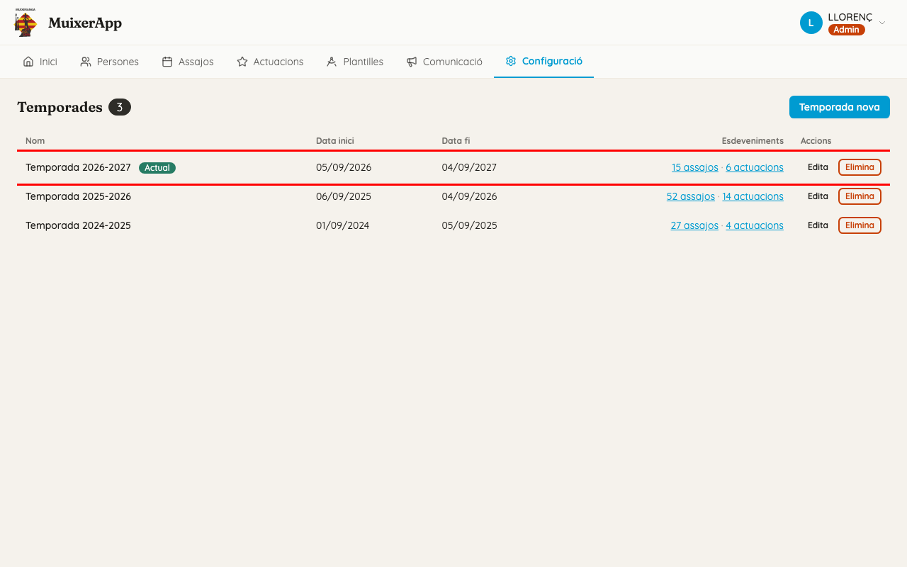
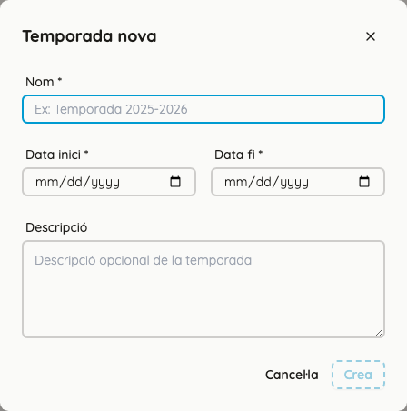

<!-- rutes: /config/seasons -->

# Temporades

## Per a què serveix

Una temporada és un període amb una data d'inici i una data de fi. Agrupa els assajos i les actuacions, i és la base de les estadístiques d'assistència que cada membre veu al seu perfil de l'app del mòbil.

## On és

«Configuració» → targeta «Temporades».

## Com cau un event dins d'una temporada

Un assaig o una actuació **no es posa** dins d'una temporada a mà: cau dins de la temporada que conté la seua data.

- Les temporades no es poden solapar. Per això cada data té, com a molt, una temporada.
- Si canvieu les dates d'una temporada, els events canvien de temporada sols.

## Pas a pas

### Llegir la llista

- Les columnes són «Nom», «Data inici», «Data fi», «Esdeveniments» i «Accions».
- La temporada d'avui porta la insígnia «Actual».
- A «Esdeveniments», «N assajos» i «N actuacions» són enllaços: obrin la llista d'[Assajos i actuacions](07-assajos-i-actuacions.md) filtrada per eixa temporada.

### Crear la temporada següent

1. Feu clic a «Temporada nova».
2. Ompliu «Nom» (per exemple, «Temporada 2026-2027»), «Data inici» i «Data fi».
3. Si voleu, ompliu «Descripció».
4. Feu clic a «Crea».

**Creeu-la abans del primer assaig de la temporada nova.** Si una data no és dins de cap temporada, no s'hi pot crear cap assaig ni cap actuació.

### Moure la frontera entre dues temporades

Com que dues temporades no es poden solapar, cal fer-ho en dos passos:

1. Escurceu la temporada que acaba. Si això deixa events fora, el formulari avisa («N esdeveniments quedaran sense temporada. Voleu continuar?») i el botó canvia a «Alça igualment». Feu-hi clic.
2. Allargueu l'altra temporada perquè torne a cobrir eixos events.

### Esborrar una temporada

1. Feu clic a «Elimina» a la fila de la temporada.
2. El modal «Eliminar temporada» diu quants events quedaran sense temporada.
3. Feu clic a «Elimina».

Els events no s'esborren: només es queden sense temporada.

## Events fora de temporada

Si hi ha events la data dels quals no és dins de cap temporada, a dalt de la pantalla apareix l'avís «Hi ha N esdeveniments que no estan dins de cap temporada.».

- Solen ser events antics que han vingut de l'app antiga: la sincronització els porta igualment. Vegeu [Dades de l'app antiga](02-dades-app-antiga.md).
- Un event fora de temporada no compta per a cap estadística de temporada. Si l'editeu, davall de la data es llig «Sense temporada».
- L'avís no diu quins són. Per a trobar-los, aneu a Assajos o Actuacions i activeu la columna «Temporada» a «Columnes visibles»: tenen «—».
- Per a arreglar-ho, creeu o allargueu una temporada que cobrisca eixes dates.

## Compte amb

- «Data fi» ha de ser posterior a «Data inici». Si no ho és, ix «La data fi ha de ser posterior a la data d'inici» i no podeu alçar.
- No hi pot haver dues temporades amb el mateix nom ni amb dates que se solapen. L'error ix a dalt del formulari.
- Si un event es queda sense temporada, el podeu editar igualment, però no podeu canviar-li la data a una altra data que tampoc no siga dins de cap temporada.

## Relacionat

- [Assajos i actuacions](07-assajos-i-actuacions.md)
- [Dades de l'app antiga](02-dades-app-antiga.md)
- [L'app dels membres (PWA)](19-pwa.md): estadístiques del perfil
