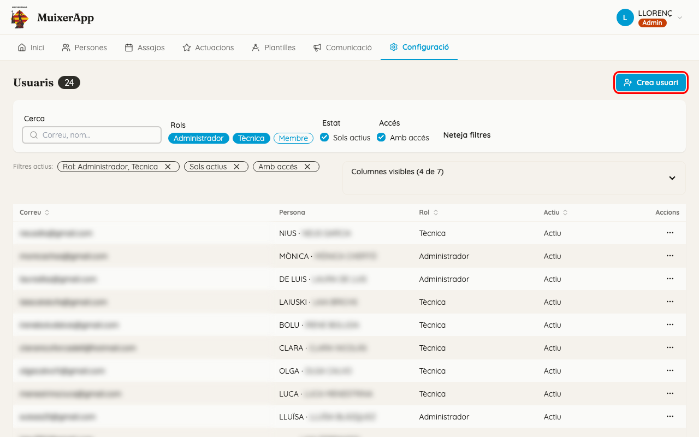
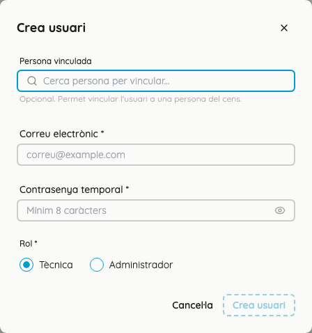
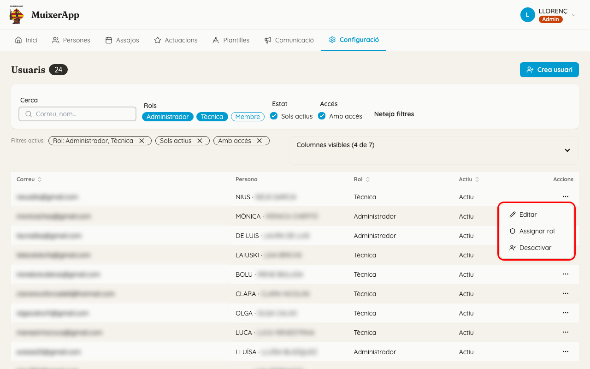
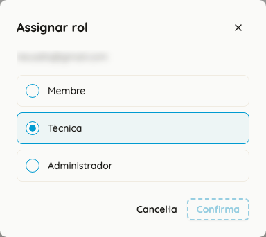

<!-- rutes: /config/users /config/legal -->

# Usuaris i accés

## Per a què serveix

Decidir qui pot entrar a MuixerApp i què hi pot fer.

## On és

«Configuració» → targeta «Usuaris». La targeta «Privacitat i legal» només la veuen els administradors.

## Persones i usuaris no són el mateix

- Una **persona** és algú de la colla. És al cens (pantalla [Persones](03-persones.md)), té assistència i se la pot col·locar a les figures. Quasi totes vénen de l'app antiga.
- Un **usuari** és un compte per a entrar a l'app, amb correu i contrasenya.
- Una persona pot no tindre usuari. Llavors no entra mai a l'app, però la podeu col·locar igual.
- Un usuari es pot vincular a una persona. És el que permet que un membre s'apunte als assajos des del mòbil.
- La xicalla no té usuari propi: ho gestiona un adult responsable. Vegeu [Persones](03-persones.md).

## Rols

| Rol | Què pot fer |
|---|---|
| «Membre» | Només l'app del mòbil: apuntar-se i veure on li toca. **No pot entrar al Dashboard.** |
| «Tècnica» | Tot el Dashboard, i a l'app del mòbil les opcions de tècnica («Passa llista», recomptes). |
| «Administrador» | El mateix que «Tècnica» i, a més: «Assignar rol», «Privacitat i legal», la sincronització amb l'app antiga i canviar comptes d'administrador. |

## Pas a pas

### Donar accés a un membre: l'enllaç d'invitació

És la manera normal. Es fa des de la fitxa de la persona, no des d'esta pantalla.

1. Aneu a Persones, obriu la persona i, a la part del compte, feu clic a «Crea enllaç d'invitació».
2. L'enllaç es copia sol. Si el navegador no ho permet, l'enllaç ix dins del missatge verd.
3. **L'app no envia cap correu.** Heu d'enviar-li l'enllaç vosaltres, per WhatsApp, per correu o com vulgueu.
4. La persona obri l'enllaç al mòbil, arriba a la pantalla «Activa el teu compte» i tria la contrasenya.
5. Fins que no l'activa, la fitxa diu «Pendent d'activar». Després diu «Compte actiu».
6. L'enllaç caduca al cap de 72 hores. Si caduca, torneu a fer clic a «Crea enllaç d'invitació»: se'n crea un de nou i l'anterior deixa de funcionar.

Trobareu el botó i les captures a [Persones](03-persones.md). Què veu el membre en entrar, a [L'app dels membres (PWA)](19-pwa.md).

### Crear un compte de tècnica

1. Feu clic a «Crea usuari».
2. Si voleu, trieu la persona a «Persona vinculada» («Cerca persona per vincular...»). Si ja té compte, ix l'avís «Esta persona ja està vinculada a un altre usuari.».
3. Ompliu «Correu electrònic» i «Contrasenya temporal» (mínim 8 caràcters).
4. Trieu el «Rol *». Una tècnica només pot triar «Tècnica»; un administrador també pot triar «Administrador».
5. Feu clic a «Crea usuari».

Passeu la contrasenya a la persona per un canal privat i digueu-li que la canvie. Al Dashboard no hi ha cap opció per a canviar-la: es fa des de l'app del mòbil (Perfil → Configuració → «Contrasenya») o amb «Heu oblidat la contrasenya?» a la pantalla d'entrada.

«Crea usuari» no serveix per a fer membres: per a un membre, feu servir l'enllaç d'invitació.

### Buscar usuaris

- «Cerca» busca per correu o nom.
- «Rols» filtra per un o més rols.
- «Sols actius» amaga els comptes desactivats.
- «Amb accés» deixa només els comptes que ja tenen contrasenya, és a dir, que ja s'han activat.
- La columna «Invitació expira» està amagada: activeu-la a «Columnes visibles».

### Canviar un usuari

Feu clic al botó «…» de la dreta de la fila («Accions»):

- «Editar»: canvia el correu o la persona vinculada. El rol no es canvia ací.
- «Assignar rol» (només administradors): trieu «Membre», «Tècnica» o «Administrador» i feu clic a «Confirma». Així es fa tècnica una persona que ja tenia compte de membre.
- «Desactivar»: després de confirmar amb «Desactiva», la persona perd l'accés **al moment**, també en les sessions que tenia obertes. «Activar» i «Activa» li'l tornen.

## Privacitat i legal (només administradors)

Si no sou administradors, no veureu esta targeta. És normal.

- Hi ha dos textos: «Política de Privacitat» i «Avís de confidencialitat».
- «Desa correcció» canvia el text sense demanar res a ningú. És per a faltes i detalls.
- «Publica versió nova (cal reacceptar)» obliga **tots els usuaris** a tornar a acceptar el text la pròxima vegada que entren.
- «Veure historial de versions» mostra les versions anteriors.

## Compte amb

- Un membre que intenta entrar al Dashboard torna a la pantalla d'entrada: no té permís.
- La xicalla no pot rebre invitació. A la seua fitxa, el botó «Crea enllaç d'invitació» està desactivat: primer cal l'adult responsable.
- No podeu canviar-vos el rol ni desactivar el vostre compte.
- Una tècnica no pot desactivar ni canviar el compte d'un administrador.
- Si el missatge de l'enllaç d'invitació s'ha perdut, no passa res: torneu a crear-lo.

## Relacionat

- [Persones](03-persones.md): enllaç d'invitació, adult responsable, delegacions
- [L'app dels membres (PWA)](19-pwa.md): activar el compte i què veu un membre
- [Primers passos](01-primers-passos.md): entrar i eixir
