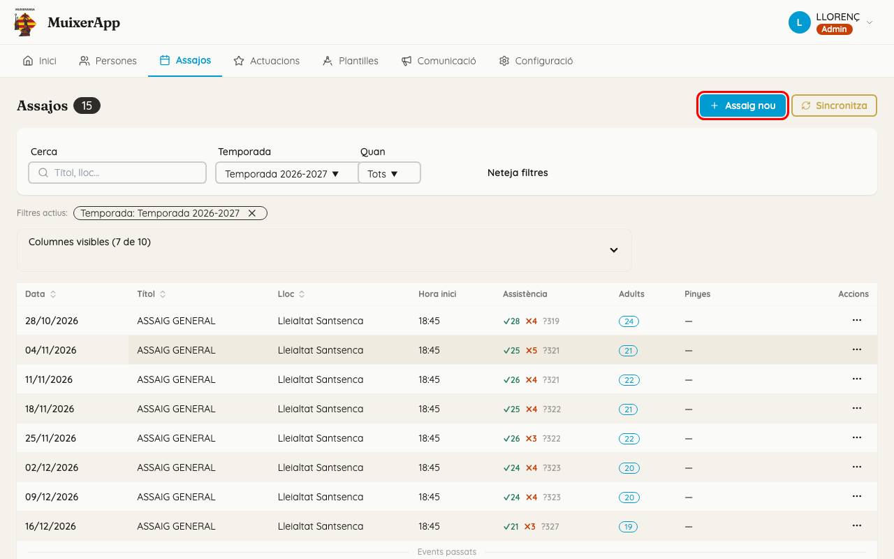
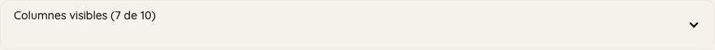
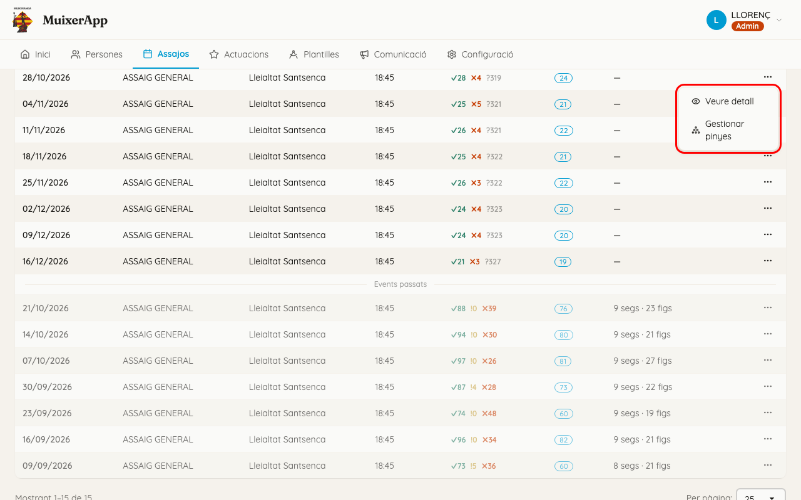
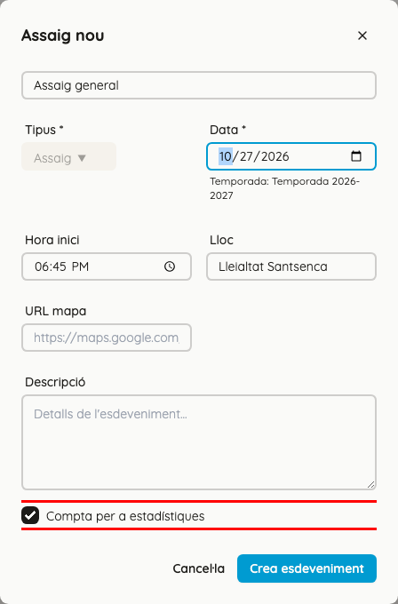
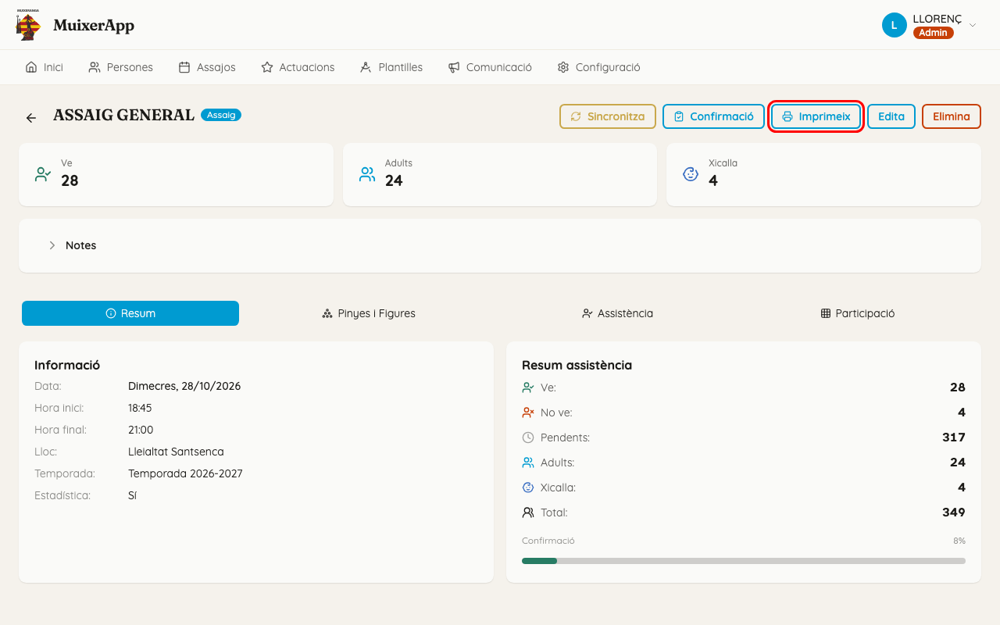
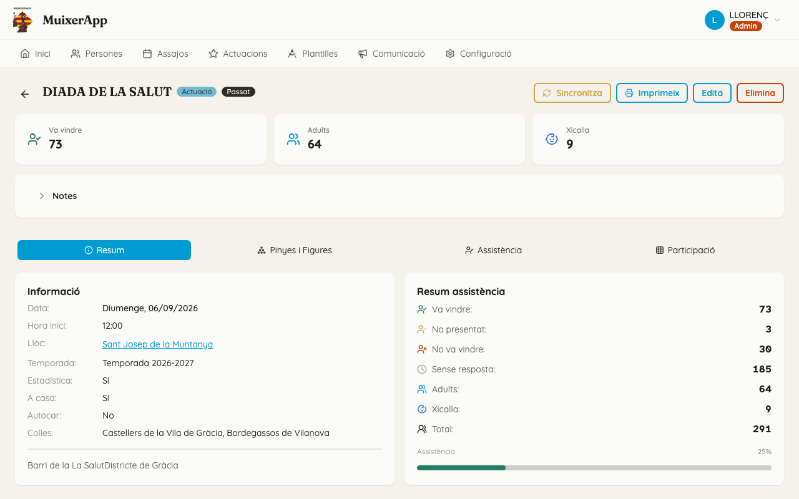
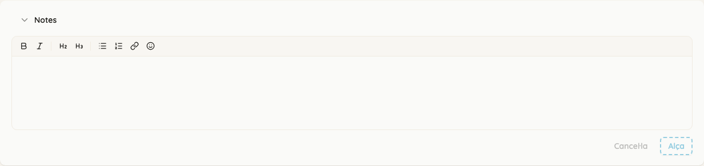
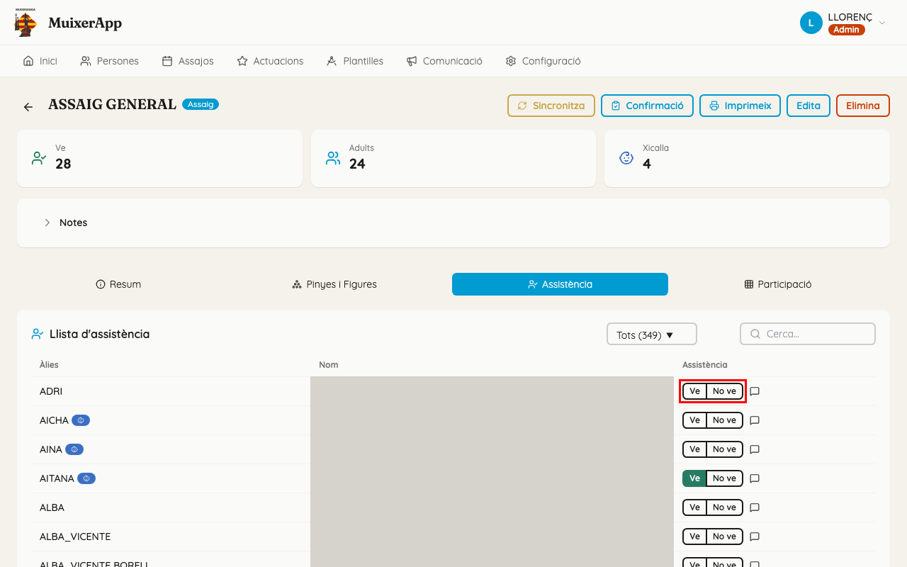
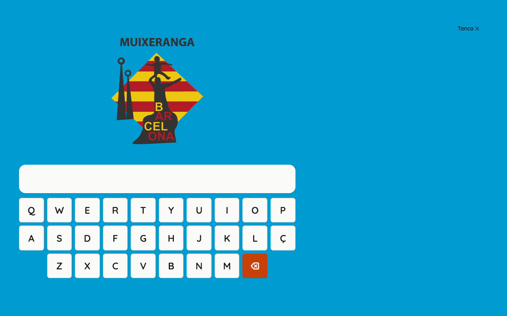

<!-- rutes: /rehearsals /performances /events/:id /events/:id/confirmation -->

# Assajos i actuacions

## Per a què serveix

Veure tots els assajos i actuacions i crear-ne de nous. Dins de cada un podeu veure qui ve, marcar qui ha arribat, apuntar notes i imprimir el resum.

## On és

Navegació principal → «Assajos» o «Actuacions». Les dues pantalles són iguals; només canvia el tipus d'event.

## D'on vénen els events

Hui per hui, la majoria d'assajos i actuacions **vénen de l'app antiga**. Un administrador els porta amb la sincronització. Vegeu [Dades de l'app antiga](02-dades-app-antiga.md).

- Un event que ve de l'app antiga es reconeix pel botó «Sincronitza» del seu detall.
- Cada vegada que es sincronitza, l'app antiga **torna a escriure** el títol, la data, l'hora, el lloc i la informació de l'event. Si els canvieu ací, el canvi es perd a la sincronització següent.
- La sincronització no toca la «Descripció», l'«URL mapa», «Compta per a estadístiques», les «Notes» ni els segments i les figures.
- La sincronització també torna a escriure l'assistència amb el que diu l'app antiga (qui ve, qui no ve, qui no ha contestat). L'única excepció és «Ha arribat»: si l'heu marcat ací, es manté.
- Un event que creeu al Dashboard **no existeix a l'app antiga**, i la sincronització no el toca mai. Qui vulga apuntar-s'hi ho ha de fer des de l'app del mòbil, o el marqueu vosaltres a la pestanya «Assistència».

**Si l'event ja és a l'app antiga (o hi serà), no el creeu al Dashboard.** Espereu que arribe amb la sincronització. Si el creeu als dos llocs, en tindreu dos de repetits.

## Pas a pas

### Trobar un event

- «Cerca» busca pel títol i pel lloc.
- «Temporada» deixa només els events d'una temporada.
- «Quan» té «Tots», «Propers» i «Passats».
- Els filtres actius apareixen com a etiquetes que podeu llevar. «Netejar filtres» ho buida tot.
- Els events que ja han passat queden davall de la ratlla «Events passats».
- Feu clic a una fila per a obrir l'event.

### Llegir les columnes

- «Assistència», abans de l'event: ✓ apuntats · ✗ no venen · ? no han contestat.
- «Assistència», quan l'event ja ha passat: ✓ han vingut · ! havien dit que venien i no han vingut · ✗ no venen.
- «Adults»: la mateixa xifra de gent que ve (o que ha vingut), sense la xicalla.
- «Pinyes»: «N segs · N figs», és a dir, quants segments i quantes figures hi ha preparats.
- «Columnes visibles (N de M)» obri la llista de columnes. Hi podeu activar «Temporada», «Estadístiques» i «Creat». El Dashboard recorda l'elecció en este navegador.

### Accions d'una fila

El botó «…» de la dreta («Accions») té «Veure detall» i «Gestionar pinyes». Ara mateix **les dues obrin el mateix**: el detall de l'event, a la pestanya «Pinyes i Figures».

### Crear un assaig o una actuació

1. Feu clic a «Assaig nou» o «Actuació nova».
2. El «Tipus» ja ve triat i no es pot canviar.
3. Un assaig nou ja ve amb el «Títol», l'«Hora inici», el «Lloc» i l'«URL mapa» de la colla (per defecte, «Assaig general» a les 18:45). Els administradors els canvien a [Configuració de la colla](21-configuracio-colla.md). Una actuació nova ve buida.
4. Trieu la «Data». Davall apareix «Temporada: ...». Si diu «Esta data no és dins de cap temporada.», no podreu crear l'event: primer cal crear la temporada. Vegeu [Temporades](05-temporades.md).
5. Si voleu, ompliu o canvieu «Hora inici», «Lloc», «URL mapa» (l'enllaç de Google Maps) i «Descripció».
6. Deixeu marcat «Compta per a estadístiques», llevat que siga un event que no ha de comptar (vegeu més avall).
7. Feu clic a «Crea esdeveniment». S'obri el detall de l'event nou.

### «Compta per a estadístiques»

- Ve marcat.
- Desmarqueu-lo en un assaig cancel·lat o especial que no ha de comptar.
- Només afecta el percentatge d'assistència que cada membre veu al seu perfil de l'app del mòbil.
- Si està desmarcat, el detall de l'event porta la insígnia «Sense estadística».

### Editar o esborrar un event

- Al detall, «Edita» obri el mateix formulari («Editar esdeveniment»). Feu els canvis i feu clic a «Alça canvis». Recordeu el que torna a escriure la sincronització en els events de l'app antiga.
- «Elimina» demana confirmació al navegador. No es pot esborrar un event que ja té assistència: ix «No es pot eliminar un event que té registres d'assistència.». Per això, en general, els events de l'app antiga no es poden esborrar.

## El detall d'un event

### Capçalera

Insígnies:

- «Assaig» o «Actuació»;
- «Passat»: ja ha passat l'hora d'inici;
- «Sense estadística»: no compta per a les estadístiques;
- «Assignacions bloquejades»: han passat els dies de bloqueig de la colla (2, si no s'ha canviat a [Configuració de la colla](21-configuracio-colla.md)), i ja no es poden canviar les figures ni qui hi va.

Botons:

- «Sincronitza»: només apareix en els events de l'app antiga, i **només el pot fer servir un administrador**. Porta l'assistència d'este event des de l'app antiga. Per a la resta, el botó està gris.
- «Confirmació»: només en assajos. Vegeu «Confirmació d'arribada», més avall.
- «Imprimeix»: fa un PDF amb la capçalera, les «Notes» i els segments numerats, amb les figures, les direccions i els pisos del tronc. S'obri en una pestanya nova. En els mòbils que no poden mostrar PDF, es descarrega. Si falla, ix «No s'ha pogut generar el PDF. Torneu a provar-ho més tard.».
- «Edita» i «Elimina»: vegeu més amunt.

### Xifres

La primera targeta diu «Ve» abans del dia de l'event, i «Ha arribat» des del dia de l'event. Les altres dues són «Adults» i «Xicalla».

### Pestanyes

L'event té quatre pestanyes: «Resum», «Pinyes i Figures», «Assistència» i «Participació». **En obrir un event, s'obri «Pinyes i Figures».**

- «Pinyes i Figures» s'explica a [Segments i figures](11-segments-i-figures.md).
- «Participació» s'explica a [Participació](17-participacio.md).

### Resum

- Targeta «Informació»: data, hores, lloc (amb enllaç si hi ha «URL mapa»), temporada i «Estadística».
- En les actuacions, a més: «A casa», «Autocar» i «Colles». Vénen de l'app antiga.
- Targeta «Resum assistència»: quanta gent hi ha de cada estat, «Adults», «Xicalla», «Total» i una barra «Confirmació» (abans de l'event) o «Assistència» (després).
- «Baixes tardanes»: qui ha dit que no venia a menys de 6 hores de l'inici. Només apareix des del dia de l'event.

## Notes

El requadre «Notes», damunt de les pestanyes, és per a la tècnica: **els membres no el veuen**.

1. Feu clic a «Notes» per a obrir-lo.
2. Escriviu. Podeu fer títols, llistes i negreta.
3. Feu clic a «Alça». «Cancel·la» desfà el que encara no heu alçat.

**Les notes ixen al PDF d'«Imprimeix».** No hi poseu res que no vulgueu imprimir.

## Assistència

A la pestanya «Assistència» hi ha la «Llista d'assistència». Dalt teniu un filtre per estat (amb quantes persones n'hi ha de cada un) i «Cerca...».

Els botons de cada fila canvien segons el dia:

| Quan | Botons de cada fila | Qui no ha contestat |
|---|---|---|
| Abans del dia de l'event | «Ve» · «No ve» | «Pendent» |
| El dia de l'event | «Ha arribat» · «No ha arribat» · «No vindrà» | «Pendent» |
| L'endemà i després | només es pot llegir: «Va vindre» · «No presentat» · «No va vindre» | «Sense resposta» |

«No ha arribat» vol dir que havia dit que venia i encara no ha arribat. «No presentat» vol dir que havia dit que venia i no va vindre.

- Un clic posa l'estat i s'alça al moment.
- Un altre clic damunt del botó que ja està marcat el torna a «Pendent».
- La bafarada de cada fila obri «Notes de ...». Hi podeu escriure, a «Notes d'assistència», el motiu d'una falta o una observació, i després feu clic a «Alça».
- «Prov.» marca una persona provisional (algú que ha vingut per primera vegada). La icona blava marca la xicalla.
- Feu clic a l'àlies per a obrir la fitxa de la persona.

## Confirmació d'arribada (assajos)

És la pantalla per a la tauleta de l'entrada de l'assaig. Ocupa tota la pantalla i té un teclat propi. Al mòbil no funciona: diu «Encara no optimitzat per a mòbil».

1. Al detall de l'assaig, feu clic a «Confirmació».
2. Cada membre escriu almenys dues lletres del seu àlies i toca la seua targeta.
3. Queda marcat com a «Ha arribat» **al moment, sense confirmació**. Dalt apareix «✓ Àlies» uns segons.
4. Qui ja ha arribat ja no ix a la llista.
5. Per a eixir, feu clic a «Tanca ✕» o premeu Esc.

Si algú toca una targeta que no és la seua, corregiu-ho a la pestanya «Assistència».

## Actuacions: arribada automàtica

Les actuacions no tenen tauleta. Per això, si la colla té marcat «Marca com a assistides les actuacions del dia» ([Configuració de la colla](21-configuracio-colla.md)), a les 3 de la matinada del dia de l'actuació l'app passa a «Ha arribat» tothom que havia dit que venia.

- El mateix dia, a la pestanya «Assistència», marqueu «No ha arribat» a qui al final no ha vingut.
- Este canvi automàtic no toca mai els assajos, ni qui no havia contestat, ni qui havia dit que no venia.

## Compte amb

- No creeu al Dashboard un event que ja és a l'app antiga: en tindreu dos.
- Canviar el títol, la data, l'hora o el lloc d'un event de l'app antiga no dura: la sincronització següent ho torna a escriure. Canvieu-ho a l'app antiga.
- Si canvieu «Ve» o «No ve» en un event de l'app antiga, la sincronització següent ho pot tornar a canviar. «Ha arribat» sí que es manté.
- Sense temporada no es pot crear cap event en eixa data.
- L'endemà de l'event, la llista d'assistència del Dashboard ja només es pot llegir. Si cal corregir-la, feu-ho des de «Passa llista» a l'app del mòbil. Vegeu [L'app dels membres (PWA)](19-pwa.md).
- Passats els dies de bloqueig (2, si no s'ha canviat) apareix «Assignacions bloquejades»: ja no es poden tocar les figures.
- «Veure detall» i «Gestionar pinyes» porten al mateix lloc.
- La «Confirmació» es pot obrir qualsevol dia i marca «Ha arribat» igualment. Feu-la servir només el dia de l'assaig.
- Si no sou administradors, el «Sincronitza» del detall està gris, i el de les llistes obri una pantalla que no podreu fer funcionar. Demaneu la sincronització a un administrador.

## Relacionat

- [Dades de l'app antiga](02-dades-app-antiga.md)
- [Temporades](05-temporades.md)
- [Segments i figures](11-segments-i-figures.md)
- [Participació](17-participacio.md)
- [L'app dels membres (PWA)](19-pwa.md): «Passa llista» i com s'apunten els membres
- [Persones](03-persones.md): fitxa de la persona i persones provisionals
