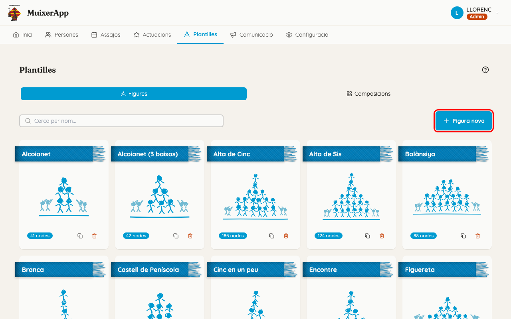
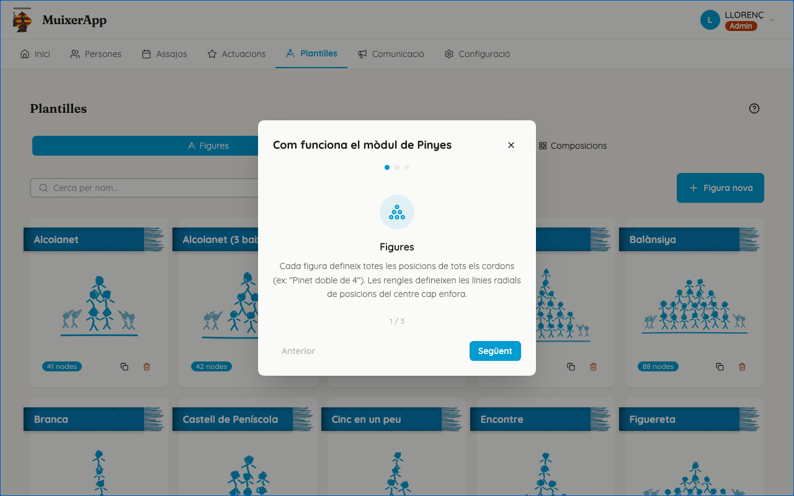
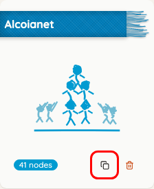
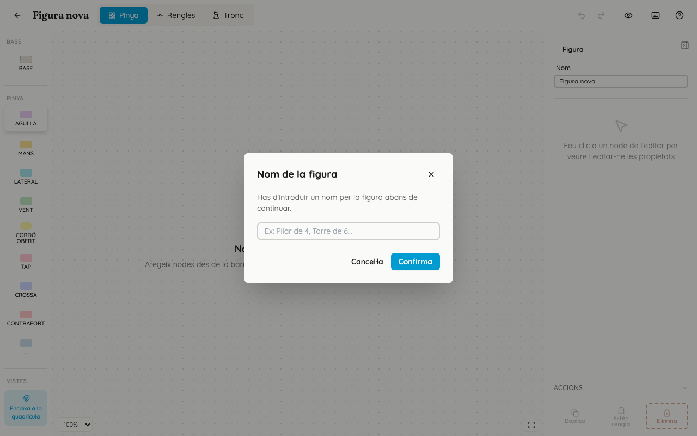
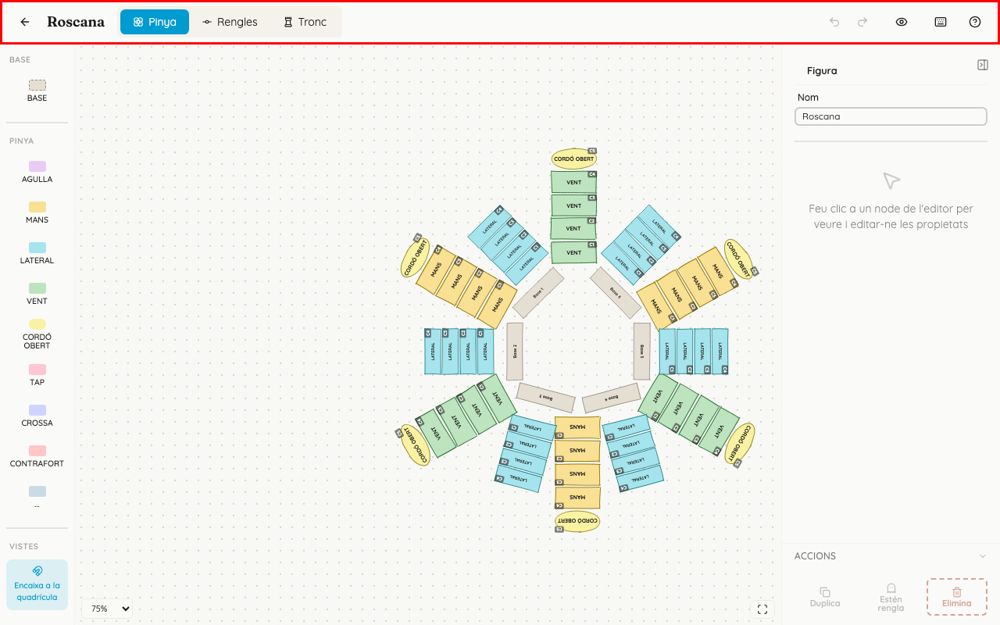
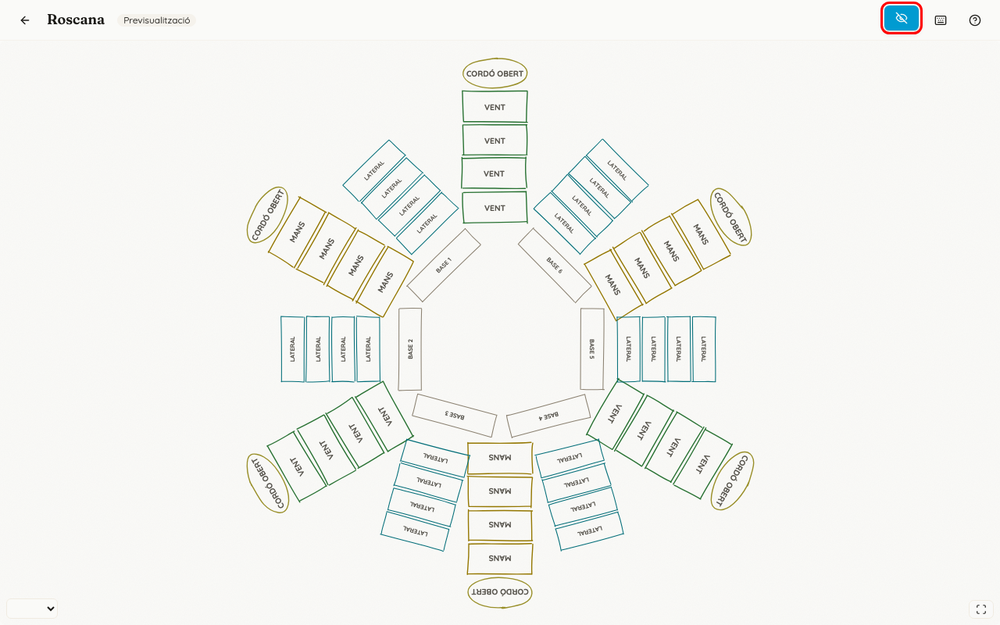
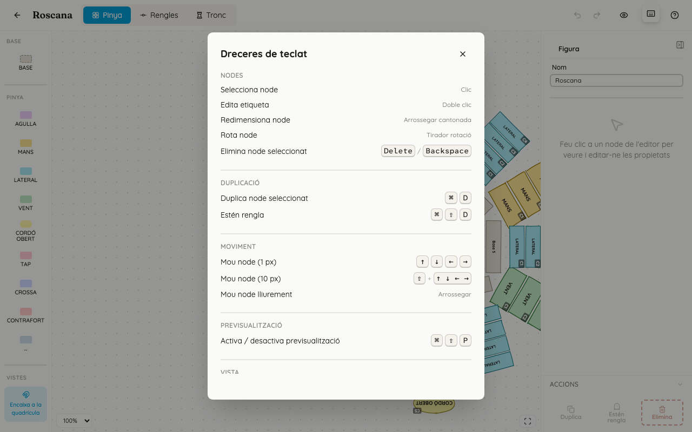
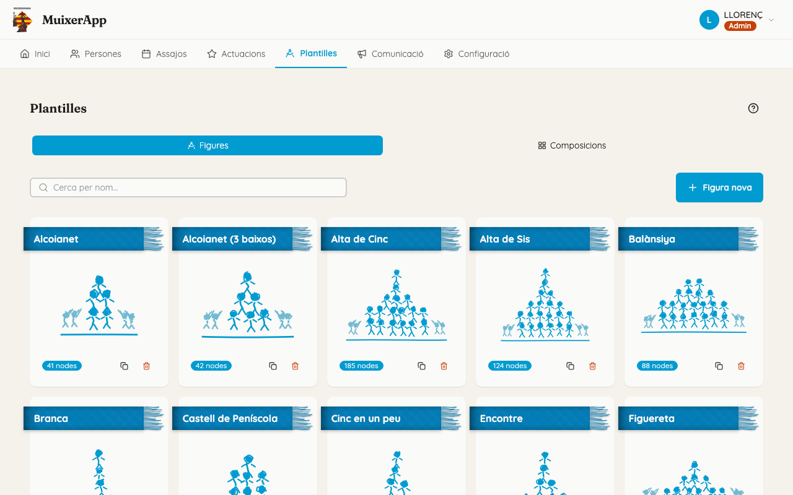
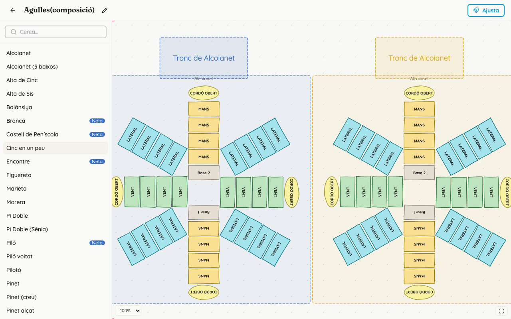

<!-- rutes: /pinyes /pinyes/templates/new /pinyes/templates/:id/edit /pinyes/compositions/new /pinyes/compositions/:id/edit -->

# Plantilles

## Per a què serveix

Una **plantilla** és el dibuix d'una figura: tots els llocs de la pinya i del tronc. Cada requadre del dibuix és un lloc on anirà una persona; l'app en diu «node».

Una **composició** és un grup de figures ja col·locades que es fan alhora, per exemple tres pilars en fila.

Les plantilles es fan una vegada. Després, a cada assaig o actuació, s'afigen als segments (vegeu [Segments i figures](11-segments-i-figures.md)).

**Una plantilla, dues mans:**

- pinyes fa la pinya, a les pestanyes «Pinya» i «Rengles» (vegeu [Plantilla: pinya i rengles](09-plantilles-pinya.md));
- troncs i xicalla fan el tronc, a la pestanya «Tronc» (vegeu [Plantilla: tronc](10-plantilles-tronc.md));
- les **bases** són de tots dos: pinyes les col·loca al dibuix de la pinya i troncs les veu com el primer pis del tronc.

## On és

Al menú principal, «Plantilles». Hi ha dues pestanyes: «Figures» i «Composicions».

## Pas a pas

### La primera vegada

La primera vegada que obriu «Plantilles» apareix el tutorial «Com funciona el mòdul de Pinyes», de tres passos: «Figures», «Rengles» i «Assignacions».

- Tanqueu-lo amb «Entesos!». Si marqueu «No tornes a mostrar», ja no eixirà més.
- Per a tornar-lo a veure, feu clic al botó «?» del costat del títol «Plantilles».

### Buscar, obrir, duplicar o eliminar una figura

1. Escriviu el nom a «Cerca per nom...».
2. Cada targeta mostra el dibuix de la figura i quants llocs té («N nodes»). Feu clic a la targeta per a obrir-la a l'editor.
3. Si hi ha més de 25 figures, a baix hi ha «Pàgina X de Y» amb fletxes.
4. Per a **duplicar** una figura, feu clic a la icona de copiar de la targeta.
   - Es crea «Nom (còpia)» i s'obri directament a l'editor.
   - Feu-ho servir per a fer una variant sense tocar l'original.
5. Per a **eliminar-la**, feu clic a la paperera i confirmeu amb «Elimina».
   - Si alguna figura d'un assaig o d'una actuació la fa servir, l'app no deixa esborrar-la i diu quantes la fan servir.

### Crear una figura nova

1. Feu clic a «Figura nova». S'obri l'editor buit, amb el missatge «No hi ha cap node de pinya».
2. Afegiu el primer lloc des de la columna «Eines» de l'esquerra.
3. L'app demana el nom de la figura («Nom de la figura»). Escriviu-lo, per exemple «Pilar de 4», i premeu «Confirma».
4. Fins que la figura no té nom, no s'alça res.

### L'editor: la barra de dalt

D'esquerra a dreta:

- la **fletxa**, per a tornar a la llista;
- el **nom** de la figura;
- les pestanyes «Pinya», «Rengles» i «Tronc»;
- l'**estat**: «S'està alçant...», «Alçat» o «S'ha produït un error en alçar»;
- «Desfer» i «Refer». Si hi passeu el ratolí per damunt, diuen què desfaran, per exemple «Desfer: Moure node»;
- l'**ull** de previsualització (Ctrl+Maj+P): mostra la figura com eixirà a la projecció, sense poder editar-la;
- el **teclat**: obri «Dreceres de teclat»;
- el **?**: obri l'ajuda de l'editor. S'obri sola la primera vegada que entreu a l'editor.

### Alçar els canvis

No cal fer res: **l'editor alça sol**. Cada canvi s'alça uns 2 segons després i dalt a la dreta apareix «Alçat». Si eixiu de l'editor abans, l'app alça el que quedava pendent.

Abans de tancar la pestanya del navegador, espereu a veure «Alçat».

### Crear o editar una composició

1. A la pestanya «Composicions», feu clic a «Composició nova» o a la targeta d'una composició.
2. A l'esquerra, a «Figures disponibles», cerqueu amb «Cerca...». Feu clic en una figura per a afegir-la al centre del dibuix. Les figures sense pinya porten la insígnia «Neta».
3. La primera figura crea la composició amb el nom d'eixa figura. Per a canviar-lo, feu clic al llapis del costat del nom.
4. Arrossegueu les figures per a col·locar-les. «Ajusta» activa l'ajust a la quadrícula.
5. Feu clic en una figura per a veure el panell «Propietats»:
   - «Nom»;
   - «Mode»: «Completa», «Peu», «Remat» o «Neta» (només si la figura té pinya);
   - «Cordons»: «Tots» o un número, amb «−» i «+»;
   - «Cordons oberts»;
   - «Posició» (X i Y) i l'angle;
   - «Elimina», per a traure la figura de la composició.

## Si sou de pinyes

- La pinya i les rengles són vostres: vegeu [Plantilla: pinya i rengles](09-plantilles-pinya.md).
- Abans de canviar una plantilla que ja es fa servir en un assaig pròxim, mireu si eixa figura ja té gent assignada. Si en té, el canvi no li arribarà (vegeu «Compte amb»).

## Si sou de troncs o xicalla

- El tronc i l'estructura del tronc són vostres: vegeu [Plantilla: tronc](10-plantilles-tronc.md).
- Les bases les compartiu amb pinyes. Si en canvieu el nombre o l'ordre, aviseu-los.

## Compte amb

- **Quan una figura d'un assaig o d'una actuació ja té algú assignat, deixa de seguir la plantilla.**
  - Quan es posa la primera persona en una figura, l'app en fa una còpia de la plantilla només per a eixa figura.
  - Des d'aquell moment, el que canvieu a la plantilla ja no hi arriba: ni llocs, ni rengles, ni l'estructura del tronc.
  - Les figures que encara no tenen ningú assignat sí que agafen els canvis, també les d'altres assajos i actuacions, i també les d'altres tècnics.
  - Perquè una figura ja assignada agafe els canvis, l'única via és «Reinicialitza» a l'espai d'assignació (vegeu [Assignació de pinyes](13-assignacio-pinyes.md)). Lleva totes les persones d'eixa figura.
  - Llevar totes les persones a mà no fa que la figura torne a seguir la plantilla.
- **No hi ha botó «Alça».** Si veieu «S'ha produït un error en alçar», no tanqueu la pestanya. Apunteu el que heu fet i aviseu.
- **Tecles:** `Supr` i `Retrocés` eliminen el lloc seleccionat; `Escape` el deixa de seleccionar. «Desfer» ho recupera mentre no eixiu de l'editor.
- **Els editors no s'obrin al mòbil.** En una pantalla estreta apareix l'avís «Aquesta funcionalitat només està disponible en dispositius d'escriptori o tauleta.» i torneu a la llista. En una tauleta sí que funcionen.
- **L'editor de composicions alça a l'instant i no té «Desfer».** Eliminar una figura d'una composició no es pot desfer. Eliminar una composició no afecta els assajos on ja l'havíeu posat.
- **En aplicar una composició a un segment, el segment pren el nom de la composició** i es perd el nom que tenia (vegeu [Segments i figures](11-segments-i-figures.md)).
- L'ajuda del botó «?» de l'editor és antiga en alguns punts: parla de «famílies» i de botons que han canviat de nom. Si no coincideix amb el que veieu, feu cas d'este manual.

## Relacionat

- [Plantilla: pinya i rengles](09-plantilles-pinya.md)
- [Plantilla: tronc](10-plantilles-tronc.md)
- [Segments i figures](11-segments-i-figures.md)
- [Assignació de pinyes](13-assignacio-pinyes.md) («Reinicialitza»)
