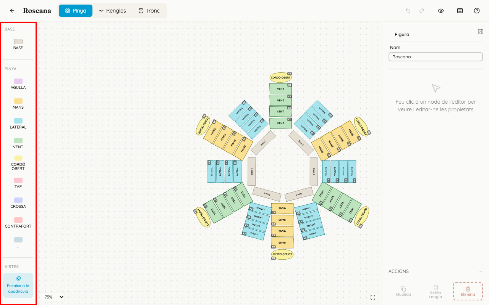
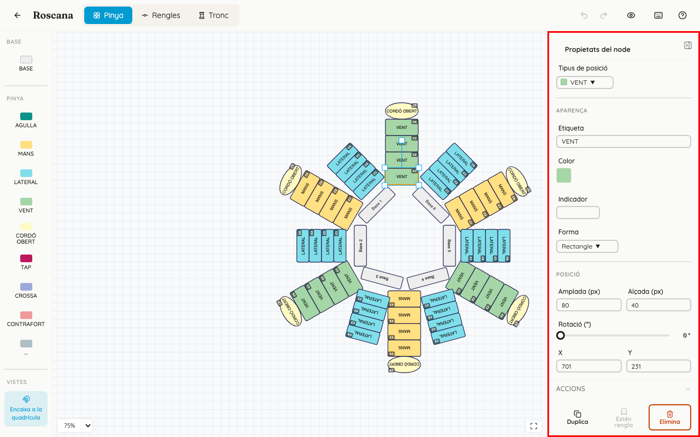
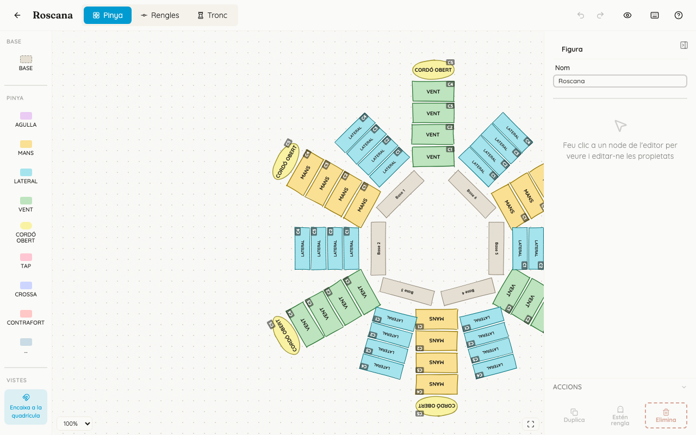
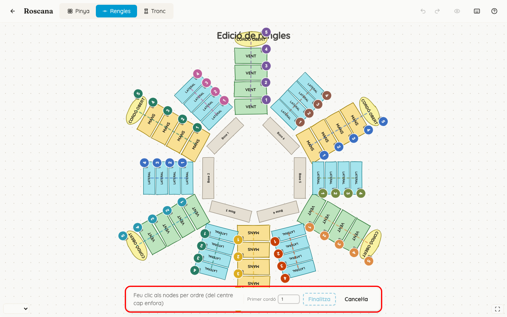

<!-- rutes: /pinyes/templates/:id/edit -->

# Plantilla: pinya i rengles

## Per a què serveix

A la pestanya «Pinya» es dibuixa la pinya vista des de dalt: on va cada persona i quin tipus de lloc és.

A la pestanya «Rengles» es diu a quin cordó pertany cada lloc. Sense rengles, en un assaig o una actuació no es pot triar quants cordons es fan.

## On és

«Plantilles» → feu clic a la targeta de la figura → pestanya «Pinya» o «Rengles».

## Pas a pas

### Afegir i col·locar llocs de pinya

1. A la columna «Eines» de l'esquerra, a l'apartat «Pinya», feu clic al tipus de lloc:
   - «AGULLA», «MANS», «LATERAL», «VENT», «CORDÓ OBERT», «TAP», «CROSSA» o «CONTRAFORT»;
   - «...», un lloc genèric amb el nom que vulgueu.
2. El lloc apareix al dibuix. Arrossegueu-lo on toque.
   - Per a moure'l amb precisió, feu servir les fletxes del teclat: 1 píxel cada vegada, o 10 amb `Maj`.
   - «Encaixa a la quadrícula», a l'apartat «Vistes», l'ajusta a la quadrícula.
3. Per a girar-lo o canviar-ne la mida, feu servir les nanses del lloc seleccionat.
4. Per a canviar-ne el nom, feu doble clic sobre el lloc.
5. Per a moure la vista, feu servir la roda del ratolí (zoom) i arrossegueu el fons del dibuix.

### Les bases

1. A l'apartat «Base», feu clic a «BASE». Cada base nova s'anomena «Base 1», «Base 2»...
2. Col·loqueu-les **en sentit antihorari, a partir de dalt a l'esquerra**:
   - Base 1: dalt a l'esquerra;
   - Base 2: baix a l'esquerra;
   - Base 3: baix a la dreta;
   - Base 4: dalt a la dreta.
3. Si no seguiu este ordre, davall de «BASE» apareix l'avís groc «Ordre incorrecte». Feu-hi clic per a obrir l'ajuda amb el dibuix de l'ordre correcte.

L'ordre importa perquè decideix quina persona del tronc va damunt de quina base.

### Canviar un lloc: «Propietats del node»

Feu clic en un lloc. Al panell de la dreta trobareu:

- «Tipus de posició»: canvia el tipus i el color del lloc;
- «Aparença»:
  - «Etiqueta»: el nom del lloc;
  - «Color»;
  - «Indicador»: una marca curta, de fins a 6 caràcters, que eixirà al costat de la persona assignada;
  - «Forma»: «El·lipse» o «Rectangle»;
- «Posició»: «Amplada (px)», «Alçada (px)», «Rotació (°)», X i Y;
- «Accions», a baix:
  - «Duplica» (⌘/Ctrl+D);
  - «Estén rengla» (⌘/Ctrl+Maj+D): crea un lloc darrere del seleccionat, a la mateixa rengla i en el cordó següent. Només funciona amb el lloc més exterior d'una rengla;
  - «Elimina».

Si no hi ha cap lloc seleccionat, el panell mostra «Figura» → «Nom», per a canviar el nom de la plantilla.

En una tauleta, en lloc de les caselles de «Posició» apareix el bloc «Moure», amb fletxes.

### Fer les rengles

Una rengla és la línia de llocs que va del centre de la pinya cap enfora. Cada lloc d'una rengla és d'un cordó diferent: el més pròxim al centre és el cordó 1, el següent el 2, i així.

1. Obriu la pestanya «Rengles». El dibuix queda bloquejat i dalt hi diu «Edició de rengles».
2. Feu clic a «Rengla nova». Apareix la indicació «Feu clic als nodes per ordre (del centre cap enfora)».
3. Feu clic als llocs **en ordre, del centre cap enfora**. Cada clic hi posa el número del cordó.
   - Un segon clic sobre el mateix lloc el lleva.
   - `Ctrl`/`⌘`+`Z` lleva l'últim que heu triat.
4. «Primer cordó» és el número del primer lloc on heu fet clic. Canvieu-lo si la rengla comença més enfora, per exemple en el cordó 2.
5. Feu clic a «Finalitza» (o premeu `Intro`). La rengla es crea amb el nom «Rengla 1», «Rengla 2»... «Cancel·la» (o `Escape`) la descarta.
6. Per a canviar una rengla feta, feu-hi clic. Podeu:
   - canviar-ne el «Primer cordó»;
   - fer «Suprimeix», que esborra la rengla però no els llocs.

L'agulla, la crossa i el contrafort no van en cap rengla: són al centre i en este mode no s'hi pot fer clic.

## Si sou de pinyes

- **Per què importen les rengles.** En preparar un assaig (vegeu [Segments i figures](11-segments-i-figures.md)), cada figura té un comptador de cordons («Tots», «2/4»...). Quan feu menys cordons, s'amaguen els llocs dels cordons més exteriors i la insígnia «x/y pinyes» compta només els que queden.
  - Si la plantilla no té rengles, la figura mostra «Sense rengles» i no podeu triar els cordons.
  - Els llocs que no són de cap rengla sempre es mostren.
- Els llocs «CORDÓ OBERT» no depenen del nombre de cordons. Es mostren o s'amaguen amb el botó «Cordons oberts» de cada figura.

## Si sou de troncs o xicalla

Ací no heu de tocar res, excepte les bases. Si en necessiteu una més, afegiu-la des de la pestanya «Tronc» (vegeu [Plantilla: tronc](10-plantilles-tronc.md)) i aviseu pinyes perquè la col·loque al dibuix.

## Compte amb

- `Supr` i `Retrocés` eliminen el lloc seleccionat. A la pestanya «Rengles», eliminen la **rengla** seleccionada. «Desfer» ho recupera.
- Quan passeu el ratolí per damunt d'un lloc, darrere apareix un «+» transparent. Un clic en eixe «+» crea un lloc nou. Si ho feu sense voler, feu «Desfer».
- Si una figura d'un assaig ja té gent assignada, els canvis de llocs o de rengles no hi arriben (vegeu [Plantilles](08-plantilles.md)). Feu les rengles **abans** de començar a assignar.
- Si canvieu l'ordre de les bases, el tronc canvia de lloc respecte a la pinya. Parleu-ho amb troncs.

## Relacionat

- [Plantilles](08-plantilles.md)
- [Plantilla: tronc](10-plantilles-tronc.md)
- [Segments i figures](11-segments-i-figures.md) (cordons)
- [Assignació de pinyes](13-assignacio-pinyes.md)
