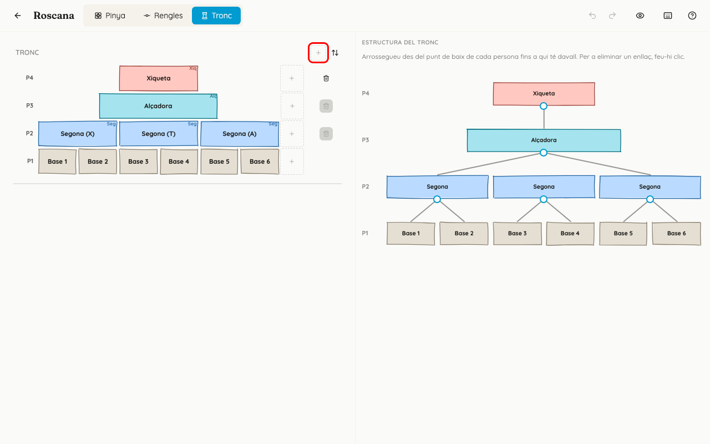
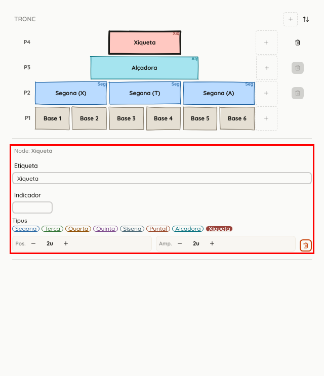
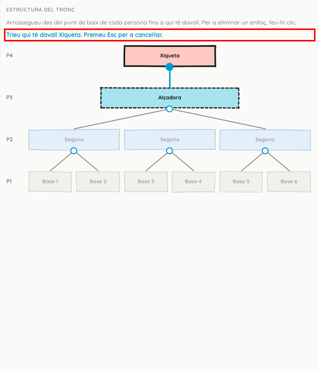

<!-- rutes: /pinyes/templates/:id/edit -->

# Plantilla: tronc

## Per a què serveix

A la pestanya «Tronc» es dibuixa el tronc pis per pis, vist de costat. També es diu qui va damunt de qui. Amb això, quan assigneu persones, l'app calcula les alçades i avisa si un pis queda desnivellat.

## On és

«Plantilles» → feu clic a la targeta de la figura → pestanya «Tronc».

La pestanya ocupa tota la pantalla. A l'esquerra hi ha el tronc i a la dreta, «Estructura del tronc».

## Pas a pas

### Bases i pisos

1. Si la figura encara no té bases, apareix el text «Afegiu bases per poder configurar el tronc.» i el botó «Afegeix base».
   - La fila P1 és la de les «Bases». El «+» del final d'eixa fila n'afig una altra.
2. Per a afegir un pis, feu clic al «+» de la capçalera «Tronc» («Afegeix pis»). Cada pis nou va damunt de l'últim i porta un tipus per defecte:
   - P2: Segona;
   - P3: Terça;
   - P4: Quarta;
   - P5: Quinta;
   - P6: Xiqueta.

   Com a màxim hi ha 5 pisos damunt de les bases.
3. El «+» del final de cada pis afig un lloc nou en eixe pis, del mateix tipus que l'últim.
4. La paperera del costat d'un pis («Eliminar pis») només funciona amb el pis de dalt de tot. Als altres diu «Elimina primer els pisos superiors».
5. La fletxa de la capçalera («Invertir orientació (P1 dalt / P1 baix)») només gira la vista. No canvia la plantilla.

### Canviar un lloc del tronc

Feu clic en un lloc. Davall del tronc apareix «Node:» amb el nom del lloc i estos camps:

- «Etiqueta»: el nom del lloc;
- «Indicador»: una marca curta, de fins a 6 caràcters, que eixirà al costat de la persona assignada;
- «Tipus»: «Segona», «Terça», «Quarta», «Quinta», «Sisena», «Puntal», «Alçadora» o «Xiqueta»;
- «Pos.» i «Amp.», amb «−» i «+»: on comença el lloc i quant ocupa, en passos de mitja persona (1u és l'amplada d'una persona);
- la paperera «Elimina node». En una base, és «Elimina base».

### «Estructura del tronc»: qui va damunt de qui

1. A la dreta es veuen els mateixos pisos. Davall de cada persona, excepte a les bases, hi ha un punt.
2. **Arrossegueu des del punt fins a la persona que té davall.** Ha de ser al pis just de davall.
   - També podeu fer clic al punt i després clic a una o més persones de davall. Mentrestant, dalt hi diu «Trieu qui té davall …. Premeu Esc per a cancel·lar.»
3. Una persona pot anar damunt de més d'una, i una persona pot portar-ne més d'una damunt.
4. Per a esborrar un enllaç, feu clic sobre la línia.
5. Si un pis és buit, els punts del pis de damunt es desactiven i apareix un avís, per exemple:
   - «No hi ha bases: afegiu-ne per a indicar damunt de qui va el P2.»
   - «El P3 està buit: afegiu-hi nodes per a indicar damunt de qui va el P4.»

## Si sou de troncs o xicalla

- **Per què val la pena fer l'estructura.** Quan assigneu persones a la pestanya Troncs (vegeu [Assignació de troncs](12-assignacio-troncs.md)), l'app suma les alçades de qui va davall:
  - cada pis mostra la diferència d'alçada entre les persones del pis: groga a partir de 5 cm i roja a partir de 10 cm;
  - una balança avisa quan algú va damunt de persones que no queden a la mateixa alçada: groga a partir de 3 cm i roja a partir de 5 cm.
- Sense enllaços, l'app no pot calcular res i mostra «—».
- L'alçada que es fa servir és l'«Alçada espatlles (cm)» de la fitxa de cada persona (vegeu [Persones](03-persones.md)). Si a algú li falta, apareix «?? cm».
- **Les direccions** (direcció de tronc, de xicalla i de pinya) no es posen a la plantilla. S'afigen a cada figura des de la pestanya Troncs de l'assignació (vegeu [Assignació de troncs](12-assignacio-troncs.md)).

## Si sou de pinyes

Les bases que s'afigen ací també apareixen al dibuix de la pinya. Col·loqueu-les a la pestanya «Pinya» seguint l'ordre antihorari (vegeu [Plantilla: pinya i rengles](09-plantilles-pinya.md)).

## Compte amb

- **L'estructura també es copia** quan una figura d'un assaig rep la primera persona. Si la feu després, eixa figura continuarà sense alçades. Feu l'estructura **abans** d'assignar, o feu «Reinicialitza» a l'assignació (vegeu [Assignació de pinyes](13-assignacio-pinyes.md)), que en lleva totes les persones.
- Si elimineu un pis o un lloc, també s'esborren els enllaços que hi anaven.
- Les bases són el P1 i segueixen l'ordre de la pinya: antihorari des de dalt a l'esquerra. Si el tronc no quadra amb les bases, mireu si hi ha l'avís «Ordre incorrecte», que també apareix en esta pestanya.
- «Desfer» i «Refer» també desfan i refan els enllaços de l'estructura.

## Relacionat

- [Plantilles](08-plantilles.md)
- [Plantilla: pinya i rengles](09-plantilles-pinya.md) (bases)
- [Assignació de troncs](12-assignacio-troncs.md) (alçades i direccions)
- [Persones](03-persones.md) («Alçada espatlles (cm)»)
