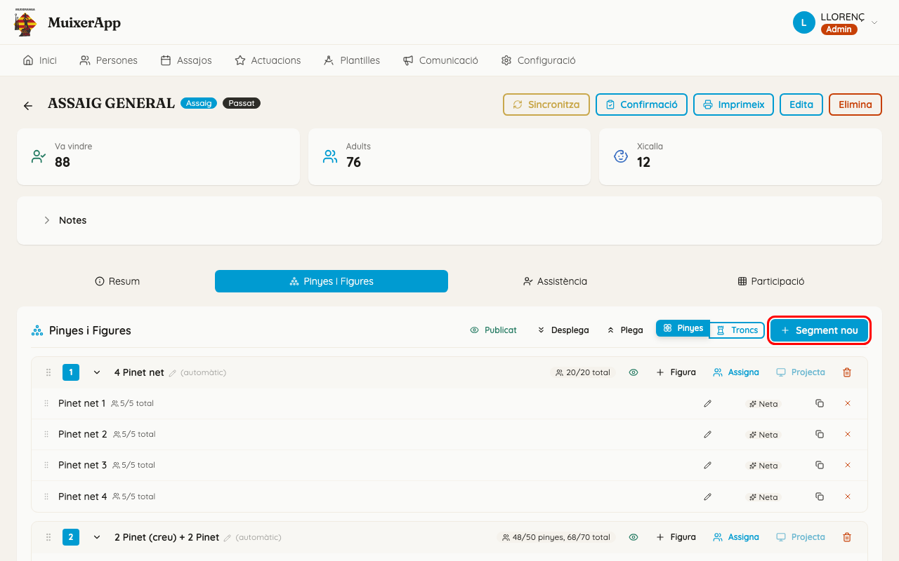
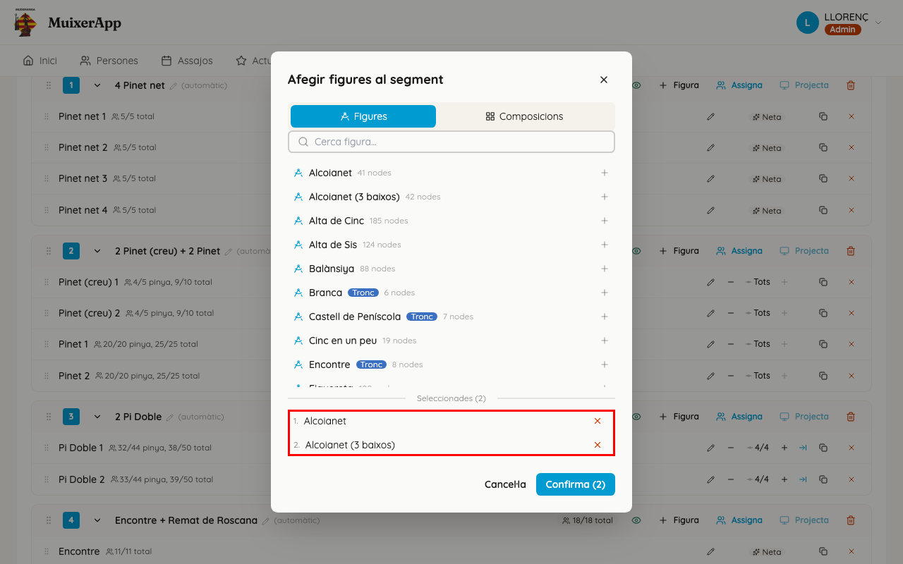
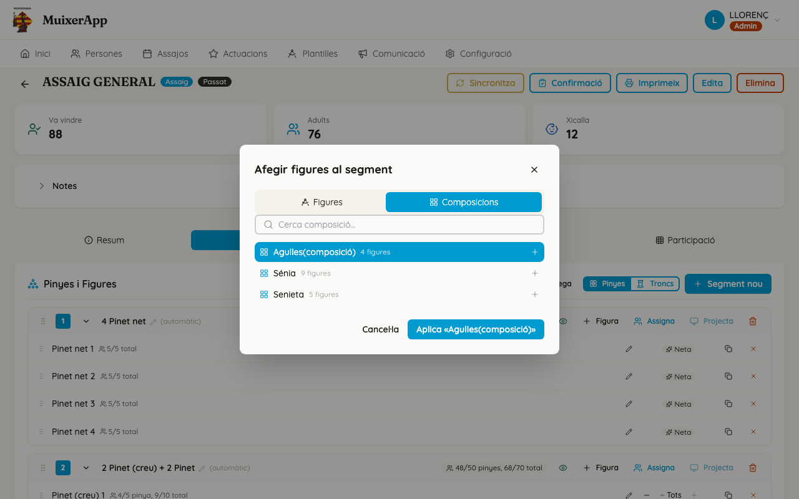
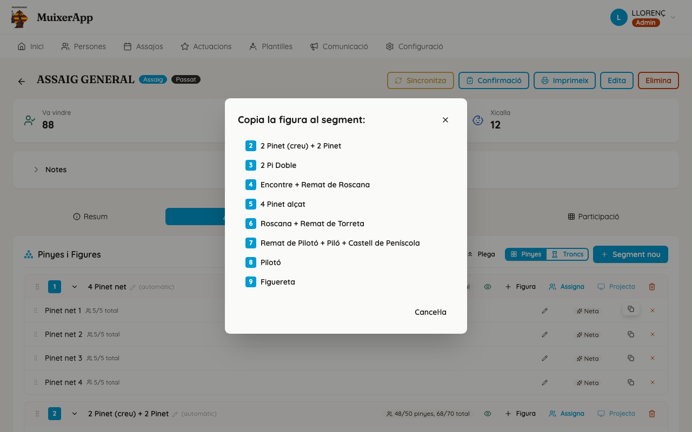
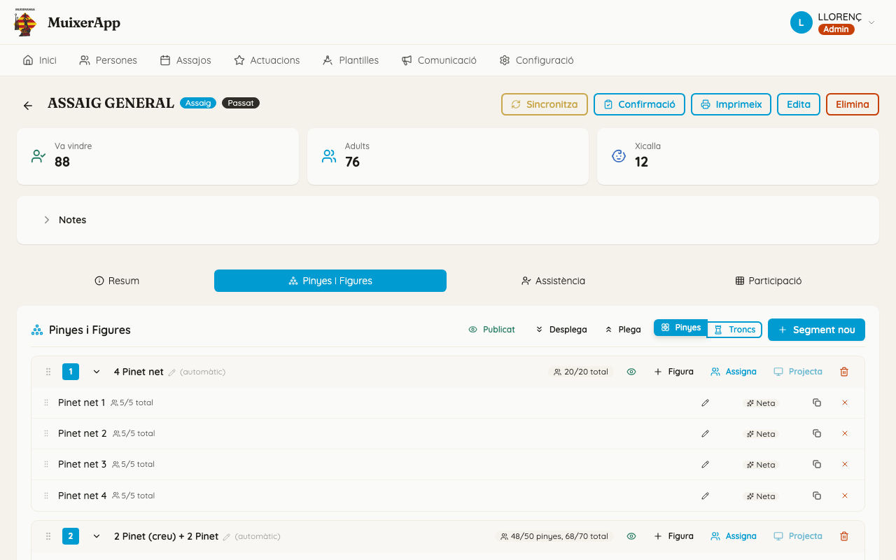
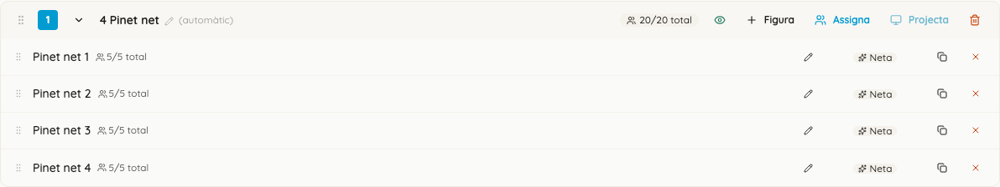
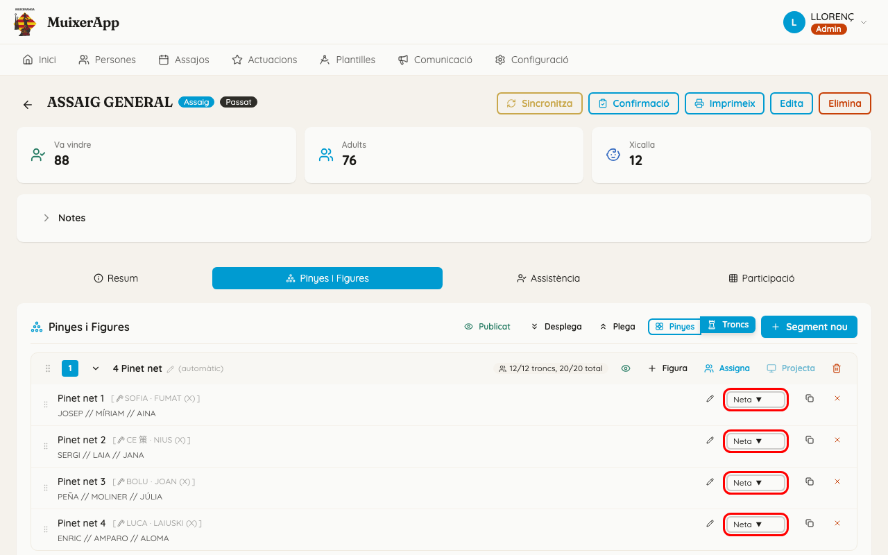
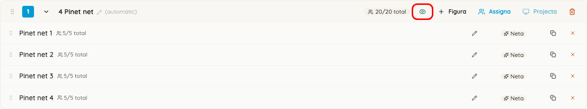
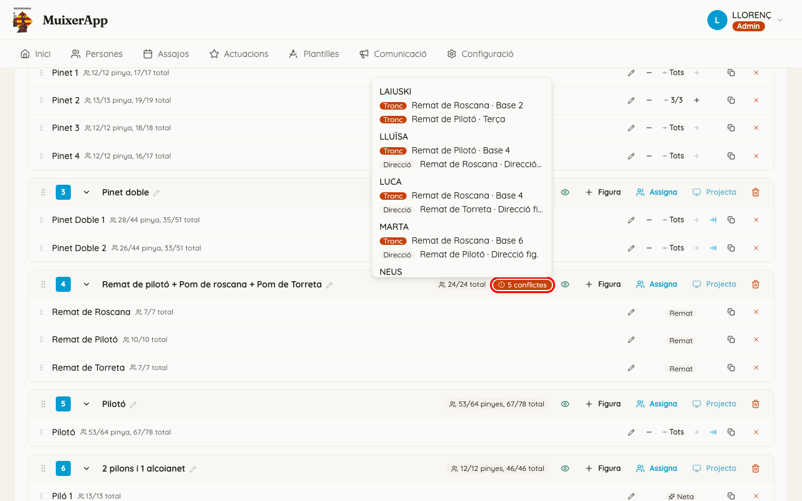
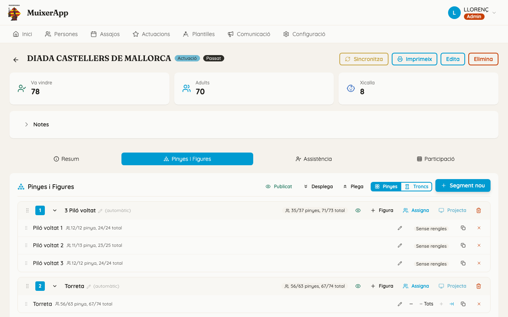

<!-- rutes: /events/:id?tab=pinyes -->

# Segments i figures

## Per a què serveix

És l'esquelet de l'assaig o de l'actuació: quins **segments** hi haurà (proves, rondes o moments de l'actuació) i quines **figures** es fan en cada un.

Les figures d'un mateix segment es fan alhora. Per això, en cada segment una persona només pot estar en un lloc.

Des d'ací també es mira si hi ha prou gent, es trien els cordons i es decideix què veuen els membres a l'app del mòbil.

## On és

«Assajos» o «Actuacions» → feu clic en l'assaig o l'actuació. Tant «Veure detall» com «Gestionar pinyes» porten ací.

El detall s'obri directament a la pestanya «Pinyes i Figures».

## Pas a pas

### Crear els segments

1. Feu clic a «Segment nou». S'afig un segment buit al final, sense demanar res.
2. Mentre no té nom, el segment es diu com les figures que porta, amb «(automàtic)» al costat:
   - «Segment sense nom», si encara no té cap figura;
   - «Pilar de 4 + Torre», per exemple, quan en té;
   - «2 Pilar», si hi ha dues figures iguals.
3. Per a posar-li nom, feu clic al nom. Escriviu-lo a «Nom del segment (opcional)» i premeu «Alça» o `Intro`.
   - `Escape` o «Cancel·la» ho deixen com estava.
   - Si l'esborreu i alceu, el segment torna al nom automàtic.
4. Per a canviar l'ordre, arrossegueu la nansa (els sis punts) de l'esquerra. El número del quadre és la posició del segment.
5. «Desplega» i «Plega» obrin o tanquen tots els segments. La fletxa de cada segment obri o tanca només eixe.
6. Per a eliminar un segment, feu clic a la paperera de la dreta. El navegador demana confirmació. S'esborra amb totes les figures i les persones assignades, i no es pot desfer.

### Afegir figures a un segment

1. Feu clic a «+ Figura» al segment. S'obri «Afegir figures al segment».
2. A la pestanya «Figures»:
   - cerqueu amb «Cerca figura...» i feu clic en una o més figures. Podeu repetir la mateixa;
   - van a «Seleccionades», en l'ordre en què les heu triades. La «×» en lleva una;
   - premeu «Confirma (N)» per a afegir-les.

   Les figures que no tenen pinya porten la insígnia «Tronc».
3. A la pestanya «Composicions», trieu-ne una i premeu «Aplica «nom»».
   - S'afigen totes les figures de la composició, ja col·locades i amb el mode i els cordons que s'hi van triar.
   - El segment pren el nom de la composició.
4. Si al segment hi ha dues figures que es diuen igual, l'app les numera: «Pilar 1», «Pilar 2».
5. Per a posar un nom propi a una figura, feu clic al llapis de la figura («Nom personalitzat (opcional)»).

### Ordenar, moure i copiar figures

- **Ordenar dins del segment:** arrossegueu la nansa de la figura.
- **Moure a un altre segment:** arrossegueu la figura fins a l'altre segment. Se'n va amb les persones assignades.
  - Si alguna persona ja estava en eixe segment, queda en dos llocs alhora. L'app avisa: «N persones han quedat en conflicte en este segment. Resoleu-ho des de l'assignació.» (vegeu [Conflictes](14-conflictes.md)).
- **Copiar a un altre segment:** feu clic a la icona de copiar de la figura. S'obri «Copia la figura al segment:». Trieu el segment i apareix «Figura copiada al segment.».
- **Traure una figura:** feu clic a la «×» de la figura. S'obri «Eliminar figura del segment».
  - Si té gent assignada, avisa: «N assignacions es perdran.».
  - Confirmeu amb «Elimina». No es pot desfer.

### Hi ha prou gent? Llegir els comptadors

L'app no té cap comptador que diga «falten N persones». Ho podeu calcular amb dues dades.

1. **El que necessiteu.** Mireu la insígnia de cada segment, amb la vista «Pinyes» activada. Diu, per exemple, «23/35 pinyes, 29/45 total».
   - El número de la dreta de cada parell (35, 45) són els **llocs** que té el segment:
     - «pinyes»: els llocs de pinya, només dels cordons que es fan;
     - «total»: pinya, tronc, bases i direccions.
   - El número de l'esquerra (23, 29) són els llocs que ja tenen algú.
   - Amb la vista «Troncs», la mateixa insígnia diu, per exemple, «4/10 troncs, 29/45 total».
   - Cada figura també té el seu: «12/20 pinya (2 cor.), 15/24 total».
2. **El que teniu.** Dalt de tot, la primera targeta diu quanta gent ve:
   - «Ve», abans del dia de l'assaig;
   - «Ha arribat», el mateix dia.

   Al costat hi ha «Adults» i «Xicalla». A la pestanya «Resum» també hi ha els «Pendents», que encara no han contestat.
3. **Compareu-ho.** En un segment, cada persona fa un sol lloc:
   - si el «total» del segment és més gran que la gent que ve, no hi ha prou gent per a fer-lo tal com està;
   - per a la pinya, compteu els adults que no aniran al tronc.

   Mireu cada segment per separat: en el segment següent, la mateixa gent torna a estar disponible.
4. **Si no n'hi ha prou,** reduïu els cordons, desactiveu els cordons oberts, canvieu el mode de la figura o traieu-ne una. La insígnia es recalcula de seguida.
5. A l'hora d'assignar, el panell de persones mostra «N lliures · N elegibles per a pinya» (vegeu [Assignació de pinyes](13-assignacio-pinyes.md)).

### Cordons i cordons oberts

Amb la vista «Pinyes» activada, a la dreta de cada figura hi ha «−» i «+» amb «Tots» o, per exemple, «2/4»: quants cordons de pinya es fan dels que té la plantilla.

- «+» des de l'últim cordó torna a «Tots».
- Només funciona si la plantilla té rengles (vegeu [Plantilla: pinya i rengles](09-plantilles-pinya.md)). Si no en té, la figura diu «Sense rengles».
- El botó del costat activa o desactiva els llocs «CORDÓ OBERT». Si hi passeu el ratolí per damunt, diu «Cordons oberts: activats» o «Cordons oberts: desactivats».
- Si el canvi deixa fora persones ja assignades, l'app ho pregunta abans: «Canvia els cordons» o «Desactiva els cordons oberts», amb el missatge «Esta acció eliminarà N assignacions… Les persones assignades quedaran lliures.». Confirmeu amb «Elimina-les». Si no hi ha ningú afectat, el canvi es fa directament.
- Si la figura no té pinya, o està en mode Remat o Neta, no hi ha comptador: es veu la insígnia «Neta» o «Remat».

### Mode de la figura: Completa, Peu, Remat, Neta

El mode **només es canvia amb la vista «Troncs»**: és el selector de la dreta de cada figura.

- «Completa»: tota la figura.
- «Peu»: el nom passa a ser «Peu de …». Es fa la part de baix; al resum del tronc no ixen els pisos de dalt que no tenen ningú.
- «Remat»: el nom passa a ser «Remat de …». Sense pinya i sense bases.
- «Neta»: el nom acaba en «neta» o «net». Sense pinya.

Passar a «Remat» o a «Neta» lleva la gent de la pinya; en el cas de «Remat», també la de les bases. Si hi havia algú, l'app ho pregunta abans («Canviar a Remat» o «Canviar a Figura neta») i no es pot desfer. «Completa» i «Peu» s'apliquen sense preguntar.

Amb la vista «Troncs», davall de cada figura es veu:

- el resum del tronc per pisos, de baix a dalt, amb «?» als llocs buits. Si encara no hi ha ningú, diu «Sense assignacions al tronc» o «Sense assignacions»;
- les direccions, entre claudàtors.

Amb la vista «Pinyes» només es veu la direcció de pinya.

### Publicar als membres

L'ull de cada segment diu si els membres el veuen:

- verd: «Visible als membres — cliqueu per ocultar»;
- gris: «Ocult als membres — cliqueu per publicar».

Un membre només veu a l'app del mòbil els segments publicats: el segment, on va ell i la projecció (vegeu [L'app dels membres](19-pwa.md)). Els segments ocults no els veu.

El botó «Publicat» / «No publicat» de dalt actua sobre tots alhora:

- si no n'hi ha cap de publicat, els publica tots;
- si n'hi ha **algun** de publicat, els oculta tots.

És recomanable que publiqueu un segment quan l'assignació estiga acabada i revisada.

### Anar a assignar o a projectar

- «Assigna» obri l'espai de treball del segment per a posar-hi persones.
  - Amb la vista «Troncs», s'obri directament la pestanya Troncs (vegeu [Assignació de troncs](12-assignacio-troncs.md)).
  - Amb la vista «Pinyes», s'obri la pestanya Pinyes (vegeu [Assignació de pinyes](13-assignacio-pinyes.md)).
  - Si feu clic al nom d'una figura, s'obri l'espai de treball amb eixa figura triada.
- «Projecta» obri la projecció a pantalla completa (vegeu [Previsualitza i projecció](16-previsualitza-i-projeccio.md)).

La vista «Pinyes» o «Troncs» queda recordada en eixe navegador fins que la canvieu.

## Si sou de pinyes

- Compareu les insígnies «x/y pinyes» de cada segment amb els «Adults» que vénen.
- Ajusteu els cordons i els cordons oberts **abans** que es comence a assignar: si els reduïu després, en lleveu gent.
- La direcció de pinya de cada figura es veu entre claudàtors amb la vista «Pinyes».

## Si sou de troncs o xicalla

- Treballeu amb la vista «Troncs»: s'hi veu el resum de cada tronc i les direccions, i s'hi tria el mode de la figura.
- «Assigna» des d'esta vista obri l'assignació directament a la pestanya Troncs.
- Assigneu primer vosaltres. Després, pinyes omplirà la pinya amb la gent que quede.

## Compte amb

- **Aplicar una composició canvia el nom del segment** pel de la composició, encara que ja n'hi hàgeu posat un.
- **Les insígnies compten llocs, no persones.** Si algú està en dos llocs del mateix segment, compta dues vegades. La insígnia roja «N conflictes» del segment avisa d'això. Si hi passeu el ratolí per damunt, diu qui està en dos llocs i on, i acaba amb «Resoleu-los des de l'assignació.» (vegeu [Conflictes](14-conflictes.md)).

  

- **El botó «Publicat» de dalt ho oculta tot** si hi ha algun segment publicat. Per a publicar-ne només un, feu servir l'ull d'eixe segment.
- **Assajos i actuacions bloquejats.** Dos dies després de la data apareix la insígnia «Assignacions bloquejades».
  - Ja no es poden afegir, eliminar, moure ni canviar de nom segments ni figures, ni canviar els cordons o el mode.
  - Encara podeu publicar o ocultar segments, obrir «Assigna» (amb un cadenat) i «Projecta».

  

- **Al mòbil** s'amaguen «Segment nou», «+ Figura», la paperera, les insígnies, els cordons, el selector de mode i els botons de copiar i traure figures. Munteu l'esquelet des de l'ordinador o la tauleta.
- Si un segment té hora o notes, es veuen davall del nom, però des d'esta pantalla no es poden posar ni canviar.
- Canviar una plantilla no canvia les figures d'este assaig que ja tenen gent assignada (vegeu [Plantilles](08-plantilles.md)).

## Relacionat

- [Assajos i actuacions](07-assajos-i-actuacions.md) (crear l'assaig i les xifres d'assistència)
- [Plantilles](08-plantilles.md)
- [Plantilla: pinya i rengles](09-plantilles-pinya.md) (rengles i cordons)
- [Assignació de troncs](12-assignacio-troncs.md)
- [Assignació de pinyes](13-assignacio-pinyes.md)
- [Conflictes](14-conflictes.md)
- [Previsualitza i projecció](16-previsualitza-i-projeccio.md)
- [L'app dels membres](19-pwa.md)
