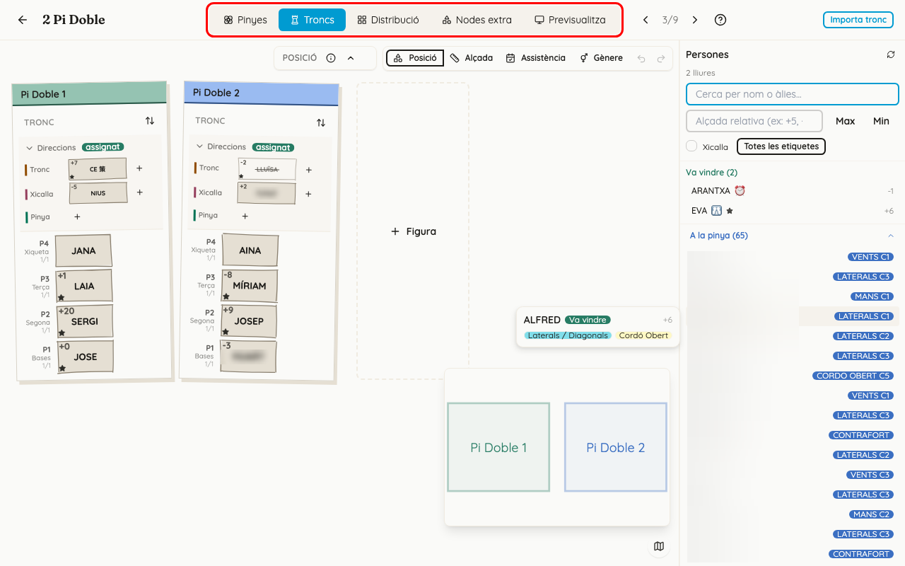
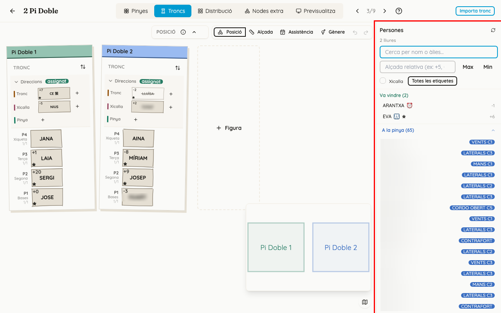
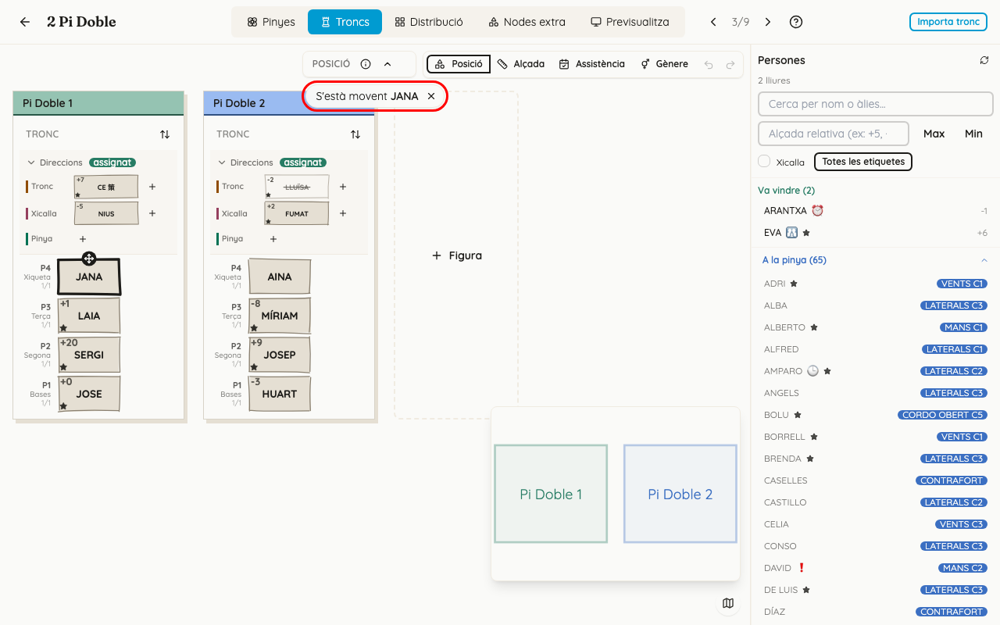
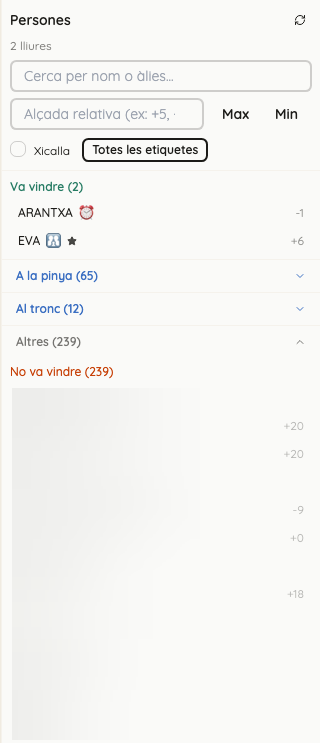
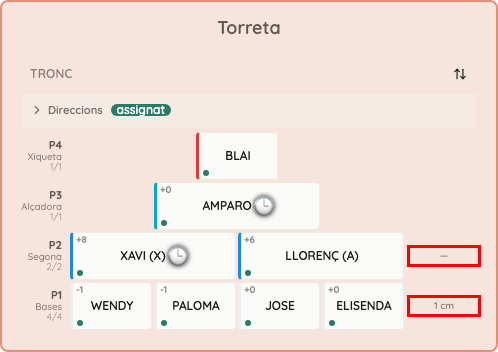
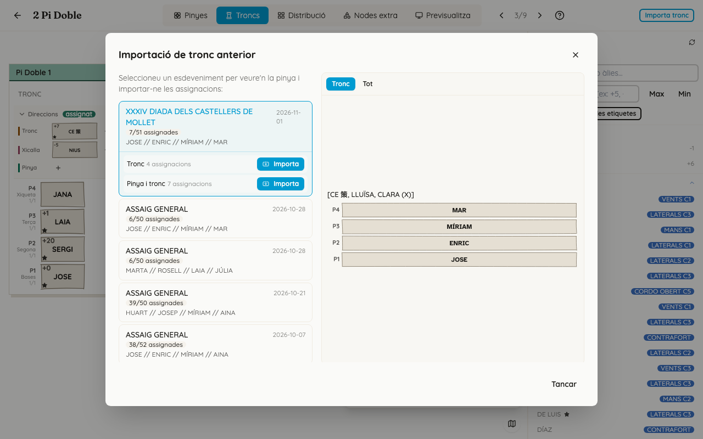

<!-- rutes: /pinyes/events/:eventId/segments/:segmentId/assign /pinyes/events/:eventId/segments/:segmentId/assign/:instanceId -->

# Assignació de troncs

## Per a què serveix

L'espai de treball del segment és la pantalla on es posa cada persona al seu lloc de la figura. Té cinc pestanyes. Esta pàgina explica la part comuna a totes i la pestanya «Troncs», que és la primera que es fa servir: troncs i xicalla trien primer, i després pinyes ompli la pinya amb la gent que queda.

Unes quantes paraules que es repeteixen:

- **Figura:** la construcció (una muixeranga, una figura de pinya…).
- **Lloc:** cada caixa de la figura on va una persona (una base, un segon, una mà…).
- **Segment:** cada prova de l'assaig o de l'actuació. Cada segment té les seues figures.

## On és

- Obriu l'event i aneu a la pestanya «Pinyes i Figures». Al segment que vulgueu, feu clic a «Assigna». Si la llista de segments està en mode «Troncs», s'obri directament la pestanya «Troncs».
- O feu clic al nom d'una figura de la llista: s'obri amb eixa figura seleccionada.
- També s'hi arriba des de la pestanya «Participació» de l'event, si cliqueu una casella (vegeu [Participació](17-participacio.md)).

## Pas a pas

### Conéixer la capçalera

D'esquerra a dreta:

1. **Fletxa de tornar** («Torna arrere»): torna a l'event, a la pestanya d'on veníeu.
2. **Nom del segment.** Si al costat ix «Bloquejat», ja han passat dos dies de l'event i no es pot canviar res.
3. **Pestanyes** «Pinyes», «Troncs», «Distribució», «Nodes extra» i «Previsualitza». L'app recorda si l'última vegada vau treballar a «Pinyes» o a «Troncs» i la torna a obrir.
4. **Fletxes de segment anterior i següent**, amb la posició del segment («3/7»). En canviar de segment, continueu a la mateixa pestanya.
5. **«Ajuda»** (icona d'interrogant).
6. A la dreta, **«Importa tronc»** (a la pestanya «Troncs») o **«Importa pinya»** i **«Reinicialitza»** (a la pestanya «Pinyes»).

### La pestanya Troncs

Hi ha una targeta per a cada figura que té tronc. Cada targeta té el mateix color que la figura al minimapa i, a dalt, el nom de la figura. Dins de cada targeta hi ha:

- **«Direccions»:** tres espais, «Tronc», «Xicalla» i «Pinya», per a les persones que dirigeixen. Amb «+» n'afegiu un; amb la paperera en lleveu un de buit.
- **Els pisos del tronc**, de la base cap amunt. El botó de les fletxes («Invertir orientació (P1 dalt / P1 baix)») posa la base a dalt o a baix, com us vaja millor.
- **Al costat de cada pis**, quants llocs hi ha plens («3/4»).

Cada lloc ple mostra l'àlies de la persona, la seua alçada (vegeu més avall), l'emoji d'observacions si en té, i un punt de color que diu si ve:

| Color del punt | Abans del dia de l'event | El dia de l'event i després |
|---|---|---|
| verd | ve | ha arribat |
| taronja | — | va dir que venia però no ha arribat |
| roig | no ve | no ve o no ha contestat |
| gris | no ha contestat | — |

Els llocs buits mostren el nom del lloc.

Si al segment li falta una figura, el botó «Figura» (amb un «+») obri el mateix selector de figures que «+ Figura» de la llista de segments.

El botó redó de baix a la dreta («Mostra o amaga el mapa de figures») obri o tanca el **minimapa**: un plànol xicotet de com estan col·locades les figures, amb els mateixos colors que les targetes. Ajuda a orientar-se quan hi ha moltes figures.

### Posar una persona en un lloc

1. Feu clic en un lloc buit. Queda ressaltat i el cursor salta al cercador «Cerca per nom o àlies...» del panell de la dreta.
2. Escriviu unes lletres de l'àlies. Ixen fins a cinc resultats: trieu-ne un amb el ratolí, o amb les fletxes i Intro.
3. També podeu fer clic directament en una persona de la llista.
4. La persona queda posada i la selecció **salta sola al lloc buit següent** del tronc: primer la base, després el primer pis, el segon… i les direccions al final. Podeu continuar escrivint àlies sense tornar a clicar.
5. Tab i Maj+Tab passen al lloc següent o a l'anterior sense posar ningú.

També ho podeu fer al revés: feu clic primer en una persona de la llista (queda marcada) i després en el lloc buit.

### Canviar, moure o llevar una persona

- **Canviar la persona d'un lloc:** feu clic en el lloc ple i trieu una altra persona. La primera queda lliure.
- **Llevar-la:** feu clic en el lloc ple i premeu «Desassigna» (al panell, davall dels filtres). També funciona la tecla Retrocés amb el cercador buit.
- **Moure-la o intercanviar-la:**
  - Arrossegueu la persona d'un lloc a un altre. Si el lloc de destí és buit, s'hi mou; si és ple, les dues persones s'intercanvien. També funciona entre figures diferents.
  - O feu clic dret sobre la persona: ix «S'està movent …». Després feu clic en el lloc de destí. Esc o la creu del missatge ho cancel·len.
- **Desfer i refer:** els dos botons de dalt a la dreta, o Ctrl+Z i Ctrl+Maj+Z. Desfan i refan posar, llevar, moure i intercanviar persones.

### El panell de persones

**Capçalera.** «Persones», amb un botó per a refrescar la llista, i el comptador «N lliures»: adults que vénen i encara no tenen cap lloc al tronc d'este segment. La xicalla no hi compta.

**Filtres:**

- **Alçada.** Escriviu una diferència respecte de 140 cm d'alçada d'espatlles («+5», «-10»). La llista **no amaga ningú**: només posa primer les persones que s'hi acosten més. «Max» posa primer les més altes i «Min» les més baixes. Les persones sense alçada registrada van al final.
- **«Xicalla».** Mostra o amaga les persones que tenen marcat «Menor de 16» a la seua fitxa (no mira l'etiqueta de xicalla). Comença desactivada i canvia sola: s'activa quan cliqueu un lloc del tronc i es desactiva quan cliqueu una base, una direcció o un lloc de pinya. La podeu canviar a mà quan vulgueu.
- **«Totes les etiquetes».** Mostra només qui porta l'etiqueta que trieu. Té un cercador d'etiquetes, i la «✕» lleva el filtre. És l'únic lloc on una etiqueta amaga gent.

**Grups.** El nom dels grups canvia segons el dia:

| Grup | Abans del dia de l'event | El dia de l'event | Després |
|---|---|---|---|
| persones que vénen i no tenen lloc | «Ve (N)» | «Ha arribat (N)» | «Va vindre (N)» |
| van dir que venien però no han arribat | — | «No ha arribat (N)» | «No presentat (N)» |
| ja tenen un lloc a la pinya | «A la pinya (N)» | «A la pinya (N)» | «A la pinya (N)» |
| ja tenen un lloc al tronc o a una direcció | «Al tronc (N)» | «Al tronc (N)» | «Al tronc (N)» |
| la resta | «Altres (N)»: «No ve» i «Pendents» | «Altres (N)»: «No vindrà», que també inclou qui no ha contestat | «Altres (N)»: «No va vindre» i «Sense resposta» |

**Qui ix primer.** Quan hi ha un lloc seleccionat, les persones que porten una etiqueta pensada per a eixe lloc pugen dalt de tot i porten un punt del color de l'etiqueta. La resta continua a la llista i es pot posar igualment: l'etiqueta només suggereix, no prohibeix. Per això convé tindre les etiquetes al dia (vegeu [Etiquetes](04-etiquetes.md)).

**Icones al costat de l'àlies:**

- L'emoji o la icona d'observacions: passeu-hi el ratolí per a llegir la nota.
- 🎭: «Vindrà a la propera actuació». Ajuda a decidir qui ha d'assajar el que farà a l'actuació.

**Fitxa ràpida.** Si passeu el ratolí per damunt d'una persona, ix una fitxa amb l'assistència, l'alçada, les etiquetes i les observacions.

**Trobar on és algú.** Sense cap lloc seleccionat, feu clic en una persona dels grups «A la pinya» o «Al tronc» i l'app vos porta al seu lloc. Si cal, canvia de pestanya.

**L'assistència sempre està al dia.** Cada vegada que cliqueu un lloc, si fa més de 10 segons que es va carregar la llista, es torna a demanar. Així, si algú confirma des del mòbil o el dia de l'assaig es passa llista, ho veieu mentre assigneu. El botó de refrescar ho fa a l'instant. Per això diverses persones tècniques poden treballar alhora, cada una en un segment diferent.

### Les alçades del tronc

Cada lloc ple mostra l'alçada de la persona com a diferència respecte de 140 cm d'espatlles («+6», «-3»).

A la dreta de cada pis, l'app calcula a quina alçada queden les espatlles de cada persona amb la figura alçada, sumant-hi les persones que té davall. Hi pot eixir:

- **«N cm»:** la diferència entre la persona que queda més alta i la que queda més baixa del pis. Es posa taronja a partir de 5 cm i roja a partir de 10 cm.
- **Un xip amb una balança i «N cm»:** una persona va damunt de dues o més que no estan igualades. Es posa taronja a partir de 3 cm i roja a partir de 5 cm. Si hi passeu el ratolí, ressalta els llocs implicats i diu, per exemple, «La diferència d'alçades és 4 cm, entre A i B, que porten C.».
- **«?? cm»:** algú d'este pis o dels de davall no té l'alçada registrada a la seua fitxa.
- **«—»:** encara no hi ha prou gent en el pis per a comparar, o la plantilla no diu qui va damunt de qui. Això es configura a la plantilla (vegeu [Plantilla: tronc](10-plantilles-tronc.md), «Estructura del tronc»).

De moment, els límits (5 i 10 cm per pis, 3 i 5 cm entre suports) són fixos.

### Importar un tronc anterior

1. Feu clic a «Importa tronc». Si el segment té més d'una figura, trieu-ne una a «Selecciona una figura».
2. A l'esquerra ix la llista de figures fetes **amb la mateixa plantilla** en altres segments o events (les 20 més recents). De cada una veieu la data, el segment, quants llocs tenien gent («12/20 assignades») i un resum del tronc. Les que ixen grises no tenen ningú posat.
3. Feu clic en una per a veure-la a la dreta. Els botons «Tronc» i «Tot» canvien què es veu.
4. Davall de la figura triada ixen dues opcions, cada una amb quantes persones portaria:
   - «Tronc»: només el tronc, la base i les direccions.
   - «Pinya i tronc»: tota la figura.

   Premeu «Importa» en la que vulgueu.
5. Si a la figura d'este segment ja hi ha llocs ocupats, ix «Nodes ja ocupats»: eixos llocs no es toquen i la resta s'importa. «Entesos, importa» continua; «Cancel·la» no fa res.
6. Al final ix un missatge amb quantes persones s'han importat, quantes s'han omés i si alguna ha quedat en dos llocs alhora.

## Si sou de troncs o xicalla

- Sou els primers. Assigneu el tronc i les direccions abans que pinyes comence.
- Per a la xicalla: quan cliqueu un lloc del tronc, la casella «Xicalla» ja s'activa sola. Si busqueu un adult per a un pis de dalt, desactiveu-la.
- La casella «Xicalla» es guia pel camp «Menor de 16» de la fitxa de la persona, no per l'etiqueta. Si una criatura ix com a adult, o no ix, reviseu eixe camp a [Persones](03-persones.md).
- Abans de donar el tronc per bo, mireu la diferència d'alçades de cada pis i els xips de la balança.
- «Importa tronc» és la manera ràpida de repetir el tronc d'un assaig anterior. Després repasseu els punts de color: la importació no mira qui ve.
- Si treballeu des de la tauleta el dia de l'assaig:
  - Toqueu un lloc i ix la llista de persones en una finestra («Assigna una persona» o «Canvia la persona»).
  - Per a moure algú, mantingueu el dit damunt de la persona i després toqueu el lloc de destí.
  - En tauleta només hi ha les pestanyes «Pinyes» i «Troncs».

## Si sou de pinyes

- Normalment no cal que toqueu esta pestanya. Les persones que troncs ja ha posat ixen al grup «Al tronc» del vostre panell i no compten com a «elegibles per a pinya» (vegeu [Assignació de pinyes](13-assignacio-pinyes.md)).

## Compte amb

- **La importació porta les persones encara que no vinguen.** Després d'importar, busqueu els punts rojos o grisos i substituïu eixes persones.
- **La importació pot deixar gent en dos llocs.** Si una persona importada ja tenia un altre lloc en este segment, s'hi posa igualment. Mireu la barra roja de conflictes (vegeu [Conflictes](14-conflictes.md)).
- **La importació també porta els nodes extra** de la figura d'origen, encara que només importeu el tronc (vegeu [Distribució i nodes extra](15-distribucio-i-nodes-extra.md)).
- **El camp d'alçada no filtra, només ordena.** Si no trobeu algú, és més avall.
- **Intro amb el cercador buit** posa la primera persona lliure de la llista en el lloc seleccionat.
- **Dos tècnics en el mateix segment no veuen els canvis de l'altre** fins que no canvien de pestanya o recarreguen la pàgina. Si tots dos ocupeu el mateix lloc, al segon li ix «Este lloc ja està ocupat.». Repartiu-vos els segments.
- **«Bloquejat»:** dos dies després de l'event ja no es pot canviar res.
- **L'«Ajuda» de dalt és la del creador de figures.** Hi ha algunes dreceres de teclat que no funcionen en esta pantalla; feu cas d'esta pàgina.

## Relacionat

- [Segments i figures](11-segments-i-figures.md)
- [Assignació de pinyes](13-assignacio-pinyes.md)
- [Conflictes](14-conflictes.md)
- [Plantilla: tronc](10-plantilles-tronc.md)
- [Etiquetes](04-etiquetes.md)
- [Participació](17-participacio.md)
