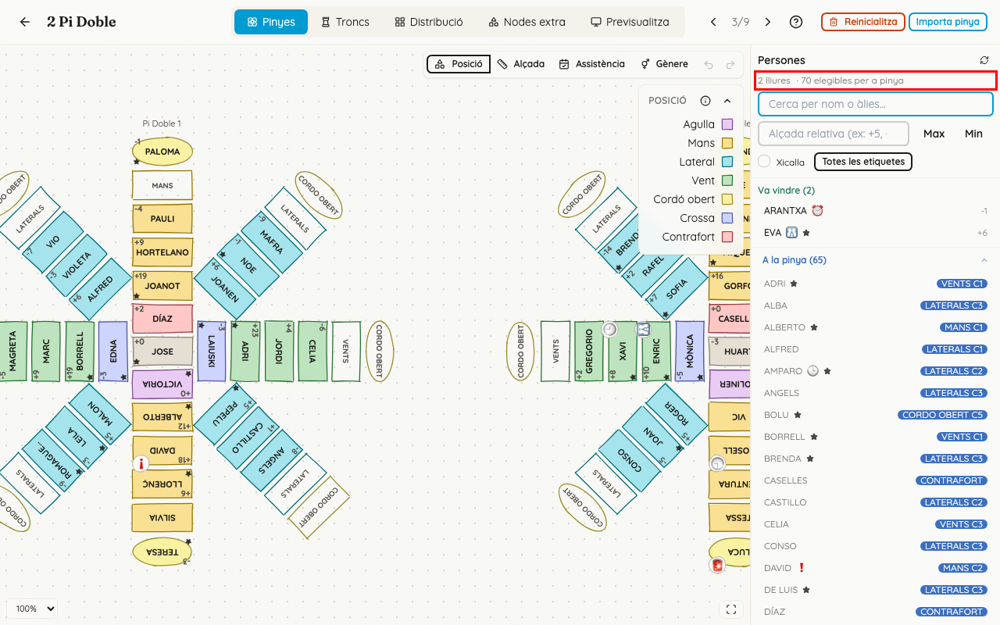
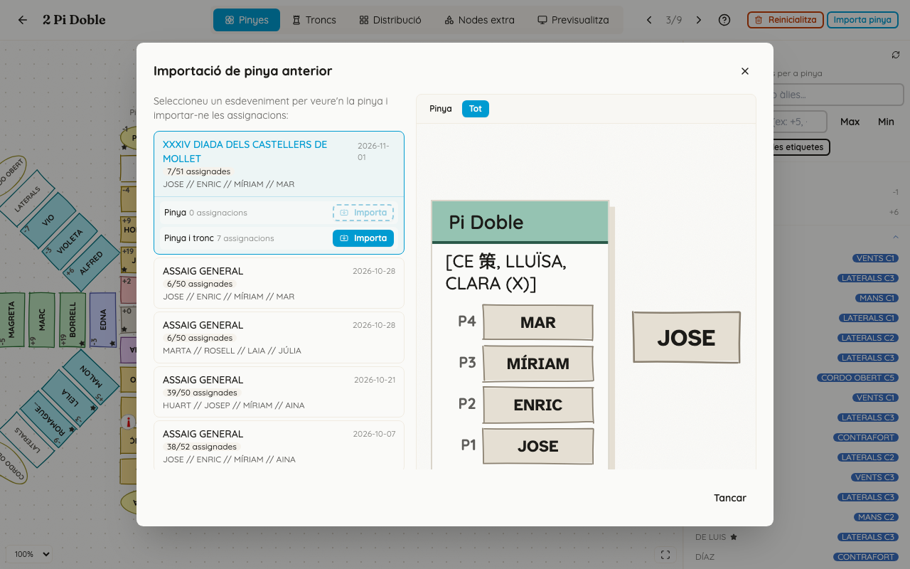
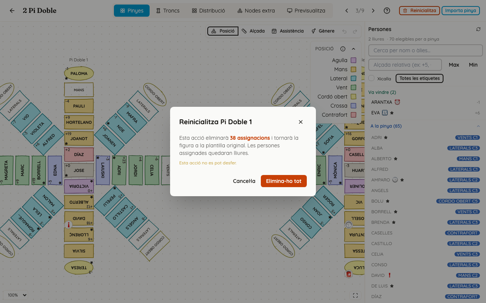

<!-- rutes: /pinyes/events/:eventId/segments/:segmentId/assign -->

# Assignació de pinyes

## Per a què serveix

La pestanya «Pinyes» de l'espai de treball mostra tota la pinya del segment en un sol dibuix, amb les figures col·locades com a la distribució. Ací és on pinyes ompli els llocs de pinya amb la gent que queda després que troncs i xicalla hagen fet el tronc.

## On és

Obriu l'espai de treball del segment (vegeu [Assignació de troncs](12-assignacio-troncs.md)) i aneu a la pestanya «Pinyes». Si la llista de segments està en mode «Pinyes», el botó «Assigna» ja l'obri.

## Pas a pas

### Moure's pel dibuix

- **Zoom:** roda del ratolí, Ctrl+ i Ctrl−, o el selector de percentatge de baix a l'esquerra.
- **Desplaçar el dibuix:** arrossegueu el fons. Només funciona si no hi ha cap lloc seleccionat; premeu Esc abans. El botó del mig del ratolí funciona sempre.
- **«Ajusta a la pantalla»** (botó de la cantonada): torna a mostrar-ho tot.
- Si el segment no té cap figura amb pinya, ix «Este segment no té cap figura amb pinya.».

### Assignar persones

Es fa igual que a la pestanya «Troncs» (vegeu [Assignació de troncs](12-assignacio-troncs.md), «Posar una persona en un lloc» i «El panell de persones»). En resum:

- Feu clic en un lloc buit, escriviu l'àlies al cercador i trieu la persona. També funciona al revés: primer la persona i després el lloc.
- Després de posar algú, la selecció salta sola al lloc buit següent, en este ordre: base, agulla, crossa, contrafort, i després cordó per cordó (mans, vents, laterals…), cordons oberts i la resta.
- Tab i Maj+Tab: lloc següent o anterior.
- Supr o Retrocés, amb un lloc ple seleccionat: el deixa lliure.
- Esc: lleva la selecció i cancel·la un moviment.
- **Moure o intercanviar:** arrossegueu una persona a un altre lloc, o feu clic dret sobre ella i després cliqueu el lloc de destí. Mentre es mou, ix «S'està movent …», amb una creu per a cancel·lar-ho.
- **«Desfer» i «Refer»:** dalt a la dreta del dibuix, o Ctrl+Z i Ctrl+Maj+Z.

L'assistència de cada persona es veu en l'ompliment del seu lloc: ple si ve (o ha arribat), ratlles si encara no ha contestat o no ha arribat, i buit amb el nom ratllat si no ve. Una estrella (★) vol dir que vindrà a la propera actuació. Un llaç roig amb una icona d'advertència vol dir que la persona té dos llocs en este segment (vegeu [Conflictes](14-conflictes.md)). La taula completa i els modes «Alçada», «Assistència» i «Gènere», que canvien els colors, són a [Assignació de troncs](12-assignacio-troncs.md), «Canviar els colors».

### Els comptadors del panell

- **«N lliures»:** adults que vénen i no tenen **cap** lloc en este segment, ni a la pinya ni al tronc.
- **«N elegibles per a pinya»:** adults que vénen i no són al tronc. És el màxim de gent que podeu posar a la pinya sense traure ningú del tronc.
- Cap dels dos no compta la xicalla.

El Dashboard no té cap comptador de «mans necessàries contra gent apuntada». Per a saber si arribeu, compareu estos comptadors amb la insígnia de cada segment a la llista de segments (per exemple, «23/35 pinyes, 29/45 total»; vegeu [Segments i figures](11-segments-i-figures.md)). Si «elegibles per a pinya» és menor que els llocs de pinya que vos falten, no hi ha prou gent: reduïu cordons o parleu amb troncs.

### Si la persona ja té un lloc: «Persona ja assignada»

Ix quan teniu un lloc seleccionat i trieu una persona que ja té un altre lloc en este segment (des del cercador o des dels grups «A la pinya» o «Al tronc»).

La finestra diu, per exemple, «X ja és Mans a Roscana.» i llista tots els llocs de la persona, cada un amb l'etiqueta «Tronc», «Pinya» o «Direcció». Si un d'ells és al tronc, ho avisa en roig. Els botons són:

- **«Moure ací»** (el principal): la porta al lloc nou i la lleva de tots els anteriors.
- **«Veure col·locació»:** vos porta on és ara.
- **«Assignar igualment»:** la deixa als dos llocs. Això crea un conflicte.
- **«Cancel·lar»:** no fa res.

Hi ha una excepció: una persona que fa de «Direcció pinya» d'una figura pot tindre també un lloc a la pinya d'eixa mateixa figura. En este cas la finestra no ix i no es considera conflicte.

### Importar una pinya anterior

Funciona igual que «Importa tronc» (vegeu [Assignació de troncs](12-assignacio-troncs.md), «Importar un tronc anterior»), però la finestra es diu «Importació de pinya anterior» i les opcions són:

- «Pinya»: només la pinya.
- «Pinya i tronc»: tota la figura.

Si troncs ja ha fet la seua part, trieu «Pinya». Amb «Pinya i tronc», els llocs ocupats no es toquen, però els llocs del tronc que troncs haja deixat buits sí que s'ompliran.

### Reinicialitzar una figura

«Reinicialitza» només ix a la pestanya «Pinyes» i només quan alguna figura del segment ja té gent posada. Si n'hi ha més d'una, primer vos demana quina («Selecciona una figura»).

La confirmació diu «Esta acció eliminarà N assignacions i tornarà la figura a la plantilla original. Les persones assignades quedaran lliures.» i «Esta acció no es pot desfer.». El botó és «Elimina-ho tot».

S'esborra:

- **totes les persones de la figura, també les del tronc i les direccions;**
- els nodes extra que s'hi havien afegit;
- l'historial de «Desfer».

Per a què serveix: quan una figura encara no té ningú posat, segueix la plantilla. Quan s'hi posa la primera persona, la figura es copia, i els canvis que es facen després a la plantilla ja no li arriben. «Reinicialitza» llença eixa còpia i torna a llegir la plantilla. Feu-lo servir si s'ha canviat la plantilla i voleu els canvis en este segment.

## Si sou de pinyes

- Espereu que troncs i xicalla hagen acabat el segment, o almenys el tronc de cada figura.
- Si hi ha un assaig anterior semblant, comenceu per «Importa pinya» amb l'opció «Pinya». Després repasseu els punts rojos i taronja (la importació no mira qui ve) i la barra roja de conflictes.
- Ompliu de dins cap a fora i deixeu que la selecció avance sola: només cal escriure l'àlies i prémer Intro.
- Abans de començar, mireu «elegibles per a pinya». Si no arriba, reduïu cordons (vegeu [Distribució i nodes extra](15-distribucio-i-nodes-extra.md)).

## Si sou de troncs o xicalla

- No cal que hi entreu. Si necessiteu una persona que pinyes ja ha posat, parleu-ho: si la poseu igualment amb «Assignar igualment», quedarà en dos llocs.
- **No premeu «Reinicialitza»:** també esborra el tronc.

## Compte amb

- **«Reinicialitza» esborra també el tronc i les direccions** de la figura, i no es pot desfer.
- **«Importa pinya» amb «Pinya i tronc»** pot omplir llocs del tronc.
- **La importació no mira qui ve** i pot deixar gent en dos llocs. Reviseu els ompliments i els conflictes just després.
- **«Assignar igualment» crea un conflicte a posta.** Feu-lo servir només si la persona realment farà les dues coses.
- **Per a desplaçar el dibuix** no hi ha d'haver cap lloc seleccionat: premeu Esc primer.
- **En tauleta**, tocar un lloc obri la llista en una finestra, i la selecció no avança sola: cada lloc és tocar i triar. Per a moure algú, cal mantindre el dit damunt.

## Relacionat

- [Assignació de troncs](12-assignacio-troncs.md)
- [Conflictes](14-conflictes.md)
- [Distribució i nodes extra](15-distribucio-i-nodes-extra.md)
- [Segments i figures](11-segments-i-figures.md)
- [Plantilla: pinya i rengles](09-plantilles-pinya.md)
