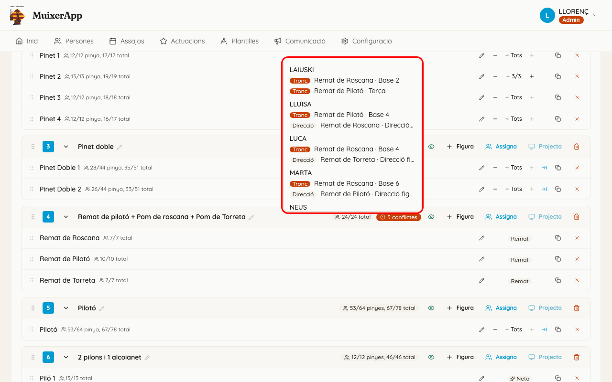
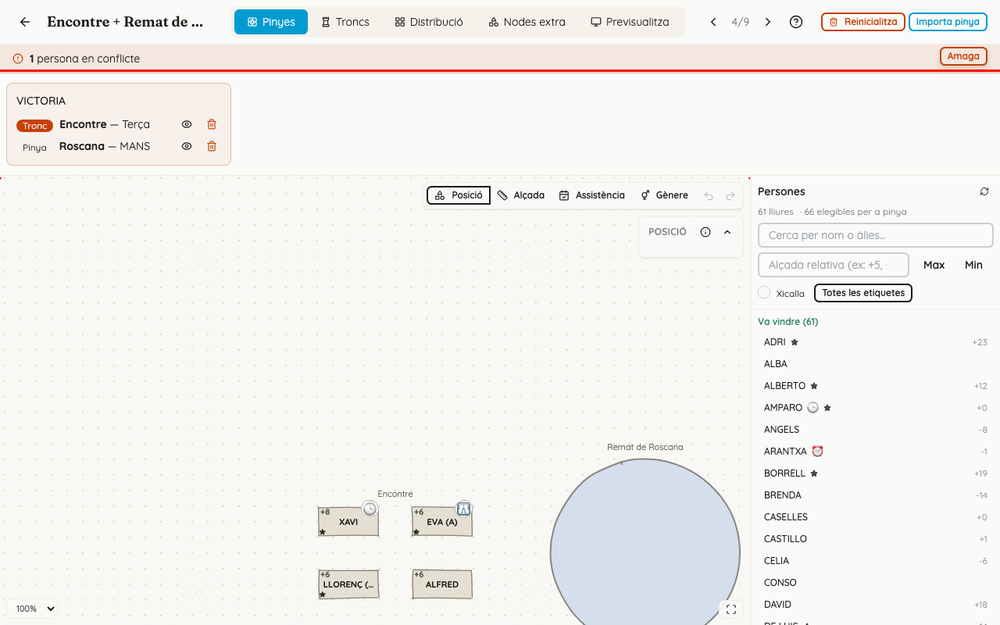
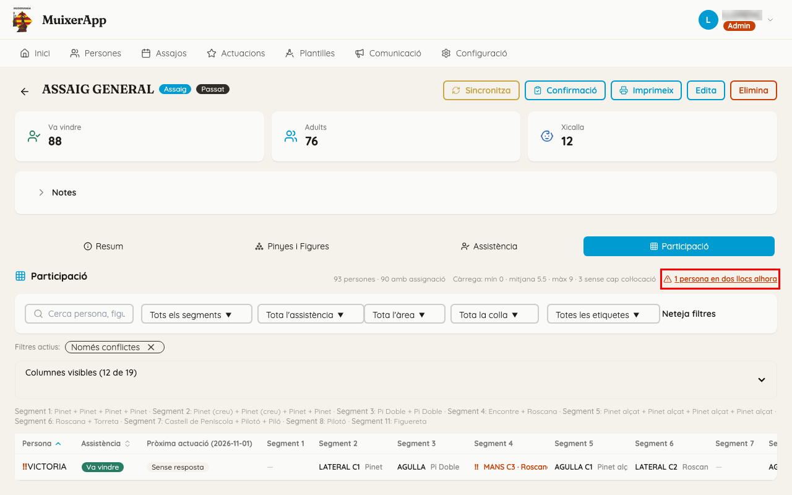

<!-- rutes: /events/:id /pinyes/events/:eventId/segments/:segmentId/assign -->

# Conflictes

## Per a què serveix

Hi ha un conflicte quan **una persona té dos llocs o més en el mateix segment**: no pot estar en dos llocs alhora. L'app **mai no ho impedeix**, només ho avisa, perquè de vegades és volgut o és temporal mentre es reorganitza la figura. Esta pàgina explica on es veuen els conflictes i com es resolen.

### Què compta com a conflicte

- Dos llocs al tronc, un al tronc i un a la pinya, o dos a la pinya, en la mateixa figura o en figures diferents **del mateix segment**.
- Les direccions també compten, amb una excepció: una persona que fa de «Direcció pinya» d'una figura pot tindre també un lloc a la pinya d'**eixa mateixa** figura.
- Tindre llocs en segments diferents no és mai un conflicte.
- No tindre cap lloc tampoc no és un conflicte.

## On és

Els conflictes es veuen en tres llocs:

1. **A la llista de segments** (event → «Pinyes i Figures»): una píndola roja «N conflictes» al costat del segment, on N és el nombre de persones afectades. Si hi passeu el ratolí, ix la llista de persones i els seus llocs, cada un amb l'etiqueta «Tronc», «Pinya» o «Direcció», i al final el recordatori «Resoleu-los des de l'assignació.».

   

2. **A l'espai de treball del segment:** una barra roja davall de la capçalera, «N persones en conflicte», que es veu des de les cinc pestanyes. Al dibuix de la pinya i als troncs, els llocs d'eixes persones tenen una vora roja.

3. **A la pestanya «Participació»** de l'event: a la capçalera, «N persones en dos llocs alhora»; davant de l'àlies, el signe «‼»; i les caselles afectades, en roig (vegeu [Participació](17-participacio.md)).

## Pas a pas

### Resoldre un conflicte des de l'espai de treball

1. A la barra roja, feu clic a «Mostra».

   

2. Ix una targeta per a cada persona, amb tots els seus llocs: l'àrea («Tronc», «Pinya» o «Direcció»), la figura i el lloc. Si no hi caben totes, useu les fletxes dels costats o desplaceu-les.
3. Per a cada lloc teniu dos botons:
   - **L'ull** («Veure on està assignada»), o el nom de la figura: vos porta a eixe lloc. Si cal, canvia de pestanya.
   - **La paperera** («Treure aquesta assignació»): deixa lliure eixe lloc. No demana confirmació, però es pot desfer amb «Desfer».
4. Quan la persona ja només té un lloc, la seua targeta desapareix. Quan no en queda cap, desapareix la barra.

També podeu anar al lloc, clicar-lo i posar-hi una altra persona.

### Trobar conflictes des de Participació

1. A la pestanya «Participació», feu clic a «N persones en dos llocs alhora». S'activa el filtre «Només conflictes».
2. Feu clic en la casella del segment: s'obri l'espai de treball en eixe segment i eixa figura.

## Si sou de pinyes

- Normalment el conflicte ve de posar a la pinya algú que troncs ja tenia, o d'una importació.
- La regla és que **el tronc té prioritat**: lleveu el lloc de pinya i busqueu una altra persona.

## Si sou de troncs o xicalla

- Si importeu un tronc, mireu la barra roja just després. El missatge final de la importació ja diu quantes persones han quedat en dos llocs.
- Si una persona ha de fer realment dues coses en el mateix segment (per exemple, dirigir una figura i ser a la pinya d'una altra), podeu deixar-ho així. És un avís, no un error.

## Compte amb

- **Una importació pot crear conflictes sense preguntar** (vegeu [Assignació de troncs](12-assignacio-troncs.md) i [Assignació de pinyes](13-assignacio-pinyes.md)).
- **«Assignar igualment»**, a la finestra «Persona ja assignada», crea un conflicte a posta.
- **La barra roja ix plegada.** El número ja vos diu que hi ha feina pendent.
- **Amb el segment bloquejat** (passats els dies de bloqueig de la colla, 2 si no s'ha canviat), els botons del panell estan desactivats.
- **Els conflictes no impedeixen publicar ni projectar.** Si publiqueu el segment, els membres veuran la persona en els dos llocs a l'app.

## Relacionat

- [Assignació de troncs](12-assignacio-troncs.md)
- [Assignació de pinyes](13-assignacio-pinyes.md)
- [Participació](17-participacio.md)
- [Segments i figures](11-segments-i-figures.md)
