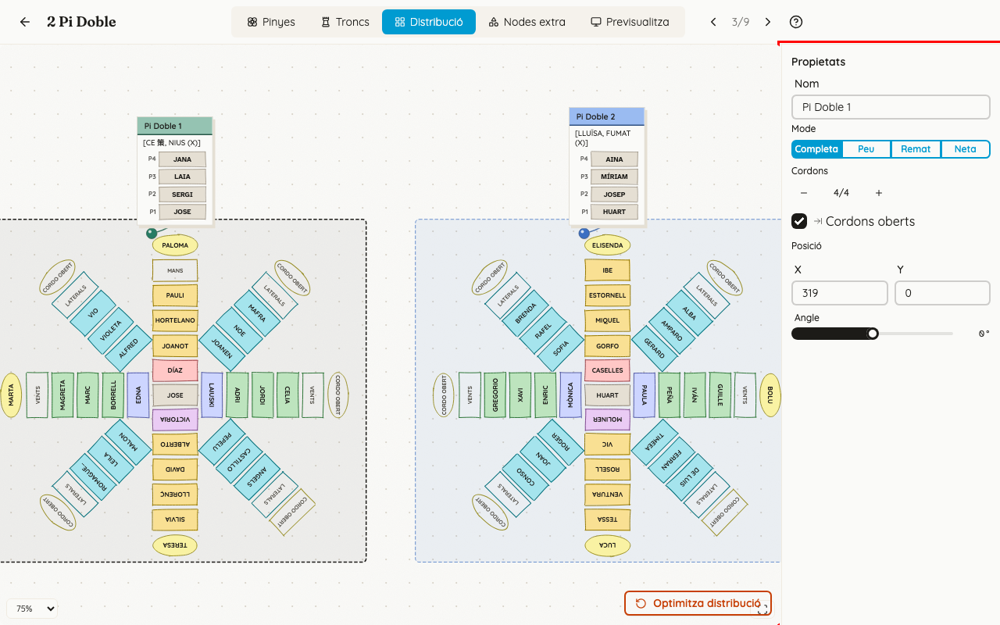
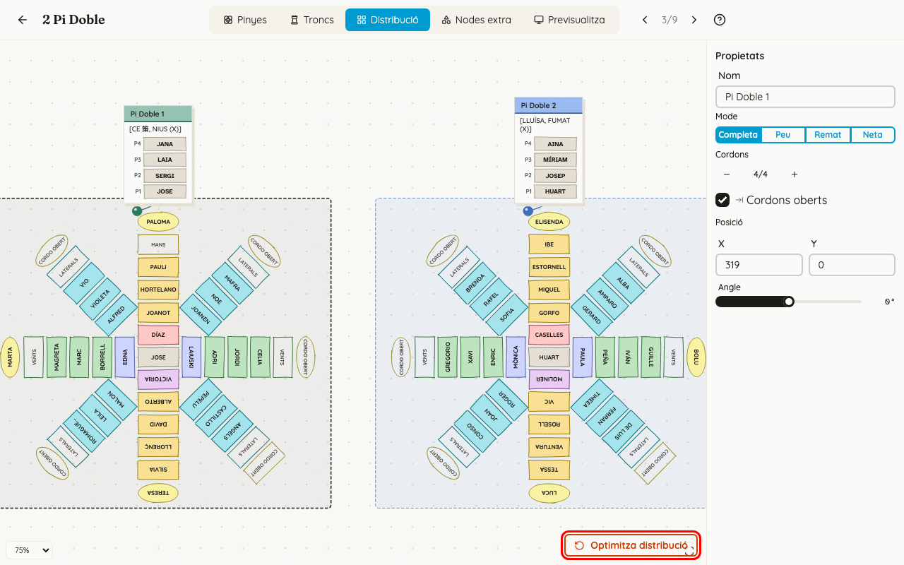
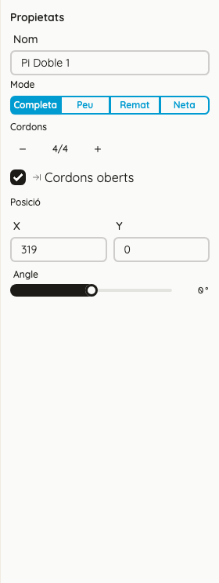
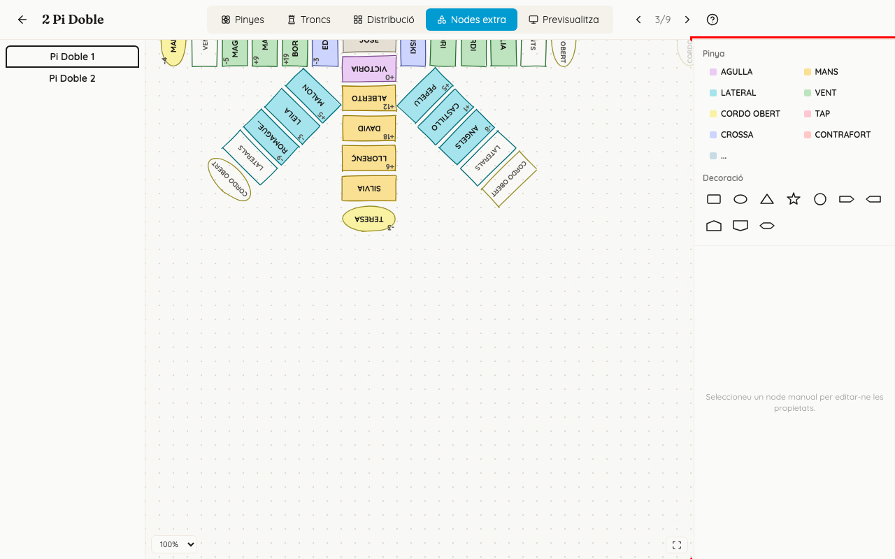
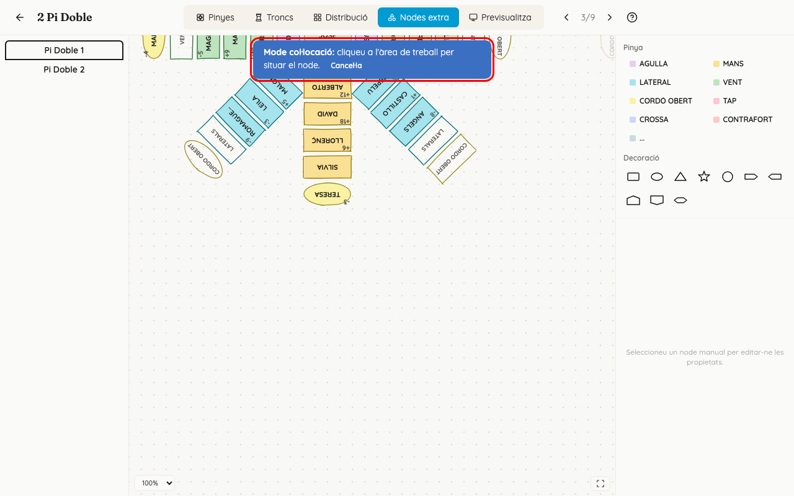

<!-- rutes: /pinyes/events/:eventId/segments/:segmentId/assign -->

# Distribució i nodes extra

## Per a què serveix

- **Distribució:** ací col·loqueu les figures del segment tal com eixiran a la pantalla de projecció i a l'app dels membres, i tal com es faran a la plaça: quina va al costat de quina i cap a on mira cada una. També s'hi ajusta cada figura: el nom, el mode i els cordons.
- **Nodes extra:** ací afegiu, només per a este segment, llocs que la plantilla no té (una mà de més, un comodí) o marques per a orientar-se (l'església, una paret, una fletxa).

## On és

Obriu l'espai de treball del segment (vegeu [Assignació de troncs](12-assignacio-troncs.md)) i aneu a les pestanyes «Distribució» o «Nodes extra». Només funcionen en ordinador: en tauleta i en mòbil estes pestanyes no ixen.

## Pas a pas

### Col·locar les figures

1. Cada figura apareix amb la seua pinya i, al costat, el quadre del seu tronc.
2. **Moure una figura:** arrossegueu-la. El quadre del tronc la segueix. També podeu arrossegar només el quadre del tronc per a posar-lo en un altre lloc.
3. **Girar una figura:** seleccioneu-la i arrossegueu el punt taronja que ix, o feu servir el control «Angle» del panell de la dreta.
4. **Ajust fi:** al panell «Propietats», camps «X», «Y» i «Angle».
5. **Es guarda sol** un moment després que deixeu de moure. No hi ha cap botó d'alçar.
6. **Tornar a començar:** «Optimitza distribució» (baix a la dreta) esborra totes les posicions que heu posat a mà en este segment i torna a col·locar les figures automàticament. **No demana confirmació i no es pot desfer.**

Les figures que no heu col·locat mai es col·loquen soles. La projecció i l'app dels membres mostren sempre esta distribució.

### Ajustar una figura: el panell «Propietats»

Feu clic en una figura per a veure'n les propietats a la dreta:

- **«Nom»:** el nom de la figura en este segment. Si el deixeu buit, es fa servir el de la plantilla. Canvia també els títols que veuen els membres.
- **«Mode»:** «Completa», «Peu», «Remat» o «Neta». «Neta» no té pinya; «Remat» no té ni pinya ni base.
  - «Completa» i «Peu» s'apliquen tan bon punt els cliqueu.
  - «Remat» i «Neta», si deixarien gent sense lloc, primer pregunten. «Canviar a Figura neta» avisa que desassignarà N persones de la pinya; «Canviar a Remat», de la pinya i la base. Els botons són «Canvia a Figura neta» (o «Canvia a Remat») i «Cancel·la».
  - El canvi de mode **no es pot desfer**: si torneu a «Completa», la gent no torna al seu lloc.
- **«Cordons»** (només en «Completa» i «Peu»): «−» i «+» canvien quants cordons es fan servir. «Tots» vol dir sense límit; «2/4» vol dir que se'n fan servir 2 dels 4 que té la plantilla. Si la plantilla no té rengles, ix «Sense rengles».
  - Augmentar o tornar a «Tots» s'aplica directament.
  - Si en lleveu i hi havia gent als cordons que desapareixen, ix «Canvia els cordons»: «Esta acció eliminarà N assignacions dels cordons que deixaran de mostrar-se. Les persones assignades quedaran lliures.». El botó és «Elimina-les». **No es pot desfer.**
- **«Cordons oberts»:** casella que mostra o amaga els llocs de cordó obert de la plantilla. Només ix si la plantilla en té. Si la desmarqueu i hi havia gent, ix «Desactiva els cordons oberts», amb el botó «Elimina-les». **No es pot desfer.**

El mode i els cordons també es poden canviar des de la llista de segments, amb les mateixes confirmacions (vegeu [Segments i figures](11-segments-i-figures.md)).

### Afegir nodes extra

1. A l'esquerra, trieu la figura. Les altres es veuen més apagades.
2. A la dreta, trieu què voleu afegir:
   - **«Pinya»:** llocs on es pot posar gent: «AGULLA», «MANS», «LATERAL», «VENT», «CORDÓ OBERT», «TAP», «CROSSA» i «CONTRAFORT». «...» és un comodí amb el nom que vulgueu: escriviu-lo a «Etiqueta del comodí» i premeu «Col·loca». Si la figura està en mode «Remat» o «Neta», estos botons estan desactivats («Esta figura no té pinya.»).
   - **«Decoració»:** formes per a marcar el lloc (rectangle, el·lipse, triangle, estrela, cercle i fletxes). Sempre demanen un nom («Etiqueta del node decoratiu») i no s'hi pot posar ningú.
3. Ix «Mode col·locació: cliqueu a l'àrea de treball per situar el node.». Feu clic on el vulgueu. «Cancel·la» o Esc ho anul·len.

   

4. Feu clic en un node extra per a editar-lo («Propietats del node manual»): «Etiqueta», «Color» i «Treure fons», «Forma», «Amplada», «Alçada», «Rotació», «X» i «Y». També el podeu duplicar, deixar lliure («Desassigna») o eliminar.
5. Amb el teclat:
   - fletxes: moure'l 1 píxel (amb Maj, 10);
   - Ctrl+C i Ctrl+V: copiar-lo i enganxar-lo;
   - Ctrl+D: duplicar-lo;
   - Supr o Retrocés: eliminar-lo. Si té algú posat, primer pregunta («Eliminar node manual») i avisa que es perdrà l'assignació.
6. **Per a posar-hi una persona**, aneu a la pestanya «Pinyes» i feu-ho com en qualsevol altre lloc (vegeu [Assignació de pinyes](13-assignacio-pinyes.md)). A «Nodes extra» no es pot assignar, i a «Pinyes» els nodes extra no es poden moure.

## Si sou de pinyes

- La distribució és vostra: és el que es veurà a la pantalla a l'assaig. Poseu les figures com les fareu a la plaça, perquè la gent s'orienta amb la pantalla.
- Els cordons es poden ajustar ací o a la llista de segments. Abans de reduir-los, llegiu quanta gent en traureu: el missatge ho diu, i no es pot desfer.
- Els nodes extra de pinya són per a una mà o un vent de més que només calen en este segment. Feu-los servir abans de tocar la plantilla.

## Si sou de troncs o xicalla

- Comproveu que el quadre de cada tronc no tapa cap altra figura: és el que veuran els membres.
- Canviar una figura a «Remat» també lleva la gent de la base. Parleu-ho amb pinyes abans.

## Compte amb

- **«Optimitza distribució» esborra la vostra col·locació** sense preguntar, i no es pot desfer.
- **«Completa» i «Peu» s'apliquen en un sol clic.** «Remat», «Neta», reduir cordons i desmarcar «Cordons oberts» poden llevar gent, i **no es pot desfer**.
- **«Reinicialitza»** (pestanya «Pinyes») esborra també els nodes extra de la figura. **«Importa …»** els copia de la figura d'origen.
- **En tauleta o en mòbil** no hi ha ni «Distribució» ni «Nodes extra».
- **Un node de decoració no admet ningú.** Si l'intenteu assignar, ix «Els nodes decoratius no es poden assignar.».

## Relacionat

- [Segments i figures](11-segments-i-figures.md)
- [Assignació de pinyes](13-assignacio-pinyes.md)
- [Previsualitza i projecció](16-previsualitza-i-projeccio.md)
- [Plantilla: pinya i rengles](09-plantilles-pinya.md)
