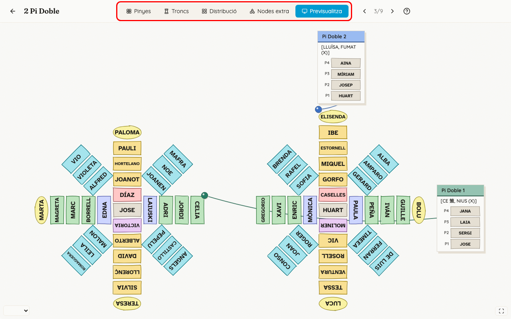
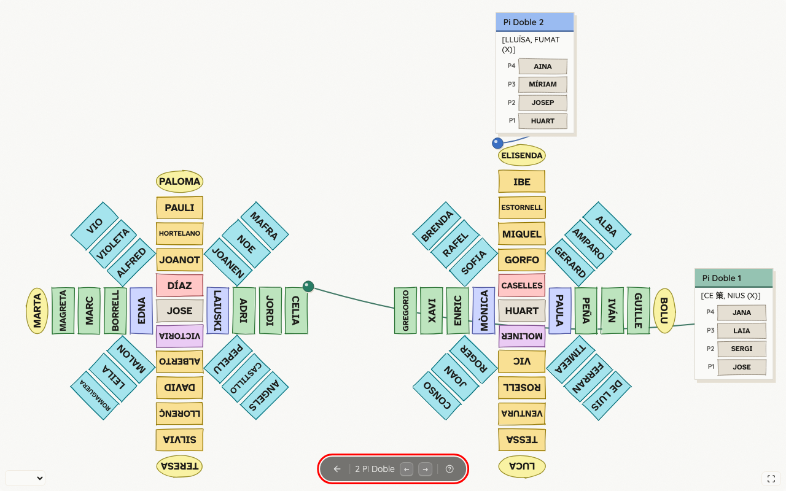
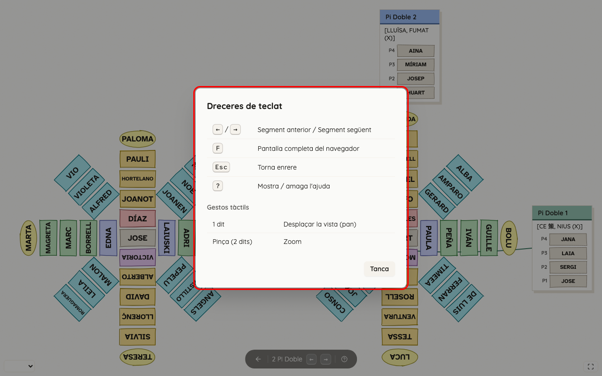

<!-- rutes: /pinyes/events/:eventId/segments/:segmentId/assign /pinyes/events/:eventId/segments/:segmentId/project /pinyes/events/:eventId/segments/:segmentId/project/:instanceId -->

# Previsualitza i projecció

## Per a què serveix

Per a comprovar com es veurà el segment a la pantalla gran de l'assaig. La projecció mostra totes les figures col·locades com a la distribució, amb cada persona al seu lloc i el tronc de cada figura al costat. També vos ajuda a saber què veuran els membres a la seua app.

## On és

- **«Previsualitza»:** la cinquena pestanya de l'espai de treball del segment (vegeu [Assignació de troncs](12-assignacio-troncs.md)).
- **«Projecta»:** a la llista de segments (event → «Pinyes i Figures»), cada segment té el botó «Projecta». S'obri a pantalla completa.

## Pas a pas

### Revisar mentre assigneu

Obriu «Previsualitza». És la mateixa imatge que es projectarà, sense eixir de l'espai de treball. Hi ixen els ompliments d'assistència (ple, ratlles o buit) i els llaços roigs dels conflictes. Al «Previsualitza» no hi ha selector de mode: es veu sempre com es projectarà.

### Projectar a l'assaig

1. A la llista de segments, feu clic a «Projecta». El segment ocupa tota la finestra.
2. Premeu F perquè el navegador passe a pantalla completa.

   

3. A baix hi ha una barra que s'amaga si no moveu el ratolí durant 3 segons. Té:
   - la fletxa de tornar («Torna a l'esdeveniment», també amb Esc);
   - el nom del segment;
   - ← i → per a anar al segment anterior o al següent;
   - el botó d'ajuda («?»).
4. Les fletxes passen per **tots** els segments de l'event, també pels que no estan publicats.

### Dreceres de teclat

| Tecla | Què fa |
|---|---|
| ← / → | Segment anterior / segment següent |
| F | Pantalla completa del navegador |
| Esc | Torna enrere |
| ? | Mostra o amaga l'ajuda |

En pantalla tàctil: amb un dit desplaceu la vista i amb dos dits (pinça) feu zoom. El moviment és fluid també en mòbils antics: mentre moveu el dit, la imatge es desplaça tal com és i es redibuixa en alçar el dit, de manera que durant un instant les vores poden mostrar una versió més borrosa.

### Com es veu la projecció

- **Fons de quadern.** El fons és de paper amb una graella de punts. Si el dispositiu està en mode fosc, la projecció també es veu fosca.
- **Targetes de tronc.** Cada tronc va en una targeta de paper amb una xinxeta del color de la figura. Un fil que penja uneix la targeta amb la seua pinya, i la xinxeta de la pinya se situa a la cantonada més pròxima. Una figura que va sola en el segment té xinxeta, però no fil.
- **Noms.** Els noms s'ajusten a la mida del lloc (es fan més menuts i, si no hi caben, acaben en «…»). Els llocs de la projecció no mostren alçada ni observacions.
- **Assistència.** La projecció usa els mateixos ompliments que l'espai de treball, segons si l'event ja ha començat. El botó ⓘ «Altres marques» explica cada marca.

### Què veuen els membres

Els membres veuen la projecció des de la seua app (vegeu [L'app dels membres (PWA)](19-pwa.md)):

- Només veuen els segments **publicats** (icona de l'ull a la llista de segments; vegeu [Segments i figures](11-segments-i-figures.md)). Un segment sense publicar no apareix enlloc per a ells, ni a la llista ni amb les fletxes.
- Al detall de l'event, cada segment publicat té un títol i una línia que diu on va el membre (per exemple, «Vent (C1) a Roscana»).
- Quan l'obrin, veuen la mateixa projecció amb el seu lloc marcat i un avís amb el botó «Troba'm». També poden buscar una altra persona («Cerca una persona») i veure «On està».
- Veuen l'estat de les assignacions del moment en què obrin la pantalla. Si canvieu alguna cosa després de publicar, la veuran quan la tornen a obrir.
- Si una persona té dos llocs en el segment, els veu tots dos, i l'avís li diu que en té més d'un.

## Si sou de pinyes

- Abans de publicar, mireu «Previsualitza». Si les figures es tapen o no estan com a la plaça, torneu a «Distribució» (vegeu [Distribució i nodes extra](15-distribucio-i-nodes-extra.md)).

## Si sou de troncs o xicalla

- El quadre del tronc de cada figura és el que la xicalla i el tronc miraran per a saber on van. Comproveu que es llig bé i que no queda tapat.

## Compte amb

- **Esc dins de «Previsualitza» vos trau de l'espai de treball** i vos porta a la pàgina de l'event. F i ? també hi funcionen; les fletxes ← i →, en canvi, no.
- **La projecció del Dashboard mostra també els segments no publicats.** Que un segment es veja ací no vol dir que els membres el vegen.
- **El que es veu depén de la distribució.** Si no l'heu tocada, les figures es col·loquen soles.
- **L'«Ajuda» de l'espai de treball parla d'una tecla E** per a canviar entre pinyes i troncs a la projecció. Eixa tecla no fa res.

## Relacionat

- [Distribució i nodes extra](15-distribucio-i-nodes-extra.md)
- [Segments i figures](11-segments-i-figures.md)
- [L'app dels membres (PWA)](19-pwa.md)
- [Conflictes](14-conflictes.md)
