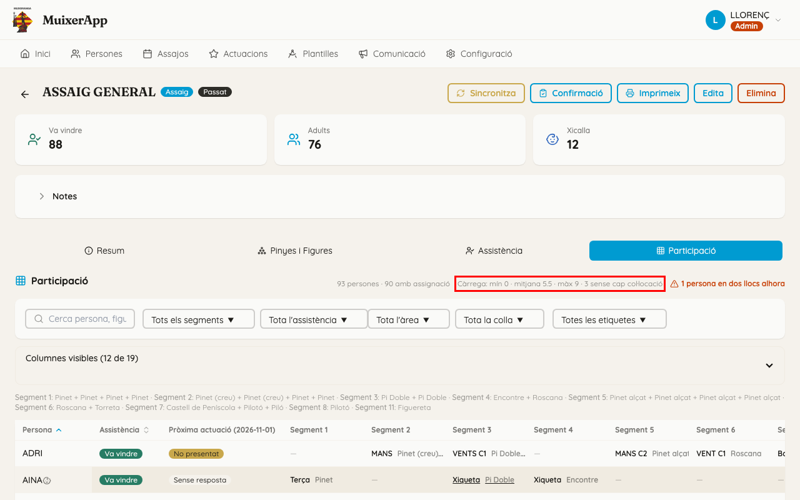
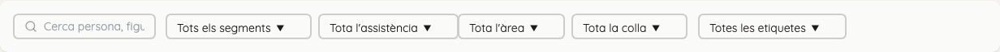
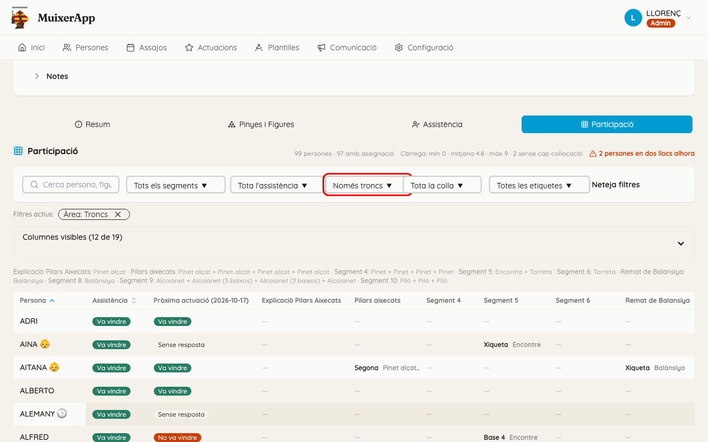

<!-- rutes: /events/:id -->

# Participació

## Per a què serveix

La pestanya «Participació» és una taula de **persones per segments**: què fa cada membre en cada prova de l'event. Serveix per a repartir la feina, perquè ningú no faça totes les proves mentre altres no en fan cap, i perquè qui va a la pròxima actuació assage el que hi farà.

## On és

Obriu l'event i aneu a la pestanya «Participació».

## Pas a pas

### Llegir la taula

- **Capçalera:**
  - «N persones · N amb assignació».
  - «Càrrega: mín X · mitjana Y · màx Z · N sense cap col·locació»: quants llocs té cada persona en tot l'event (el mínim, la mitjana i el màxim) i quantes persones no en tenen cap.
  - Si n'hi ha, «N persones en dos llocs alhora» (vegeu [Conflictes](14-conflictes.md)).
- **Qui ix a la taula:** les persones que vénen (o han vingut) i qualsevol persona que tinga un lloc en algun segment, encara que no vinga. Si apareix algú que no ve, vol dir que té un lloc assignat i convé substituir-lo.
- **Una columna per segment.** Cada casella diu el lloc i la figura (per exemple, «Mans C1 · Roscana»), o «—» si la persona no fa res en eixe segment. Davall dels filtres hi ha la llegenda: quines figures té cada segment i quins segments estan «(no publicat)».
- **Marques davant de l'àlies:** «‼» té un conflicte; 👶 és xicalla (camp «Xicalla» de la fitxa); un emoji o ⚠️ té observacions.
- **«Pròxima actuació (data)»:** en un assaig, si la persona va a la pròxima actuació de la temporada. És la mateixa informació que la icona 🎭 del panell de persones.
- **Més columnes:** amb «Columnes visibles» podeu mostrar «Nom», «Etiquetes», «Alçada», «Col·locacions» (quants llocs té en total), «Troncs» (quants al tronc), «% segments» (en quina part dels segments fa alguna cosa) i «Tronc» (tots els seus llocs de tronc de l'event en una casella). L'app recorda les columnes que trieu.
- **Ordenar:** feu clic a la capçalera de «Persona», «Assistència», «Col·locacions», «Troncs», «% segments» o «Alçada».
- **Anar a l'assignació:** feu clic en una casella i s'obri l'espai de treball en eixe segment i eixa figura, a la pestanya «Pinyes» o «Troncs» segons on és la persona (a «Troncs» si la casella és buida).

### Filtrar

- «Cerca persona, figura o posició...»: busca per persona o pel que fa (una figura, un lloc).
- «Tots els segments» o un segment concret. Amb un segment, les columnes passen a ser «Figura», «Posició» i «Zona».
- «Tota l'assistència»: les opcions canvien segons si l'event encara no ha arribat, és hui o ja ha passat.
- «Tota l'àrea», «Només troncs» o «Només pinyes».
- «Tota la colla», «Només xicalla» o «Sense xicalla» (es guia pel camp «Xicalla» de la fitxa).
- «Totes les etiquetes». Les etiquetes que no porta ningú de l'event ixen amb «(0)».

Els filtres actius ixen com a xips que podeu llevar un a un, o tots alhora.

### Repartir la càrrega

1. Mostreu la columna «Col·locacions» i ordeneu-la de menys a més. Dalt de tot hi ha qui ve i no fa res (són els «N sense cap col·locació» de la capçalera).
2. Feu clic en una casella buida d'eixa persona: s'obri l'espai de treball en eixe segment. Poseu-la en algun lloc.
3. Ordeneu-la de més a menys per a veure qui està sobrecarregat, i compareu-ho amb la mitjana de la línia «Càrrega».
4. En un assaig, mireu «Pròxima actuació» per a donar prioritat a qui hi anirà.
5. Quan torneu a la pestanya, la taula es torna a carregar. Si no veieu un canvi, canvieu de pestanya i torneu-hi.

## Si sou de pinyes

- «Només pinyes» deixa a les caselles només els llocs de pinya: veureu d'una ullada qui fa molta pinya i qui no en fa gens.
- «Sense xicalla» vos ajuda a centrar-vos en els adults.

## Si sou de troncs o xicalla

- «Només troncs», amb les columnes «Troncs» i «Tronc», vos diu qui puja a cada prova i en quin tronc.
- «Només xicalla» vos ajuda a repartir la xicalla entre les proves.

## Compte amb

- **«Només troncs» i «Només pinyes» no lleven ningú de la taula:** totes les persones continuen eixint. Les que no tenen res d'eixa àrea mostren «—».
- **La línia «Càrrega» és sempre de tot l'event**, no del que queda després de filtrar.
- **Una persona amb lloc assignat ix encara que no vinga.** Mireu la columna «Assistència» abans de pensar que està lliure.
- **La columna «Pròxima actuació» només ix en assajos**, i només si la temporada té una actuació després.
- **La participació és de cada event.** Per a veure tot el que ha fet una persona, mireu l'«Historial de pinyes» de la seua fitxa (vegeu [Persones](03-persones.md)).
- **Una casella vos porta a l'espai de treball.** Per a tornar, feu servir la fletxa de dalt a l'esquerra.

## Relacionat

- [Conflictes](14-conflictes.md)
- [Assignació de troncs](12-assignacio-troncs.md)
- [Assignació de pinyes](13-assignacio-pinyes.md)
- [Assajos i actuacions](07-assajos-i-actuacions.md)
- [Etiquetes](04-etiquetes.md)
