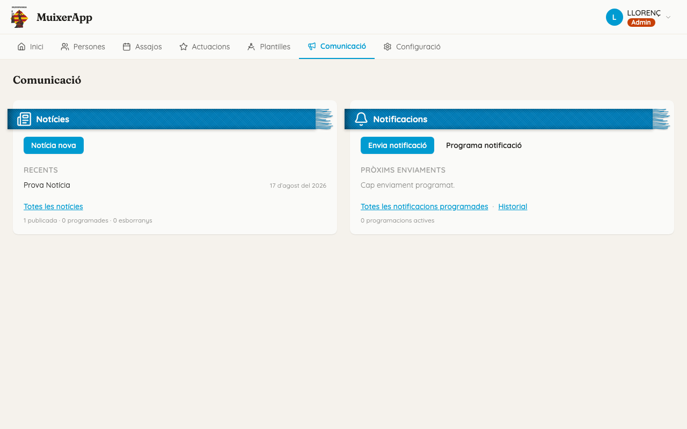
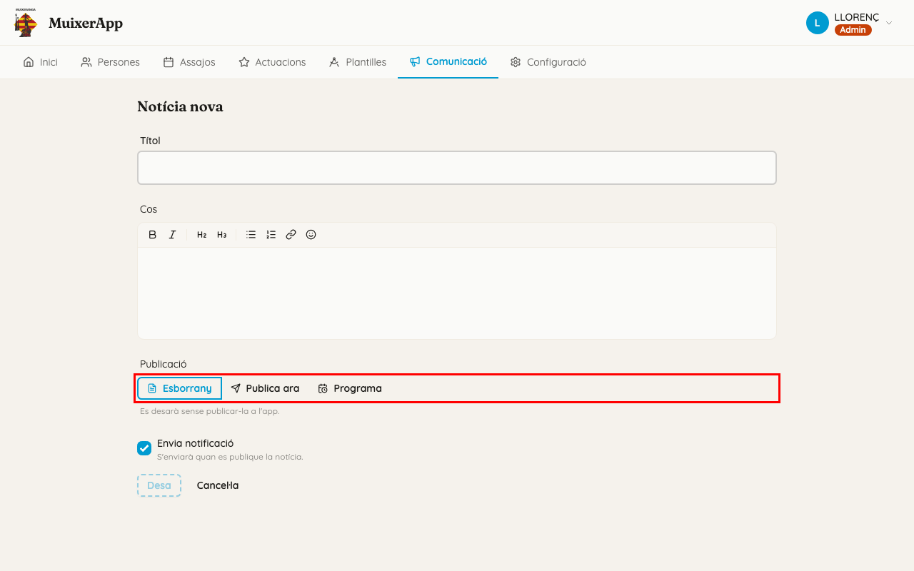
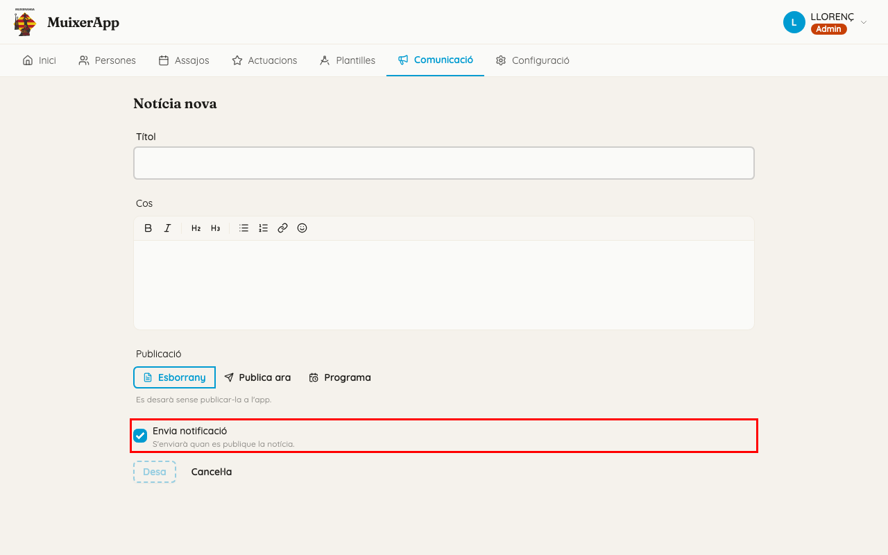
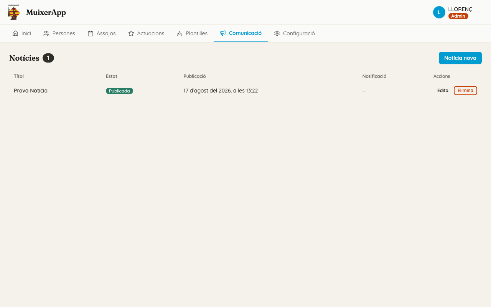
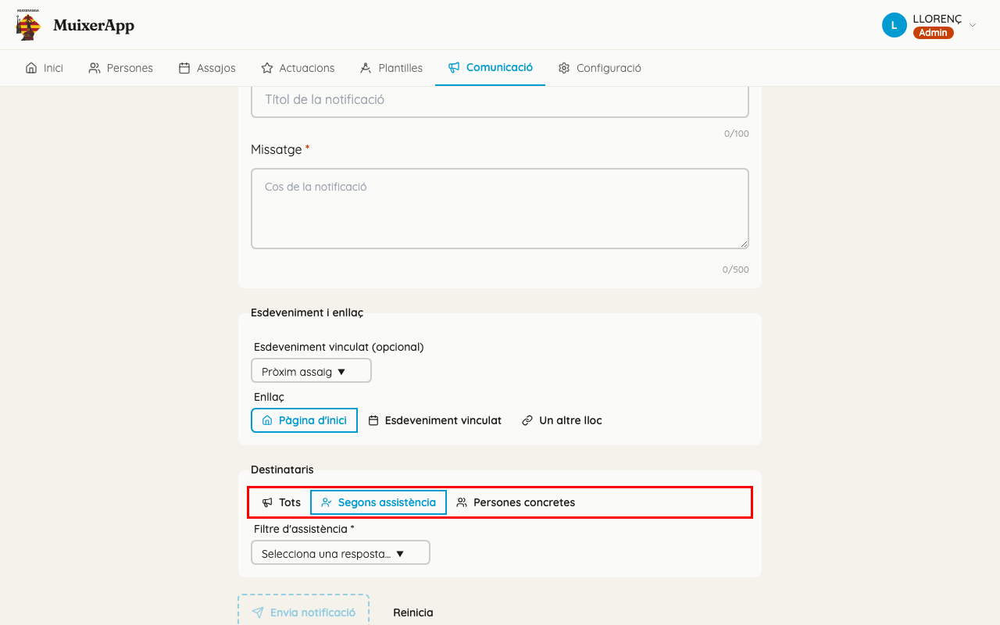
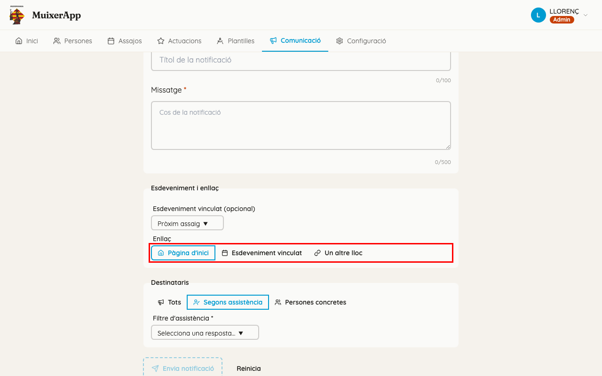
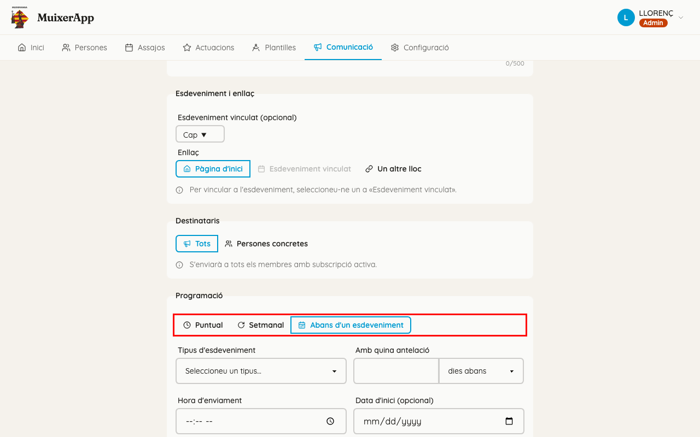
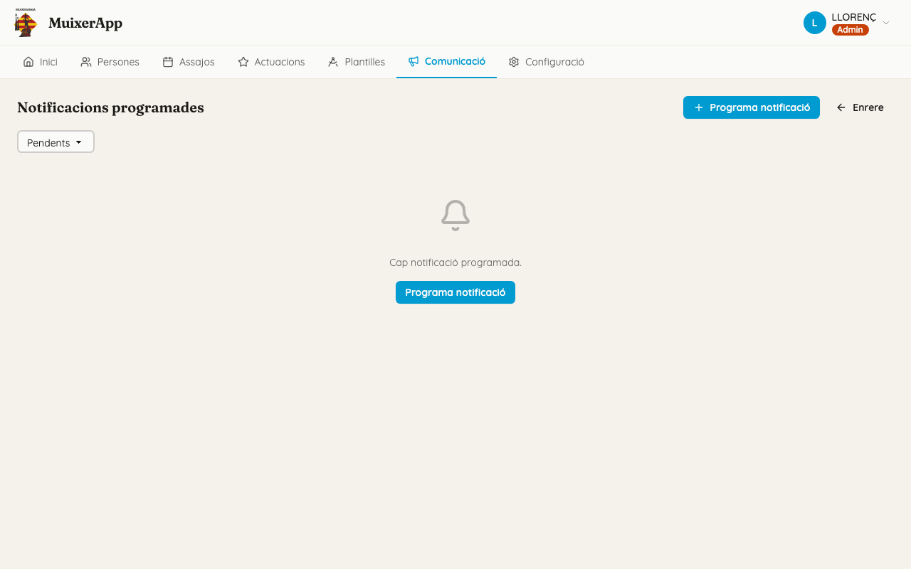
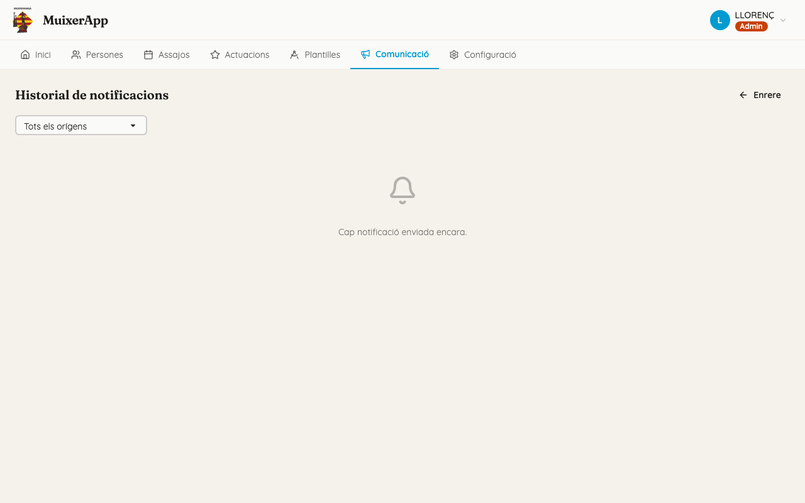
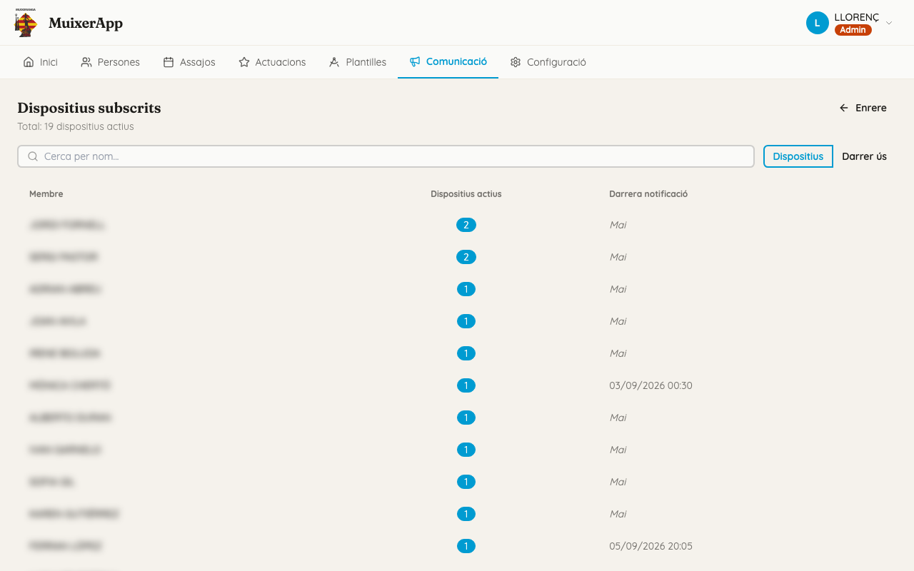

<!-- rutes: /communication /communication/news /communication/news/new /communication/news/:id/edit /communication/notifications /communication/notifications/schedules /communication/notifications/schedules/new /communication/notifications/schedules/:id/edit /communication/notifications/history /communication/notifications/devices -->

# Comunicació

## Per a què serveix

Des d'ací parleu amb la colla a través de l'app dels membres. Hi ha dues eines:

- Les **notícies** són textos que els membres llegeixen a l'app, a «Inici», a la llista «Notícies».
- Les **notificacions** són avisos curts que arriben al mòbil, com un missatge.

Una notícia també pot enviar una notificació en el moment de publicar-se.

## On és

Al menú principal, feu clic a «Comunicació». La pantalla té dues targetes:

- **«Notícies»**:
  - el botó «Notícia nova»;
  - les llistes «Recents» i «Programades», amb les tres últimes de cada tipus;
  - l'enllaç «Totes les notícies»;
  - un resum com «2 publicades · 1 programada · 0 esborranys».
- **«Notificacions»**:
  - els botons «Envia notificació» i «Programa notificació»;
  - la llista «Pròxims enviaments», amb els tres enviaments següents;
  - els enllaços «Totes les notificacions programades» i «Historial»;
  - quantes programacions hi ha actives.

## Pas a pas

### Publicar una notícia

1. A la targeta «Notícies», feu clic a «Notícia nova».
2. Ompliu «Títol» i «Cos». El cos té un editor amb format: negreta, llistes, enllaços…
3. A «Publicació», trieu «Publica ara». Davall apareix «Es publicarà en alçar-la.».
4. Mireu la casella «Envia notificació». En una notícia nova ja ve marcada, amb el text «S'enviarà quan es publique la notícia.». Desmarqueu-la si no voleu avisar al mòbil.
5. Feu clic a «Desa». El botó no s'activa fins que hi ha títol i cos. En acabar, torneu a la llista «Notícies».

### Programar una notícia per a més avant

1. A «Publicació», trieu «Programa».
2. Indiqueu el dia i l'hora en «Data i hora de publicació». Davall apareix «Es publicarà automàticament en esta data.».
3. Feu clic a «Desa».

Fins a eixe moment, la notícia surt a la llista com a «Programada» i els membres no la veuen. Si «Envia notificació» està marcada, la notificació s'envia quan es publica, no quan l'alceu.

Si encara no la voleu publicar, trieu «Esborrany»: s'alça sense publicar-la («Es desarà sense publicar-la a l'app.»).

### Corregir o retirar una notícia

1. A la targeta «Notícies», feu clic a «Totes les notícies».
2. Busqueu la notícia a la taula. Les columnes són «Títol», «Estat», «Publicació», «Notificació» i «Accions».
   - L'«Estat» pot ser «Publicada», «Programada» o «Esborrany».
   - La «Notificació» pot ser «🔔 Enviada» (ja s'ha enviat), «🔔 Pendent» (s'enviarà quan es publique) o «—» (sense notificació).
3. Trieu què voleu fer:
   - **Corregir-la:** feu clic a «Edita», canvieu el que calga i feu clic a «Desa». Una notícia ja publicada s'obri amb «Programa» i la data original, perquè no canvie de data. Si la notificació ja s'ha enviat, la casella queda bloquejada amb el text «Enviada el …» i no es torna a enviar.
   - **Amagar-la als membres sense esborrar-la:** feu clic a «Edita», trieu «Esborrany» i feu clic a «Desa».
   - **Esborrar-la:** feu clic a «Elimina» i confirmeu amb «Elimina» al diàleg «Eliminar notícia».

### Enviar una notificació ara

1. A la targeta «Notificacions», feu clic a «Envia notificació».
2. Al bloc «Contingut», ompliu:
   - «Títol», de 100 caràcters com a màxim;
   - «Missatge», de 500 caràcters com a màxim.
3. Al bloc «Esdeveniment i enllaç», trieu un «Esdeveniment vinculat (opcional)»:
   - «Cap»;
   - «Pròxima actuació», «Pròxim assaig» o «Pròxima actuació o assaig»;
   - «Esdeveniment específic...». Amb esta opció, trieu-lo a «Seleccioneu un assaig o actuació...».
4. A «Enllaç», trieu on porta la notificació quan el membre la toca:
   - «Pàgina d'inici»;
   - «Esdeveniment vinculat». Només es pot triar si abans heu vinculat un esdeveniment. Si no, apareix l'avís «Per vincular a l'esdeveniment, seleccioneu-ne un a «Esdeveniment vinculat».».
   - «Un altre lloc»: una adreça web completa o una pàgina de l'app.
5. Al bloc «Destinataris», trieu a qui s'envia:
   - «Tots»: «S'enviarà a tots els membres amb subscripció activa.».
   - «Segons assistència»: només apareix si heu vinculat un esdeveniment. Al «Filtre d'assistència», trieu «Ve», «No ve», «Pendent» o «Assistit». Per exemple, per a recordar l'assaig a qui encara no ha contestat, trieu «Pendent».
   - «Persones concretes»: busqueu cada persona a «Cerca persones...». Les persones triades apareixen com a etiquetes. La ✕ de cada etiqueta la lleva de la llista.
6. Feu clic a «Envia notificació». Apareix «Notificació acceptada» i «L'enviament s'ha processat correctament.».

Per a fer-ne una altra, feu clic a «Nova notificació». Si voleu buidar el formulari abans d'enviar, feu clic a «Reinicia».

### Programar una notificació

1. A la targeta «Notificacions», feu clic a «Programa notificació». El formulari és el mateix que el d'enviar, amb un bloc més, «Programació».
2. Al bloc «Programació», trieu quan s'envia:
   - **«Puntual»:** una sola vegada, el dia i l'hora de «Data i hora d'enviament».
   - **«Setmanal»:** cada setmana, el «Dia de la setmana» i a l'«Hora d'enviament» que trieu. Amb «Data d'inici (opcional)» i «Data de fi (opcional)» podeu limitar-ho, per exemple de setembre a juny.
   - **«Abans d'un esdeveniment»:** un recordatori automàtic de cada assaig o actuació. Ompliu:
     - «Tipus d'esdeveniment»: «Actuació» o «Assaig»;
     - «Amb quina antelació»: un número, i «dies abans» o «hores abans»;
     - «Hora d'enviament», només quan trieu «dies abans»;
     - si cal, «Data d'inici (opcional)» i «Data de fi (opcional)».
3. Trieu l'esdeveniment vinculat. Com que la notificació s'enviarà més avant, les opcions són relatives: «Següent actuació», «Següent assaig» o «Següent actuació o assaig». Amb «Abans d'un esdeveniment» hi ha també «Aquest esdeveniment», que vincula cada enviament a l'assaig o l'actuació que l'ha disparat. Trieu-la si voleu enllaçar al mateix assaig o filtrar «Segons assistència».
4. Feu clic a «Programa notificació». Apareix «Notificació programada» i «La notificació s'enviarà a l'hora programada.».

### Revisar què s'ha enviat i què està programat

**Notificacions programades.** A la targeta «Notificacions», feu clic a «Totes les notificacions programades».

- El desplegable de dalt mostra les «Pendents» o «Totes».
- Les columnes són:
  - «Pròxim enviament»;
  - «Programació», per exemple «Cada Dijous a les 20:00» o «2 dies abans de cada Assaig, a les 19:00»;
  - «Títol»;
  - «Destinataris»: «Tothom», «N persones» o «Esdeveniment»;
  - «Estat»: «Pendent» per a les puntuals, «Activa» per a les que es repeteixen i «Inactiva» per a les cancel·lades o acabades.
- Per a canviar-ne una, feu clic a «Edita». Els canvis s'alcen amb «Desa els canvis».
- Per a anul·lar-ne una, feu clic a «Cancel·la». Al diàleg «Cancel·la la notificació programada», confirmeu amb «Cancel·la». Si feu clic a «Torna», no es canvia res.

**Historial.** A la targeta «Notificacions», feu clic a «Historial». La pantalla «Historial de notificacions» mostra les notificacions que ja s'han enviat.

- Podeu filtrar per origen: «Tots els orígens», «Manual», «Programada», «Setmanal» o «Abans de l'esdeveniment».
- Les columnes són «Data», «Títol», «Origen», «Destinataris» i «Abast».

### Veure qui té les notificacions activades

Esta pantalla no té cap enllaç al menú. Per a obrir-la, escriviu l'adreça del Dashboard acabada en `/communication/notifications/devices`.

La pantalla «Dispositius subscrits» mostra:

- quants mòbils tenen les notificacions activades («Total: N dispositius actius»);
- un cercador, «Cerca per nom...»;
- dos botons per a ordenar la llista: «Dispositius» o «Darrer ús»;
- les columnes «Membre», «Dispositius actius» i «Darrera notificació». Si encara no n'ha rebut cap, diu «Mai».

Si ningú no les ha activades, diu «Cap dispositiu subscrit. Quan els membres activen les notificacions apareixeran ací.».

## Què rep el membre al mòbil

Un membre només rep notificacions si compleix les tres condicions següents:

1. Té compte a l'app. Vegeu [Persones](03-persones.md), «Crea enllaç d'invitació».
2. Ha entrat a l'app **en eixe mòbil**.
3. Hi ha activat les notificacions. Ho pot fer de dues maneres:
   - amb el bàner «Activa les notificacions» → «Activa»;
   - a «Perfil» → engranatge → «Notificacions push».

L'activació és per a cada mòbil. Si un membre té dos mòbils, ha d'activar-la en tots dos.

Què veu el membre:

- El mòbil mostra el títol i el missatge, amb la icona de l'app.
- Si toca la notificació, s'obri l'app a la pàgina que heu triat a «Enllaç».
- La notificació d'una notícia porta el títol de la notícia i el començament del text (els 200 primers caràcters). Si la toca, s'obri «Inici», no la notícia. La notícia és a la llista «Notícies» d'«Inici».

Si el membre ha tocat «Ara no» al bàner, el bàner no torna a aparéixer fins al cap de 7 dies. Mentrestant, pot activar les notificacions des de la configuració de l'app.

A l'iPhone, normalment cal afegir l'app a la pantalla d'inici abans de poder activar les notificacions. Si no ho ha fet, a la configuració de l'app li apareix «No disponibles en aquest dispositiu».

## Compte amb

- **«Tots» és tota la colla.** Ho reben totes les persones que tenen les notificacions activades. Per a fer una prova, envieu-vos-la a vosaltres mateixos amb «Persones concretes».
- **«Persones concretes» només arriba al compte de cada persona.** No arriba a l'adult responsable ni a qui gestiona la persona. La xicalla i les persones sense compte no reben res. Per a avisar una família, trieu l'adult.
- **«Notificació acceptada» no vol dir que haja arribat a algú.** Si cap destinatari no té les notificacions activades, també diu «acceptada».
- **L'«Abast» de l'historial compta comptes, no mòbils.** Amb «Tots», l'abast és tota la colla amb compte, encara que només uns quants tinguen les notificacions activades.
- **Les notificacions de les notícies no surten a l'historial.** Per a saber si s'ha enviat, mireu la columna «Notificació» de la llista de notícies.
- **No arriben a l'instant exacte.** Les notícies i les notificacions programades s'envien durant el minut següent a l'hora triada.
- **Les notícies publicades no caduquen.** Es queden a «Inici» de l'app, de la més nova a la més antiga. Quan una ja no siga útil, retireu-la amb «Esborrany» o esborreu-la amb «Elimina».
- **La notificació d'una notícia no té format.** Si el començament del text té negretes o títols, a la notificació poden aparéixer símbols com `**` o `#`. És recomanable que el primer paràgraf siga text normal.
- **«Un altre lloc» proposa com a exemple `/noticies/123`, però eixa pàgina no existeix a l'app.** Una adreça que no existeix porta a «Inici». Si no esteu segur de l'adreça, trieu «Pàgina d'inici» o «Esdeveniment vinculat».
- **A l'editor de notícies, el botó per a alçar es diu «Desa».** En altres pantalles es diu «Alça», però fa el mateix.

## Relacionat

- [L'app dels membres (PWA)](19-pwa.md): què veu el membre quan obri la notificació.
- [Persones](03-persones.md): «Crea enllaç d'invitació», perquè el membre tinga compte.
- [Assajos i actuacions](07-assajos-i-actuacions.md): l'assistència que fa servir «Segons assistència».
