<!-- rutes: pwa:/login pwa:/forgot-password pwa:/activate pwa:/home pwa:/news/:id pwa:/events pwa:/events/past pwa:/events/:id pwa:/events/:id/roll-call pwa:/events/:eventId/segments/:segmentId pwa:/profile pwa:/profile/settings pwa:/pending-dependents -->

# L'app dels membres (PWA)

## Per a què serveix

L'app dels membres és l'app del mòbil de la colla. També l'anomenem PWA: és una pàgina web que es pot instal·lar al mòbil com si fora una app. Els membres la fan servir per a:

- dir si van als assajos i a les actuacions;
- veure on els toca a cada figura;
- rebre avisos;
- llegir les notícies.

Esta pàgina explica què hi veuen, perquè pugueu respondre els seus dubtes. Els tècnics hi tenen alguna eina més, com «Passa llista».

Este manual no és dins de l'app dels membres: només és al Dashboard.

## On és

L'app dels membres té una adreça web diferent de la del Dashboard. Es pot instal·lar al mòbil de dues maneres:

- **A Android:** amb el bàner «Instal·la l'app» → «Instal·la». Si el bàner no té el botó, toqueu el menú ⋮ del navegador i després «Instal·la l'app» o «Afegeix a la pantalla d'inici».
- **A l'iPhone:** al navegador, toqueu «Compartir» i després «Afegeix a l'inici».

Per a canviar de pantalla, s'usa la barra de baix: «Inici», «Agenda» i «Perfil».

L'app s'actualitza sola: no cal desinstal·lar-la quan n'hi ha una versió nova. Quan arriba, dalt de la pantalla apareix l'avís «Hi ha una versió nova de l'app» amb el botó «Actualitza». Si no el toqueu, la versió nova es carrega la pròxima vegada que obriu l'app.

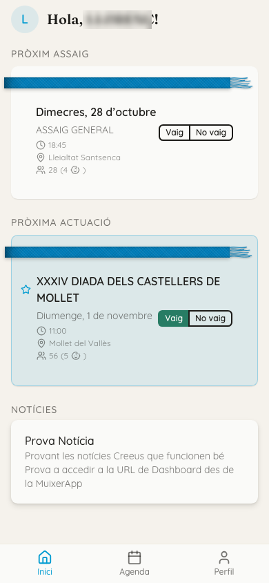

### Canvi d'adreça de l'app

L'app ha canviat d'adreça: ara és `app-beta.muixerangabarcelona.cat` (abans, `app.beta.muixerangabarcelona.cat`). L'app instal·lada no es pot traslladar: cal instal·lar la nova i esborrar l'antiga.

Qui obri l'adreça antiga veu la pantalla «L'app ha canviat d'adreça». Si no apareix, tanqueu l'app del tot (lleveu-la de les apps recents) i torneu-la a obrir. Passos:

1. Toqueu «Obre la nova app». Si s'obri dins de la mateixa app, passeu al navegador: a l'iPhone, toqueu la icona de Safari o «Obre a Safari»; a Android, toqueu ⋮ i després «Obre a Chrome». També podeu tocar «Copia l'adreça» i apegar-la al navegador.
2. Inicieu la sessió amb el vostre correu i contrasenya.
3. Instal·leu l'app com s'explica dalt. A l'iPhone, cal tornar a iniciar la sessió dins de l'app nova.
4. Activeu les notificacions a l'app nova.
5. Esborreu l'app antiga de la pantalla d'inici.

Qui entra per primera vegada o té un enllaç d'invitació no ha de fer res especial: l'enllaç ja porta a l'adreça nova, i en acabar d'activar el compte apareix el bàner «Instal·la l'app». Un enllaç d'invitació creat abans del canvi també funciona: la pantalla de canvi el porta a l'adreça nova.

## Pas a pas

### Entrar per primera vegada

1. Creeu l'enllaç d'invitació des del Dashboard: obriu la fitxa de la persona i feu clic a «Crea enllaç d'invitació». Vegeu [Persones](03-persones.md).
2. L'enllaç es copia i l'heu d'enviar vosaltres, per exemple per WhatsApp. **L'app no envia cap correu d'invitació.** L'enllaç caduca al cap de 72 hores.
3. L'enllaç obri la pantalla «Activa el teu compte». El correu ja ve posat. El membre:
   1. escriu una contrasenya a «Contrasenya» i la repeteix a «Confirmeu la contrasenya»;
   2. omple les «Dades personals»;
   3. llig la «Política de privacitat» i marca «He llegit i accepte la política de privacitat»;
   4. toca «Activa el compte».

Si l'enllaç ha caducat o ja s'ha fet servir, apareix «Este enllaç d'invitació no és vàlid o ha caducat.». Cal crear-ne un altre.

Les vegades següents, el membre entra amb «Correu electrònic» i «Contrasenya», i toca «Entra».

Si oblida la contrasenya, pot tocar «Heu oblidat la contrasenya?». Rebrà un correu amb un enllaç que obri una pàgina del Dashboard per a triar-ne una de nova. Després torna a entrar a l'app com sempre.

### Inici

La pantalla «Inici» mostra:

- la salutació «Hola, <àlies>!»;
- les targetes «Pròxim assaig» i «Pròxima actuació», amb els botons per a dir si hi va;
- la llista «Notícies». Si toca una notícia, l'obri sencera.

Per a actualitzar la pantalla, cal estirar-la cap avall.

La primera vegada apareix davall el bàner «Activa les notificacions» («Per saber quan hi ha assaig o actuació»), amb dos botons:

- «Activa»: el mòbil demana permís per a enviar notificacions;
- «Ara no»: el bàner no torna a aparéixer fins al cap de 7 dies.

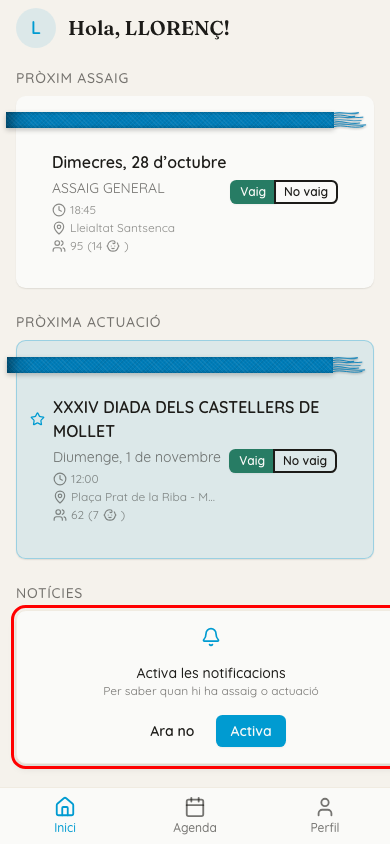

### Agenda: dir si hi aneu

La pantalla «Agenda» mostra els pròxims assajos i actuacions. Dalt hi ha:

- els filtres «Actuacions» i «Assajos»;
- el botó «Passats», que obri «Esdeveniments passats»;
- el botó del calendari, per a canviar entre la llista i el calendari del mes.

Cada targeta té els botons «Vaig» i «No vaig»:

- Si el membre toca una altra vegada el botó que ja està marcat, la resposta torna a quedar sense resposta (Pendent).
- Quan l'assaig o l'actuació ja ha passat, els botons queden desactivats.
- Quan ja consta que el membre hi ha anat, els botons es canvien per l'etiqueta «He assistit». Passa en estos casos:
  - a l'assaig, quan l'han marcat a la tauleta d'arribada o a «Passa llista»;
  - a l'actuació, a les 3 de la matinada del mateix dia, per a tots els que havien dit «Vaig».

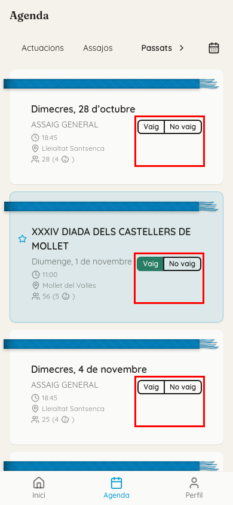

Al calendari, la llegenda explica les marques: «Vaig», «No vaig», «Pendent», «Assaig» i «Actuació». Si el membre toca un dia, veu els assajos i les actuacions d'eixe dia.

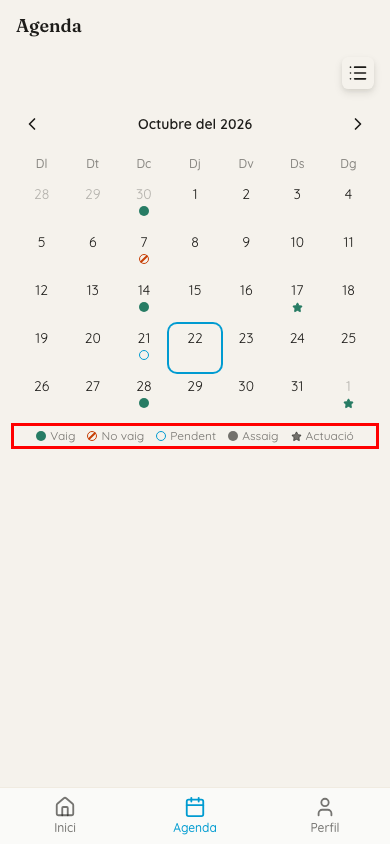

### Persones que gestioneu (xicalla i delegacions)

Alguns membres gestionen altres persones: per exemple, una mare amb fills a la xicalla, o algú amb una delegació.

- A cada targeta hi ha una fila de botons «Vaig» / «No vaig» per a cada persona, amb el nom davant.
- Si el membre només es gestiona a si mateix, hi ha una sola fila i no hi apareix cap nom.
- Al «Perfil», un selector permet canviar de persona per a veure les dades de cadascuna.

### Detall d'un assaig o actuació

Si el membre toca una targeta, s'obri el detall. Hi ha:

- la informació de l'assaig o l'actuació;
- la llista numerada de proves, que al Dashboard anomenem segments;
- els botons «Vaig» / «No vaig».

Davall de cada prova apareix on li toca, per exemple «VENT (C1) a Roscana».

Si li toca estar en dos llocs alhora, apareix en roig: «Sou en més d'un lloc alhora. La comi sanitària no recomana partir-se pel mig. Parleu amb la tècnica.».

**Només hi apareixen les proves publicades.** Al Dashboard, una prova es publica amb la icona de l'ull. Vegeu [Segments i figures](11-segments-i-figures.md).

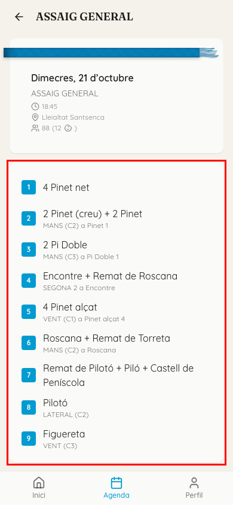

### On em toca? La projecció

Si el membre toca una prova, s'obri la figura a pantalla completa, amb la pinya i els troncs.

- La pantalla es mou sola fins al lloc del membre, que queda marcat. Cada tronc va en una targeta amb una xinxeta, unida amb un fil a la seua pinya, i la figura segueix el mode fosc o clar del mòbil (vegeu [Previsualitza i projecció](16-previsualitza-i-projeccio.md), «Com es veu la projecció»).
- Una frase que comença per «Sou …» diu on és. El botó «Troba'm» torna a portar-lo al seu lloc.
- Si no té lloc en eixa prova, la frase diu «No teniu cap posició en este segment.».

Per a buscar algú altre:

1. Toqueu la lupa («Cerca una persona»).
2. Escriviu el nom o l'àlies a «Nom o àlies» i toqueu la persona.
3. Ara la frase parla d'eixa persona i el botó es diu «On està».
4. Amb la ✕ de la frase, torneu a la posició pròpia.

A baix hi ha una barra. Les fletxes passen a la prova anterior o a la següent, i la fletxa de l'esquerra de tot torna al detall de l'esdeveniment.

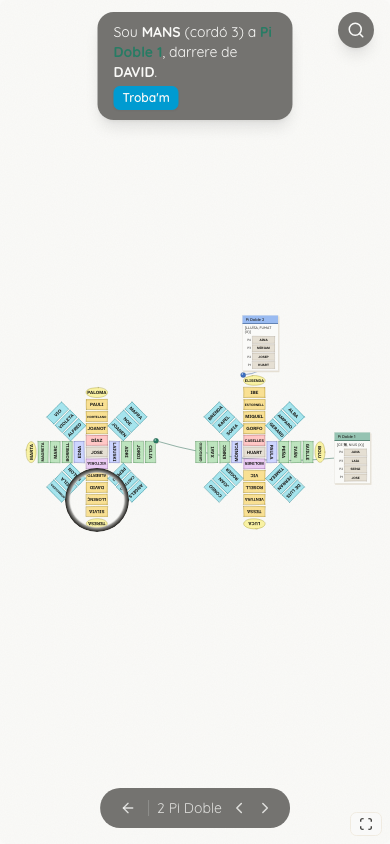

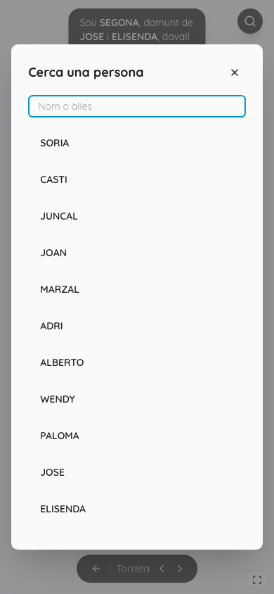

### Perfil i delegacions

La pantalla «Perfil» mostra l'àlies i el nom de la persona, i tres xifres de la temporada:

- «Assajos»: a quants ha anat del total;
- «Actuacions»: a quantes ha anat del total;
- «Assistència»: el percentatge.

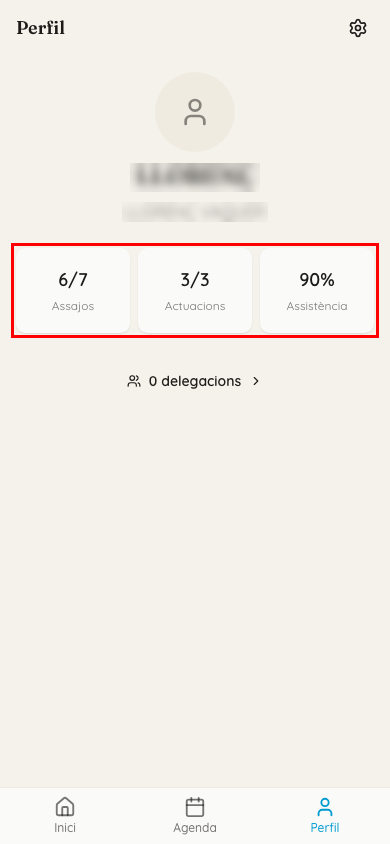

El botó «N delegacions» obri el diàleg «Delegacions». La llista diu qui pot confirmar l'assistència d'esta persona, i amb quina relació: «Pare/Mare», «Tutor/a» o «Altres».

- La persona responsable principal porta l'etiqueta «Primari» i no es pot eliminar.
- Les altres es poden llevar amb «Elimina».

Per a afegir una delegació:

1. Escriviu l'àlies de la persona a «Àlies de la persona».
2. Trieu la relació a «Tipus de relació».
3. Toqueu «Afegeix una delegació».

La persona ha de tindre compte a l'app. Si no en té, apareix «No existeix cap compte associat a aquest àlies».

L'engranatge de dalt a la dreta porta a la configuració.

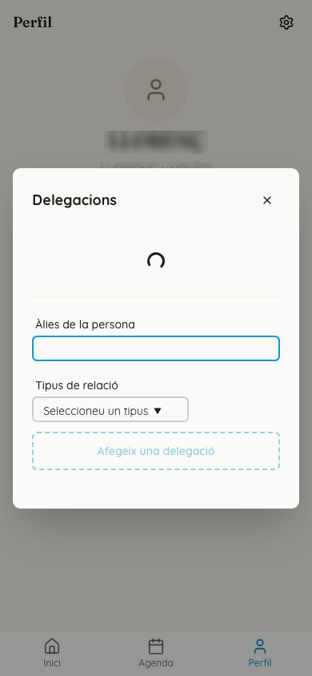

### Configuració

A la pantalla «Configuració» hi ha:

- **«Contrasenya»:** per a canviar-la. Es confirma amb «Actualitza la contrasenya».
- **«Aparença»:** «Sistema», «Clar» o «Fosc».
- **Notificacions.** Segons el mòbil, el membre hi veu una d'estes tres coses:
  - «Notificacions push», amb una casella per a activar-les o desactivar-les en eixe mòbil. Davall diu «Actives en N dispositius» o «Rebràs avisos d'assaigs i actuacions».
  - «Notificacions bloquejades»: les ha bloquejades al navegador. Ha de tornar a permetre-les a la configuració del navegador.
  - «No disponibles en aquest dispositiu»: el navegador no admet notificacions. A l'iPhone, normalment cal afegir abans l'app a la pantalla d'inici.
- **«Sobre l'app»:** amb «Contacte» i «Política de privacitat».
- **«Tancar sessió».**

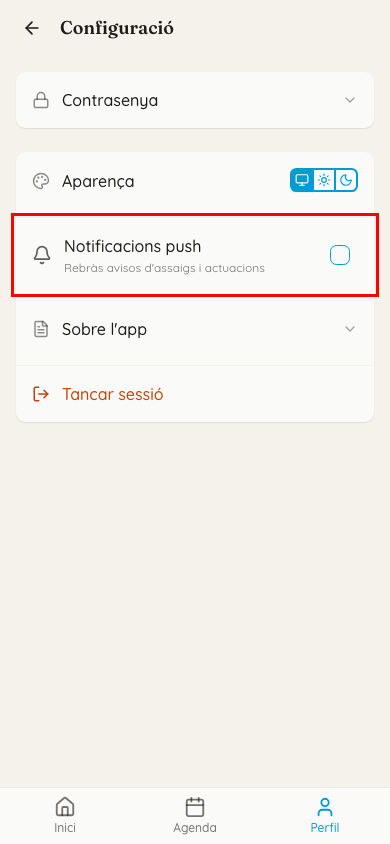

### Dades de la xicalla pendents

Quan doneu d'alta un infant de la xicalla amb un adult responsable, és l'adult qui completa les dades de l'infant. Vegeu [Persones](03-persones.md), «Defineix adult responsable».

1. L'adult veu a «Inici» l'avís «Encara no heu completat el registre de <àlies>.» i toca «Completa».
2. S'obri «Completeu les dades de la xicalla», amb el comptador «Completant dades: N de M».
3. Omple «Nom», «Primer cognom», «Segon cognom», «Gènere», «País» i «Data de naixement», i toca «Desa i continua».

## Què hi veu un tècnic de més

Les persones de pinyes, troncs i xicalla hi veuen el mateix. El que canvia és entre un **membre** i un **tècnic**:

| | Membre | Tècnic |
|---|---|---|
| Botons «Vaig» / «No vaig», projecció, «Perfil» i configuració | sí | sí |
| Comptador a cada targeta: «N total» i «N adults · N xicalla» | no | sí |
| Caixa de xifres al detall: «Vindran», «Assistit» (només als assajos), «No vindran» i «Pendents», amb adults i xicalla | no | sí |
| «Passa llista» | no | sí |

Si toqueu una de les xifres de la caixa, s'obri «Passa llista» amb eixe estat filtrat. «Pendents» l'obri sense filtre.

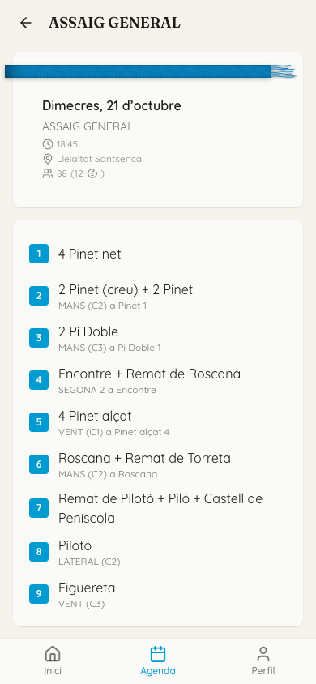

Un membre veu les mateixes pantalles, però sense els comptadors, sense la caixa de xifres i sense «Passa llista»:

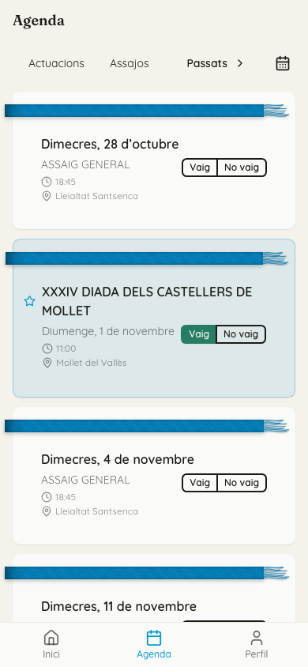

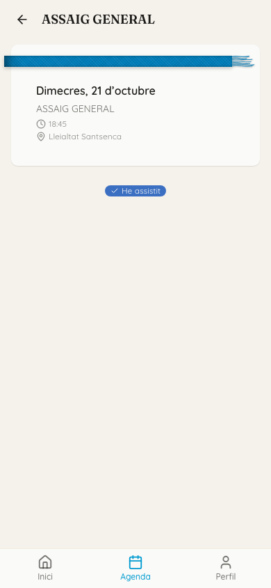

### Passa llista

L'enllaç «Passa llista» apareix al detall de l'assaig o l'actuació, davall dels vostres botons «Vaig» / «No vaig», **només el dia de l'esdeveniment**.

> Ara mateix, per una prova temporal, l'enllaç apareix tots els dies. Per això, és possible que les captures el mostren un dia que no és el de l'esdeveniment.

La pantalla mostra:

- el títol i la data;
- el cercador «Cerca persona...»;
- el botó «+ Persona nova»;
- les pestanyes «Tots», «Ha vingut», «Vindrà» i «No vindrà».

Cada persona té tres botons: «Ha vingut», «Vindrà» i «No vindrà». Primer apareixen les persones que s'han apuntat i, davall, en gris, la secció «No s'han apuntat».

Si canvieu l'estat d'una persona, la persona no canvia de grup fins que torneu a obrir la pantalla.

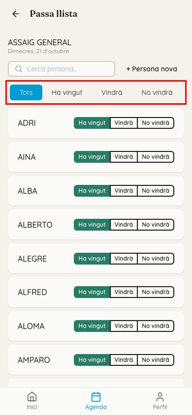

**Si ve algú per primera vegada:**

1. Toqueu «+ Persona nova».
2. Escriviu el nom o l'àlies a «Nom o àlies...».
3. Toqueu «Crea».

La persona es crea com a provisional i queda marcada com a present. Després, completeu-ne les dades al Dashboard. Vegeu [Persones](03-persones.md).

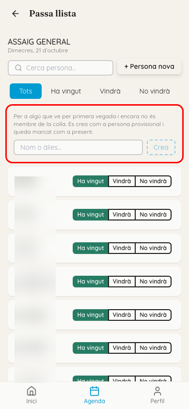

**«Canvi fora de termini».** Si canvieu l'assistència d'un esdeveniment que ja ha passat els dies de bloqueig de la colla (2, si no s'ha canviat), l'app us ho avisa amb el diàleg «Canvi fora de termini».

- «Força el canvi» fa el canvi igualment, i el canvi queda registrat.
- «Cancel·la» no canvia res.

Un membre no pot obrir «Passa llista», encara que tinga l'adreça.

## Compte amb

Estos són els dubtes més habituals dels membres i què els podeu respondre:

- **«No veig la pinya» o «no sé on em toca».** La prova no està publicada al Dashboard, o la persona no té lloc en eixa prova.
- **«No em deixa canviar l'assistència».** L'assaig o l'actuació ja ha passat i els botons estan desactivats, o ja consta «He assistit». Un tècnic ho pot canviar des del Dashboard o des de «Passa llista».
- **«Em diu "Compte no vinculat"».** El compte no està enllaçat amb cap persona. Cal enllaçar-lo des del Dashboard. Vegeu [Usuaris i accés](06-usuaris-i-acces.md).
- **«No m'arriben les notificacions».** Les ha d'activar en cada mòbil. A l'iPhone, normalment cal afegir abans l'app a la pantalla d'inici. Vegeu [Comunicació](18-comunicacio.md), «Què rep el membre al mòbil».
- **«No veig on li toca al meu fill».** La projecció marca el lloc de qui ha entrat a l'app, no el dels fills. Per a trobar el fill, cal buscar-lo amb «Cerca una persona».
- **«No em surt el canvi que dieu».** Té una versió antiga de l'app. Que toque «Actualitza» a l'avís de dalt o que tanque l'app del tot i la torne a obrir. No cal desinstal·lar-la.
- **«Ho veig diferent que tu».** Si compartiu pantalla amb un membre, recordeu que els tècnics veuen comptadors i «Passa llista», i els membres no.

## Relacionat

- [Comunicació](18-comunicacio.md): notícies i notificacions.
- [Persones](03-persones.md): invitació, adult responsable i delegacions.
- [Usuaris i accés](06-usuaris-i-acces.md)
- [Assajos i actuacions](07-assajos-i-actuacions.md): la confirmació d'arribada amb la tauleta.
- [Segments i figures](11-segments-i-figures.md): publicar les proves.
- [Previsualitza i projecció](16-previsualitza-i-projeccio.md)
