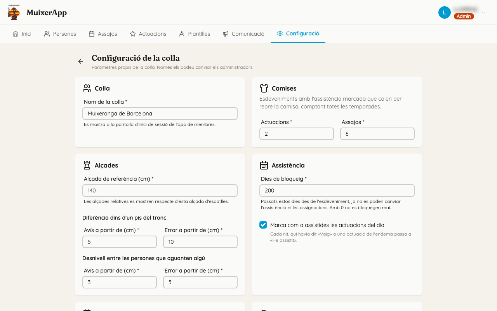
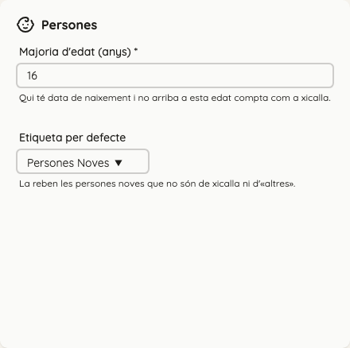

<!-- rutes: /config/colla -->

# Configuració de la colla

## Per a què serveix

Ací es guarden els paràmetres propis de la colla: el nom, què cal per a rebre la camisa, com es mostren les alçades, quan es bloquegen els events, què porta un assaig nou i com es tracten les persones noves.

Tothom veu l'efecte d'estos valors, però **només els administradors** els poden canviar.

## On és

Pestanya «Configuració» → targeta «Configuració de la colla». Només la veuen els administradors.

## Pas a pas

### Canviar un paràmetre

1. Canvieu el valor a la targeta que toque.
2. Feu clic a «Alça». Si un valor no és vàlid, el camp es posa en roig i «Alça» queda desactivat.

«Descarta els canvis» torna als valors guardats.

### Les targetes

- **«Colla».** «Nom de la colla» és el nom que ix a la pantalla d'inici de sessió de l'app dels membres ([L'app dels membres](19-pwa.md)).
- **«Camises».** «Actuacions» i «Assajos»: quants events amb l'assistència marcada calen per a rebre la camisa. Es compten totes les temporades. Per defecte, 2 actuacions i 6 assajos. Vegeu «Lliurar camises» a [Persones](03-persones.md).
- **«Alçades».**
  - «Alçada de referència (cm)»: les alçades relatives («+5», «-3») es calculen respecte d'esta alçada d'espatlles. Per defecte, 140 cm.
  - «Diferència dins d'un pis del tronc» i «Desnivell entre les persones que aguanten algú»: a partir de quants centímetres l'anàlisi d'alçades del tronc mostra un avís o un error. L'«Avís» ha de ser més xicotet que l'«Error». Vegeu [Assignació de troncs](12-assignacio-troncs.md).
- **«Assistència».**
  - «Dies de bloqueig»: quants dies després de l'event ja no es poden canviar l'assistència ni les assignacions. Amb 0 no es bloquegen mai. Per defecte, 2.
  - «Marca com a assistides les actuacions del dia»: si està marcada, cada nit l'app passa a «Ha arribat» qui havia dit «Vaig» a l'actuació del dia. Vegeu [Assajos i actuacions](07-assajos-i-actuacions.md).
- **«Assajos nous».** «Títol», «Hora d'inici», «Lloc» i «Enllaç del lloc» amb què ja ve omplit un assaig nou. Les actuacions noves comencen buides.
- **«Persones».**
  - «Majoria d'edat (anys)»: qui té data de naixement i encara no arriba a esta edat compta com a xicalla.
  - «Etiqueta per defecte»: l'etiqueta que reben les persones noves que no tenen cap etiqueta de Xicalla ni d'Altres. Serveix per a fer-ne el seguiment fins que tinguen una posició. Amb «Cap», no en reben cap.

### Canviar la majoria d'edat

En canviar «Majoria d'edat (anys)» i fer clic a «Alça», apareix «Voleu canviar la majoria d'edat?». Confirmeu-ho amb «Canvia-la»: totes les pantalles tornen a calcular qui és xicalla.

## Si sou de troncs o xicalla

- L'«Alçada de referència» és la que fan servir el filtre d'alçada i les xifres «+N» / «-N» de l'assignació de troncs.
- Els llindars d'«Alçades» decideixen quan l'anàlisi del tronc marca un pis en groc (avís) o en roig (error).
- La «Majoria d'edat» decideix qui ix amb la casella «Xicalla» del panell de persones.

## Compte amb

- **Afecta tota la colla.** Cada canvi s'aplica a totes les pantalles del Dashboard i de l'app del mòbil, i queda registrat.
- **L'etiqueta per defecte no es pot esborrar.** Si proveu d'esborrar-la a [Etiquetes](04-etiquetes.md), l'app no ho deixa. Canvieu-la abans ací.
- **Pujar els «Dies de bloqueig»** torna a obrir events antics a canvis.

## Relacionat

- [Persones](03-persones.md)
- [Etiquetes](04-etiquetes.md)
- [Assajos i actuacions](07-assajos-i-actuacions.md)
- [Assignació de troncs](12-assignacio-troncs.md)
- [L'app dels membres (PWA)](19-pwa.md)
